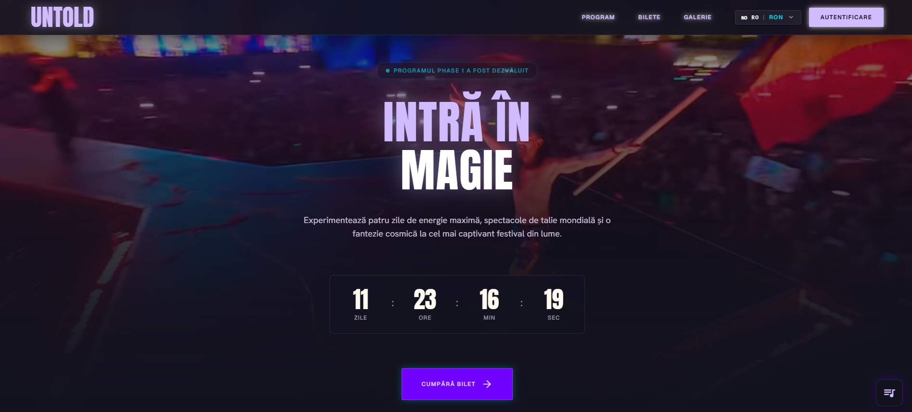
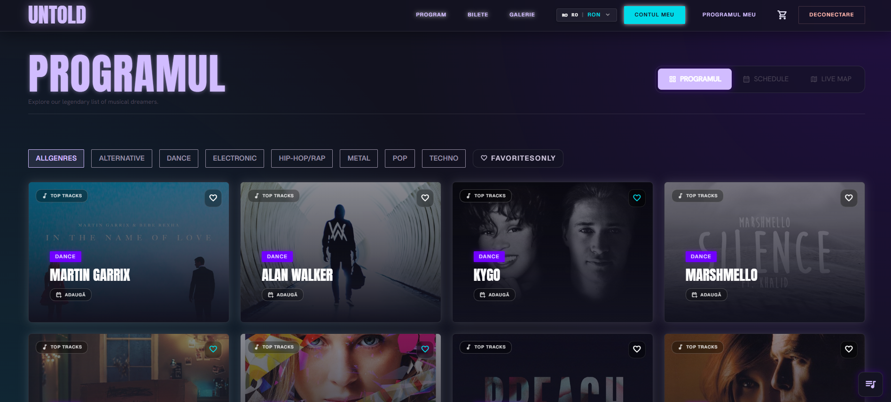
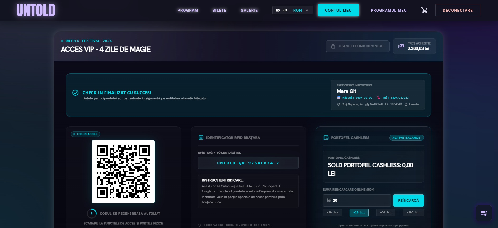
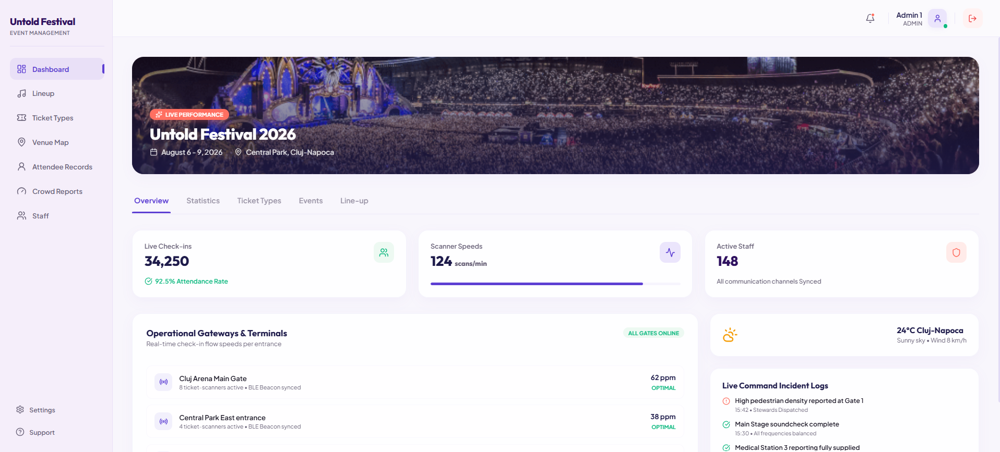
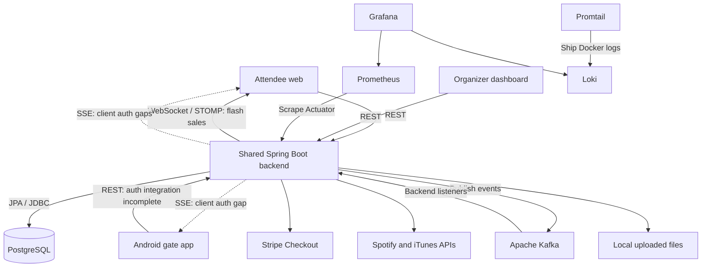

# UntoldFestivalApp

A team-developed festival ticketing, attendee experience, and event management platform inspired by UNTOLD Festival. Three client applications share a Spring Boot backend, PostgreSQL database, event infrastructure, and observability services.

<table width="100%">
  <tr>
    <td width="50%" align="center" valign="top">
      <a href="docs/screenshots/attendee/homepage.png"></a>
      <p><strong>Attendee home</strong><br><sub>Festival introduction and countdown</sub></p>
    </td>
    <td width="50%" align="center" valign="top">
      <a href="docs/screenshots/attendee/lineup.png"></a>
      <p><strong>Artist lineup</strong><br><sub>Artist discovery, genres and favorites</sub></p>
    </td>
  </tr>
  <tr>
    <td width="50%" align="center" valign="top">
      <a href="docs/screenshots/attendee/qrbracelet.png"></a>
      <p><strong>Digital ticket and bracelet</strong><br><sub>QR access and bracelet balance</sub></p>
    </td>
    <td width="50%" align="center" valign="top">
      <a href="docs/screenshots/organizer/dashboard.png"></a>
      <p><strong>Organizer dashboard</strong><br><sub>Workspace overview with demonstration metrics</sub></p>
    </td>
  </tr>
</table>

<p align="center">
  <a href="frontend-attendee/README.md#11-screenshots">Attendee photo album</a> &middot;
  <a href="frontend-admin/README.md#11-screenshots">Organizer photo album</a> &middot;
  <a href="admin-app/README.md#11-screenshots">Android photo album</a>
</p>

This is an independent, development-stage portfolio project. It is not an official UNTOLD product and is not presented as production-ready.


## 1. Applications

### 1.1 Attendee web application

For festival visitors and registered attendees: browse artists and performances, save favorites and personal schedules, purchase tickets through Stripe Checkout, complete identity check-in, view rotating access codes, transfer eligible tickets, and top up bracelet balances.

React, TypeScript, Vite, Tailwind CSS, and browser PWA APIs. Source: [frontend-attendee](frontend-attendee/). [Application guide](frontend-attendee/README.md).

### 1.2 Organizer web dashboard

For administrators: manage ticket tiers, schedule performances with conflict checks, edit venue-map layouts, inspect sales and demographic analytics, and download audit reports. Attendee-record and crowd-report screens have authentication integration gaps; staff allocation, announcements, events, and settings include demonstration-only interfaces.

React, TypeScript, Vite, and CSS. Source: [frontend-admin](frontend-admin/). [Application guide](frontend-admin/README.md).

### 1.3 Android gate management application

For gate operators using administrator accounts: camera-based QR scanning, entry/exit mode selection, validation feedback, and an occupancy statistics screen.

Kotlin, Jetpack Compose, CameraX, ML Kit, Retrofit, and OkHttp SSE. The client currently discards the login JWT, so authenticated scanning and SSE statistics remain incompletely integrated. Source: [admin-app](admin-app/). [Application guide](admin-app/README.md).

### 1.4 Shared backend

Centralizes authentication, ticket and bracelet operations, payments, artist/music data, performance scheduling, maps, crowd reports, exports, and event delivery. The current working tree defines 73 HTTP handlers in 16 controllers and 15 JPA entities.

Java 17, Spring Boot, Spring Security, JPA/Hibernate, Flyway, PostgreSQL, and Spring Kafka. Source: [backend](backend/). [Backend guide](backend/README.md).

## 2. Feature coverage

**Status terms:** implemented means a source-backed code path exists; integration gap means cooperating components do not yet form a complete flow; demo means static/local sample behavior; planned means no complete implementation was found. Runtime success is not implied.

| Domain | Source-backed functionality | Boundary |
|---|---|---|
| Authentication and users | BCrypt passwords, stateless JWT, `ADMIN`/`ATTENDEE`/`PARTNER`, administrative user CRUD | No MFA or refresh/reset flow; no partner-specific application |
| Purchasing and payments | Cart, GA/VIP day selection, Stripe Checkout and confirmation | Payment verification, ownership, and fulfillment need hardening |
| Identity check-in | Required identity/contact fields, attendee record, bracelet creation | Distinct from physical gate admission |
| Wristbands | Identifier, stored balance, Stripe top-up, transaction records | No hardware provisioning or cashless spending/POS workflow |
| Dynamic QR | Owner-scoped rotating HMAC credentials, refreshed every 30 seconds | Online issuance and validation; raw bracelet identifiers also accepted |
| Gate access | Entry/exit logs, duplicate-entry checks, re-entry after exit, enum-based day restrictions | Android authentication and daily boundary issues |
| Transfers | Owner-checked transfer to a registered attendee before check-in | Transfer history is not independently retained |
| Flash sales | Opening time, virtual queue, purchase eligibility, availability broadcasts | In-memory queue; no durable reservation |
| Artist discovery | Genre/favorite filters, iTunes import, Spotify search/embeds, song previews | Import can return mock data; results are not authoritative rankings |
| Lineup scheduling | Stage/time matrix, administrator performance CRUD, stage conflict blocking and artist warnings | Form-based editing; saved personal slots are snapshots |
| Personal schedules | Day grouping, clash warnings, reminder offsets, sound/browser notifications | Open-page timer; favorites and saved slots are separate |
| Venue and crowd | Map upload/pin editor, attendee stage map, density-report aggregation | Some organizer requests omit authentication |
| Organizer tools | Tier management, sales ledger, records, analytics | Staff/events/broadcast/settings screens contain demos |
| Reporting and exports | Sales/demographic summaries, four-sheet Excel report, personal-data PDF | Identity completion is not a gate scan; PDF is not an export of every entity |
| Offline-oriented PWA | Production service worker, cached resources/GET responses, IndexedDB check-in outbox | No offline gate verifier or durable valid offline QR wallet |
| Communication | REST, flash-sale STOMP, Kafka-to-SSE bridges, schedule polling | SSE clients have authentication gaps |
| Infrastructure | Nine Compose services, metrics, rate limiting, logs, provisioned dashboards | Development configuration; incomplete persistence/hardening |

See [full feature inventory](docs/features.md) and [known limitations](docs/known-limitations.md).

## 3. Architecture



This is a shared-backend architecture, not a microservices deployment. Kafka carries entrance and transfer events; it is not the source of truth for ticket ownership. [Architecture and communication](docs/architecture.md).

## 4. Technical highlights

- **JWT and role checks:** Bearer-token authentication reconstructs authorities from the user database. Owner checks exist for schedules, transfers, and QR generation; several other ticket operations still need them.
- **Rotating access credentials:** a timestamped HMAC-SHA256 payload expires after a short interval. This reduces screenshot reuse, without guaranteeing screenshot-proof admission.
- **Entry/exit state:** movement logs drive inside/outside decisions and net occupancy; identity check-in remains a separate operation.
- **Event delivery:** entrance and transfer events pass through Kafka listeners to SSE hubs. Flash-sale updates use a separate STOMP topic.
- **Scheduling:** same-stage overlaps are blocked; same-artist overlaps are warnings; personal itinerary overlaps are calculated in the browser.
- **Persistence:** Flyway manages the schema. Startup demonstration seeding currently replaces all performance rows.
- **Offline submission:** an IndexedDB outbox retries check-in requests from page code when connectivity returns.
- **Observability and exports:** Bucket4j, Micrometer/Prometheus, structured logging, Loki/Grafana, PDFBox personal-data PDFs, and Apache POI Excel workbooks.

## 5. Technology stack

| Area | Technologies used |
|---|---|
| Attendee frontend | React 19, TypeScript 6, Vite 8, React Router, Tailwind CSS 3, Lucide, `qrcode.react`, Workbox 6.4.1, IndexedDB, Web Audio |
| Organizer frontend | React 19, TypeScript 6, Vite 8, React Router, Lucide, CSS variables/inline styles |
| Android | Kotlin configuration 2.2.10, Compose/Material 3, CameraX 1.3.1, ML Kit 17.2.0, Retrofit/Gson 2.9.0, OkHttp SSE 4.12.0 |
| Backend | Java 17, Spring Boot 3.3.1, Spring MVC, Lombok, RestTemplate |
| Authentication/security | Spring Security, BCrypt, JJWT 0.11.5/HS256, HMAC-SHA256 QR payloads, Bucket4j 8.14.0 |
| Database/persistence | PostgreSQL 15, Spring Data JPA/Hibernate, Flyway, local uploads, in-process caches |
| Payments | Stripe Java 26.3.0 and hosted Checkout; fixed RON/EUR/USD conversion |
| Events/realtime | Spring Kafka, Kafka 3.7.0, STOMP/WebSocket, SSE; 20-second schedule polling |
| Infrastructure | Docker Compose, development Dockerfiles, Maven wrapper, Gradle wrapper configuration |
| Monitoring/logging | Actuator, Micrometer, Prometheus, Logstash Logback encoder, Promtail, Loki 2.9.4, Grafana |
| Testing/quality | JUnit, Mockito, Spring Boot Test, Android JUnit/Espresso/Compose tooling, TypeScript compiler, Oxlint |

Versions come from checked-in manifests and lockfiles, not a claim of current upstream versions. A declared dependency is not automatically a completed integration: SockJS is declared but the attendee connects through a native WebSocket; Recharts is not implemented.

## 6. Repository structure

```text
.
├── README.md
├── frontend-attendee/        # Attendee web application and PWA resources
│   ├── src/                 # Pages, components, contexts, utilities, translations
│   └── public/              # Service worker, manifest, media assets
├── frontend-admin/           # Organizer web dashboard
│   └── src/                 # Pages, components, data hooks
├── admin-app/
│   └── app/src/             # Android application, resources, template tests
├── backend/
│   ├── src/main/java/       # Controllers, services, security, entities, repositories
│   ├── src/main/resources/  # Configuration, logging, Flyway migrations
│   ├── src/test/            # Smoke and focused unit tests
│   └── uploads/             # Local venue-map files
├── monitoring/              # Prometheus, Grafana, and Promtail configuration
├── docs/                    # Current implementation guides and historical designs
├── gradle/                  # Android version catalog and wrapper configuration
├── settings.gradle.kts      # Maps :app to admin-app/app
├── docker-compose.yml
└── .env.example             # Environment variable template; no real values needed in docs
```

## 7. Getting started

These instructions are derived from source/configuration. Installation, startup, builds, and application tests were **not executed** during the documentation rewrite.

1. Install Docker with Compose. Native development additionally needs JDK 17, npm/Node satisfying `^20.19.0 || >=22.12.0`, and Android Studio/SDK for Android.
2. Clone the repository and enter the directory containing `docker-compose.yml`:

   ```sh
   git clone https://github.com/iuliamara/Untold-Festival-App.git
   cd Untold-Festival-App
   ```

3. Copy `.env.example` to `.env` and configure the database, JWT/QR signing values, Stripe test settings, Spotify settings, and Kafka settings. Do not publish `.env`.
4. Start development services:

   ```sh
   docker compose up --build
   ```

| Service | Local URL |
|---|---|
| Attendee | [localhost:5173](http://localhost:5173) |
| Organizer | [localhost:5174](http://localhost:5174) |
| Backend | [localhost:8080](http://localhost:8080) — API host, not a landing page |
| Grafana | [localhost:3000](http://localhost:3000) — provisioned Untold Backend Overview |
| Prometheus | [localhost:9090](http://localhost:9090) |
| Loki | [localhost:3100](http://localhost:3100) — API, no standalone UI |

Open the repository root in Android Studio: `settings.gradle.kts` maps `:app` to `admin-app/app`. The emulator uses `10.0.2.2:8080` to reach the host backend; physical devices require changes to both hardcoded Android URLs. The wrapper JAR is currently ignored/untracked, and protected Android operations need authentication integration. See the [Android guide](admin-app/README.md).

**Before using persistent data:** backend startup deletes/reseeds performances and synchronizes demonstration data. Read [local development](docs/local-development.md) for environment variables, networking, seed behavior, and native commands.

## 8. Screenshots and demonstrations

The previews above are a selection. Each application guide contains its complete photo album, organized by functionality.

| Application | Photo album | Original images |
|---|---|---|
| Attendee web | [11 screenshots: home, discovery, schedules, tickets, checkout, check-in, bracelet and map](frontend-attendee/README.md#11-screenshots) | [docs/screenshots/attendee](docs/screenshots/attendee/) |
| Organizer web | [5 screenshots: dashboard, lineup, ticket tiers, records and staff demonstration](frontend-admin/README.md#11-screenshots) | [docs/screenshots/organizer](docs/screenshots/organizer/) |
| Android gate | [7 screenshots: camera access, entry/exit, rejected scans and occupancy](admin-app/README.md#11-screenshots) | [docs/screenshots/android](docs/screenshots/android/) |

Follow the [user journeys](docs/workflows.md) for the interactions between components.

## 9. Project status

Development-stage portfolio project with substantial backend and client implementations. Material outstanding work includes authenticated Android/SSE integration, payment and inventory consistency, owner checks on several ticket routes, date/configuration alignment, restart-safe scheduling, and separation of demonstration data from live analytics. Staff allocation, broadcasts, events, and settings are not complete operational modules.

The documentation describes the current working tree, including existing local security/schedule changes and untracked tests/migration V15. These are not guaranteed to exist in committed HEAD. See [working-tree provenance and limitations](docs/known-limitations.md#7-working-tree-provenance).

## 10. Testing

The repository contains a backend context-load test, one focused registration unit test, four personal-schedule unit tests, and two Android template tests. Frontends provide build/type checks and Oxlint, but no application test suite. No CI workflow was found.

No application tests were run or pass results asserted during this documentation task. See [testing](docs/testing.md).

## 11. Documentation

| Guide | Scope |
|---|---|
| [Attendee](frontend-attendee/README.md) · [Organizer](frontend-admin/README.md) · [Android](admin-app/README.md) · [Backend](backend/README.md) | Application-specific setup and implementation |
| [Features](docs/features.md) | Domain and application coverage, with status |
| [Functional specifications](docs/functional-specifications.md) | Detailed behavior, inputs, rules, errors and status across all clients |
| [UI/UX](docs/ui-ux.md) | Current navigation, interaction states, forms, maps and scanner presentation |
| [Personal scheduling](docs/personal-scheduling.md) | Persistence, midnight overlap examples, reminder timing and permission behavior |
| [Architecture](docs/architecture.md) | Components, protocols, integrations, storage |
| [Roles and permissions](docs/roles-and-permissions.md) | Actual authorization and owner boundaries |
| [API](docs/api.md) | All 73 controller HTTP handlers and payload contracts |
| [Data model](docs/data-model.md) | Entities, constraints, migrations, seed lifecycle |
| [Workflows](docs/workflows.md) | Purchase, check-in, scanning, transfers, queues, schedules |
| [Local development](docs/local-development.md) | Configuration, ports, commands, troubleshooting |
| [Offline and realtime](docs/offline-and-realtime.md) | Caching, outbox, timers, polling, STOMP, Kafka/SSE |
| [Observability](docs/observability.md) | Rate limits, metrics, logs, dashboards |
| [Testing](docs/testing.md) | Existing tests, commands, coverage gaps |
| [Known limitations](docs/known-limitations.md) | Prioritized gaps and working-tree dependencies |
| [Roadmap](docs/roadmap.md) | Proposed follow-up work; no delivery commitments |
| [Historical design specifications](docs/design-specifications/README.md) | Preserved requirements and earlier design decisions |
| [Recovery and coverage record](docs/documentation-recovery.md) | Complete original preservation and current specification expansion |

## 12. Team development

This project was developed by a team. The repository demonstrates work across web, Android, backend, persistence, payments, and infrastructure. This documentation does not assign individual responsibilities or claim sole authorship; use repository history and team records for contribution attribution.
