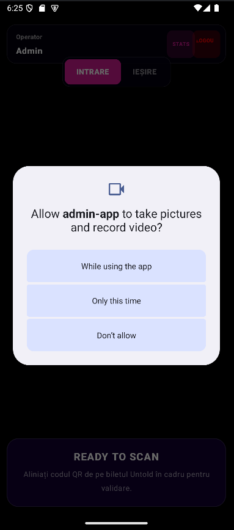
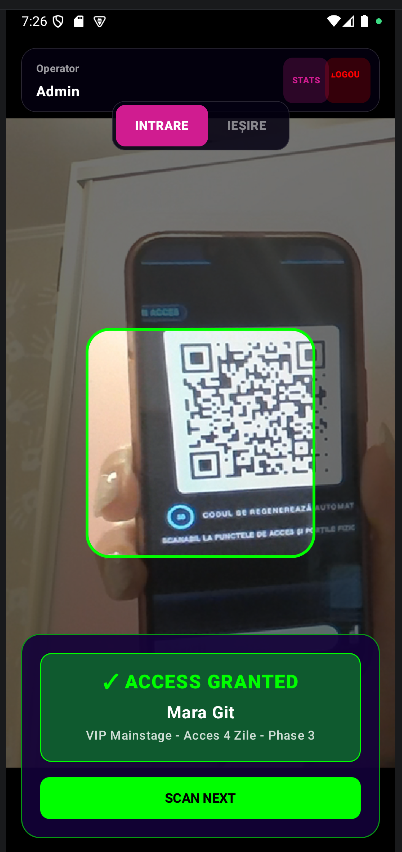
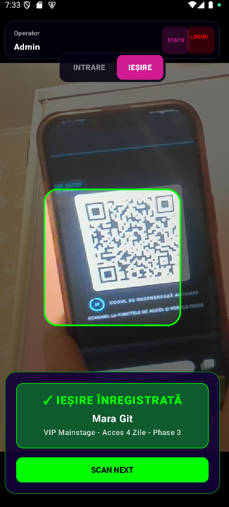
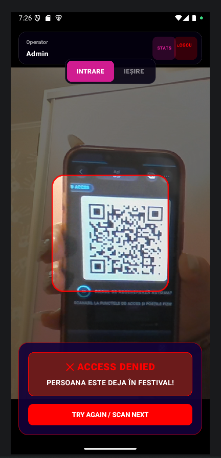
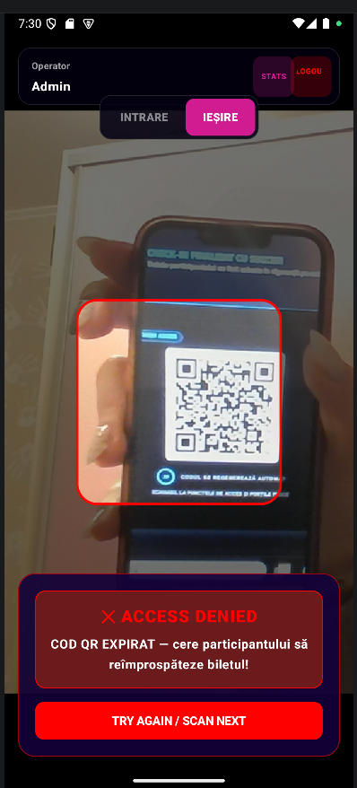
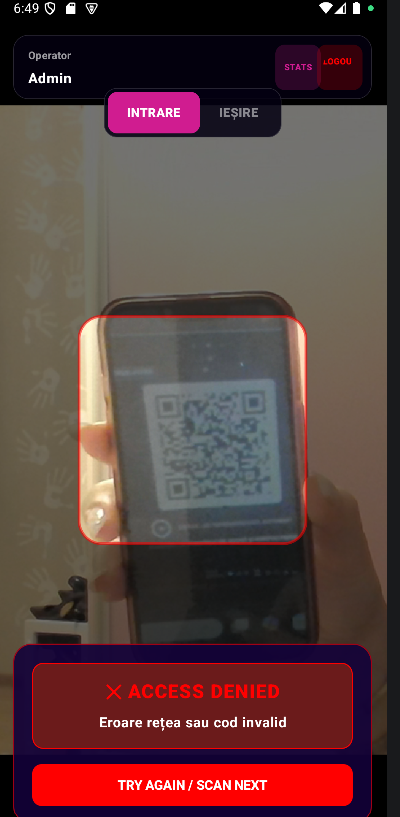
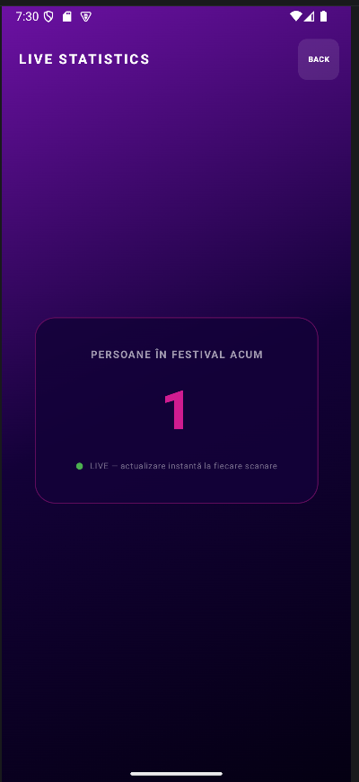

# Android gate management application

[Project overview](../README.md) · [Gate workflow](../docs/workflows.md#5-entering-and-exiting-through-the-android-gate-application) · [Known limitations](../docs/known-limitations.md)

A native Android application for gate operators using `ADMIN` accounts. It shares the backend with both web applications. It is not the attendee PWA.

## 1. Features and current status

- Email/password administrator login through `POST /api/auth/admin-login`.
- Operator username saved in SharedPreferences; logout clears it.
- Camera permission request, CameraX preview and ML Kit QR decoding.
- `IN`/`OUT` selection, validation progress and success/failure feedback.
- Participant name/ticket type on successful scans and manual Scan Next.
- Occupancy screen using SSE, connection indication and five-second reconnect attempts.

Login retains the administrator JWT and username. QR validation, REST statistics and the live statistics stream send Bearer authorization. Restoring a session requires both saved values; a saved username alone opens the login screen. A 401/403 response clears the session and returns to login with an explanation. Session preferences are excluded from cloud backups and device transfers.

The source defines an older REST statistics method, but the current statistics screen uses SSE rather than 12-second polling.

### 1.1 Screenshots

A feature-by-feature photo album. Every screenshot is shown below; click a preview to open the original image.

#### 1.1.1 Camera permission

Android requests camera permission before the scanner preview can be used.

<p align="center">
  <a href="../docs/screenshots/android/cameraaccess.png"></a>
</p>

<p align="center"><sub>Camera access · System permission prompt</sub></p>

#### 1.1.2 Entry and exit validation

The operator selects IN or OUT before scanning. The response overlay distinguishes an accepted entry from a recorded exit and offers the next-scan action.

<table width="100%">
  <tr>
    <td width="50%" align="center" valign="top">
      <a href="../docs/screenshots/android/validqr.png"></a>
      <p><strong>Entry accepted</strong><br><sub>IN mode · Access-granted feedback</sub></p>
    </td>
    <td width="50%" align="center" valign="top">
      <a href="../docs/screenshots/android/leaving.png"></a>
      <p><strong>Exit recorded</strong><br><sub>OUT mode · Departure confirmation</sub></p>
    </td>
  </tr>
</table>

#### 1.1.3 Rejected scans and error feedback

The scanner shows distinct feedback for a participant already inside and an expired QR. Invalid-code or network failures can use a generic failure message.

<table width="100%">
  <tr>
    <td width="33%" align="center" valign="top">
      <a href="../docs/screenshots/android/alreadyscanned.png"></a>
      <p><strong>Already inside</strong><br><sub>Duplicate-entry rejection</sub></p>
    </td>
    <td width="33%" align="center" valign="top">
      <a href="../docs/screenshots/android/expiredqr.png"></a>
      <p><strong>Expired QR</strong><br><sub>Refresh guidance for the participant</sub></p>
    </td>
    <td width="33%" align="center" valign="top">
      <a href="../docs/screenshots/android/invalidqr.png"></a>
      <p><strong>Invalid code or request failure</strong><br><sub>Generic error and retry action</sub></p>
    </td>
  </tr>
</table>

#### 1.1.4 Occupancy statistics

The statistics view displays the current number of people inside and the stream's connection indicator.

<p align="center">
  <a href="../docs/screenshots/android/stats.png"></a>
</p>

<p align="center"><sub>Live statistics · Festival occupancy and connection status</sub></p>

<p align="center">
  <a href="../docs/screenshots/android/"><strong>Browse the original Android screenshots &rarr;</strong></a>
</p>

## 2. Technology

| Area | Configuration |
|---|---|
| UI | Kotlin configuration 2.2.10, Jetpack Compose, Material 3, Compose BOM 2026.02.01 |
| Camera/scanning | CameraX 1.3.1, ML Kit Barcode Scanning 17.2.0 |
| Networking | Retrofit/Gson 2.9.0, OkHttp SSE 4.12.0, coroutines |
| Android | Compile SDK 36.1, target 36, minimum 24 |
| Build | Android Gradle Plugin 9.3.0, Gradle 9.5.0; daemon configuration Java 21 |
| Java compatibility | Application source/target level 11 |

Versions are declared build inputs, not a validated compatibility result. [Module build](app/build.gradle.kts) · [Version catalog](../gradle/libs.versions.toml).

## 3. Internal architecture

Most application logic lives in [MainActivity.kt](app/src/main/java/com/example/admin_app/MainActivity.kt): API models/interface, Retrofit singleton, navigation, login, scanner state, camera processing, overlays, and SSE statistics.

```text
admin-app/
├── README.md
└── app/
    ├── build.gradle.kts
    └── src/
        ├── main/
        │   ├── AndroidManifest.xml
        │   ├── java/com/example/admin_app/MainActivity.kt
        │   ├── java/com/example/admin_app/ui/theme/
        │   └── res/
        ├── test/            # Arithmetic example
        └── androidTest/     # Package-name example
```

Navigation is local Compose state between login, scanner and statistics. SharedPreferences stores `admin_user` and `admin_token`; logout and rejected sessions remove both. Scanner states are Idle, Validating, Success and Failure.

## 4. Setup and execution

These steps are configuration-derived; no Android build or device run was performed during the documentation rewrite.

1. Configure and start the root [Compose environment](../docs/local-development.md).
2. Open the repository root in Android Studio, using [settings.gradle.kts](../settings.gradle.kts). It maps `:app` to `admin-app/app`; there is no independent Gradle root inside this directory.
3. Install the configured Android SDK and satisfy the Java 21 daemon requirement.
4. Restore the missing tracked Gradle wrapper JAR through normal project maintenance before expecting a fresh clone's wrapper commands to work. The local JAR is ignored/untracked; this task does not change build files.
5. Select an emulator with a camera source, run `:app`, and grant camera permission.
6. Sign in with an administrator account in the local database. Installations with only the old saved username must sign in again to obtain a token.

The configured emulator REST base is `http://10.0.2.2:8080/`. The SSE URL separately hardcodes that address. `10.0.2.2` is the emulator's host-loopback mapping, not the address for a physical device.

For a physical device, both URLs need a reachable host LAN address, the backend port must be reachable, and device/host networking must permit the connection. No debug/staging/production URL variants exist. [AndroidManifest.xml](app/src/main/AndroidManifest.xml) permits Internet/camera access and cleartext HTTP for development.

## 5. Backend contracts

| Operation | Request/response |
|---|---|
| Login | `POST /api/auth/admin-login` with email/password; returns auth envelope containing token/user |
| Validate movement | `POST /api/tickets/validate-qr` with `qrCode` and `direction` (`IN` or `OUT`); direct validation response |
| Statistics stream | `GET /api/stream/entrance-stats`; named `entrance-stats` events containing `entriesInside` |
| Legacy REST stats method | `GET /api/tickets/stats/entrances-today`; `entriesToday` field represents net occupancy |

All validation is server-side. The camera can read a rotating payload or a QR encoding a raw bracelet identifier, but there is no offline cryptographic verifier or NFC/RFID hardware integration.

## 6. Testing

```powershell
# From the repository root, after wrapper/environment repair:
.\gradlew.bat :app:testDebugUnitTest
.\gradlew.bat :app:connectedDebugAndroidTest
```

Only template arithmetic/package-name assertions exist. Camera, authentication, entry/exit behavior and SSE are not covered by application-specific tests. The authentication fix passed `:app:assembleDebug :app:testDebugUnitTest` using the existing local dependencies with `--offline --no-daemon`. Instrumentation and the camera/scanning/live-statistics flows still require a device/emulator check.

## 7. Known limitations

- Hardcoded REST and SSE addresses require separate edits.
- Camera denial has no in-app retry/settings flow.
- Statistics are not an offline cache and require a working server/event connection.
- Gate cutoff/day and concurrent movement correctness depend on backend logic.
- Release signing/distribution and production deployment are not documented implementations.

[API reference](../docs/api.md) · [Architecture](../docs/architecture.md) · [Testing](../docs/testing.md)

## 8. Detailed operator behavior

[Functional specifications](../docs/functional-specifications.md) cover login, permission, preview, recognition, direction capture, response overlays and stream reconnection. [Gate journey](../docs/workflows.md) distinguishes the currently rejected request from the server's authorized continuation; [UI/UX](../docs/ui-ux.md) describes the scanner states.

Camera recognition produces a string, not an admission decision. The server resolves/signature-checks a rotating credential when present, loads bracelet/ticket state and decides whether IN/OUT is allowed. A green presentation state is only meaningful after that response; a saved operator username or recognized barcode alone is not permission.

The occupancy view sends the current session token through a separate SSE request with its own hardcoded URL and connection lifecycle. The old REST method remaining in the interface is not proof of polling fallback. Network disconnections retry after five seconds. A 401/403 ends the session and stops reconnecting; leaving the screen cancels the connection and prevents pending retries from reopening it.

The [complete original Android README](../docs/design-specifications/legacy-readmes/admin-app-README.md) is preserved for history, including its earlier assumptions and limitations; this guide is the current English implementation entry point.
