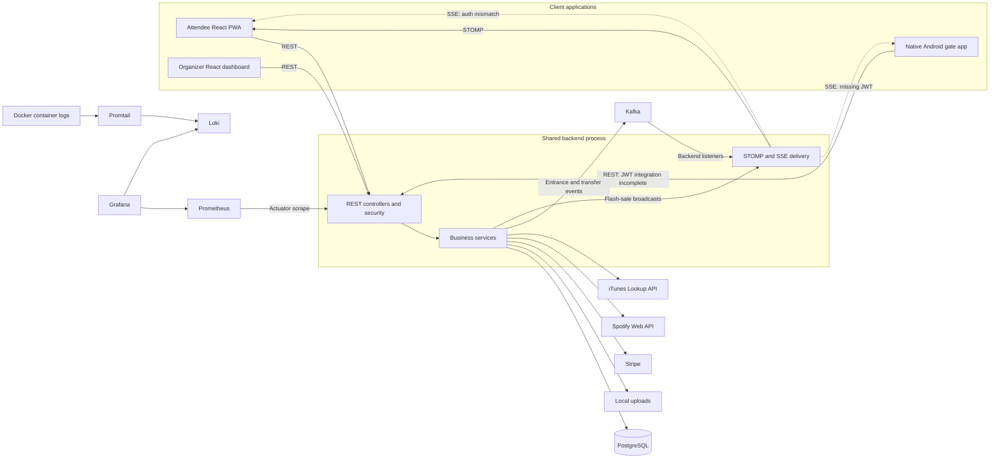
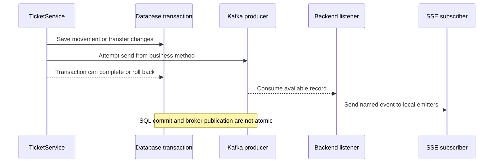

# System architecture

[Overview](../README.md) · [Data model](data-model.md) · [API](api.md) · [Offline and realtime](offline-and-realtime.md)

## 1. Scope and evidence

The system has three independently built clients and one Spring Boot backend. The root Gradle project builds only the Android `:app` module; Maven builds the backend; each web client has its own npm manifest. Compose starts nine development services. This is not a business-microservice architecture.

Evidence: [Compose](../docker-compose.yml), [Gradle settings](../settings.gradle.kts), [backend manifest](../backend/pom.xml), [attendee manifest](../frontend-attendee/package.json), [organizer manifest](../frontend-admin/package.json).

## 2. Component diagram

Dashed edges mark implemented delivery paths whose current client authentication prevents the complete flow. The Android REST scan path has the same missing-token issue.

## 3. Backend organization

| Layer | Responsibility | Source |
|---|---|---|
| Security/configuration | Stateless filters, CORS, permissions, WebSocket, Kafka topics, cache, Flyway | [configs](../backend/src/main/java/com/untold/backend/configs/), [security](../backend/src/main/java/com/untold/backend/security/) |
| Controllers | 73 HTTP handlers; request/response mapping | [controller](../backend/src/main/java/com/untold/backend/controller/) |
| Services | Ticket/payment/schedule rules, music clients, exports and event bridges | [service](../backend/src/main/java/com/untold/backend/service/) |
| Repositories/models | Spring Data persistence, custom queries, 15 JPA entities | [repository](../backend/src/main/java/com/untold/backend/repository/), [model](../backend/src/main/java/com/untold/backend/model/) |
| DTOs | API payloads and export projections | [dto](../backend/src/main/java/com/untold/backend/dto/) |
| Startup | Migrations and demonstration-data synchronization | [Flyway configuration](../backend/src/main/java/com/untold/backend/configs/FlywayConfig.java), [seeder](../backend/src/main/java/com/untold/backend/DatabaseSeeder.java) |

Layer separation is pragmatic: `MapController` handles uploads/layout persistence and `TicketAnalyticsController` assembles repository results. There is no separate API gateway or notification service.

## 4. Communication contracts

| Mechanism | Implemented use | Boundary |
|---|---|---|
| REST/JSON | Main application reads/mutations | CORS/local URLs and owner checks need attention |
| Native WebSocket/STOMP | `/ws/flash-sale` connection, `/topic/flash-sale` broadcasts | Public handshake/topic; queue payload includes user IDs |
| Kafka | `entrance-events`, `ticket-events` | Single partition/topic and one replica; development broker |
| SSE | `/api/stream/entrance-stats` and `/api/stream/tickets` | Auth integration gaps; process-local emitters |
| Polling | Attendee stage/map/performance refresh every 20 seconds | Not schedule push or guaranteed immediate delivery |
| Browser timers | Personal reminder check every 15 seconds | Open-page execution only |

[WebSocketConfig](../backend/src/main/java/com/untold/backend/configs/WebSocketConfig.java) enables a simple in-process `/topic` broker and application prefix `/app`. No SockJS fallback is enabled by the current endpoint registration. Declaring `sockjs-client` does not change the actual transport.

## 5. Storage and state ownership

PostgreSQL is authoritative for accounts, tickets/orders, people/bracelets, movement logs, catalog, maps, performances, favorites, reports and saved slots. Ticket ownership is derived through orders. Filesystem `uploads/` stores uploaded map images served under `/uploads/**`.

The flash-sale queue, Spotify result/access-token caches, rate-limit buckets and SSE subscriptions are in memory. No Redis or distributed cache is configured. The browser stores auth in session storage, preferences in local storage, pending check-in bodies in IndexedDB, and cached GET resources in Cache Storage.

PostgreSQL and Grafana have named Compose volumes. Kafka, Prometheus and Loki lack dedicated persistent volumes. Backend uploads survive development container replacement through the source bind mount, not object storage. [Persistence details](data-model.md).

## 6. External integrations

- Stripe: hosted checkout, session retrieval and webhook signature parsing.
- iTunes Lookup: numeric artist ID import with mock fallback, despite Spotify-named controller/service fields.
- Spotify: Client Credentials and track search by artist name; in-process successful-result caching.
- Spotify embeds, YouTube, fonts and remote images: client presentation/media.
- ML Kit: barcode decoding on Android; admission decisions remain backend operations.

There is no implemented Wallet pass provider, cashless POS service, hardware wristband provisioning, email/SMS delivery or server push notification provider.

## 7. Deployment and scaling boundaries

Compose uses source mounts, Vite development servers, a development Maven command, cleartext local networking and publicly reachable development monitoring. The backend override selects `linux/amd64`. No production reverse proxy/TLS, release web image, cloud deployment or release Android distribution workflow is established.

Kafka publication is best-effort from business methods; there is no transactional outbox linking database commits to broker delivery. Subscribers and caches are local to a backend process. Sharing a Kafka consumer group among multiple backend instances distributes records rather than broadcasting every event to every instance's SSE clients. Horizontal delivery consistency is therefore not established.

See [known limitations](known-limitations.md) before interpreting architecture diagrams as reliability guarantees.

## 8. Request lifecycle and integration boundaries

### 8.1 Web request to persistence

A browser page chooses its own API URL and reads the current token from context/session storage. Protected fetches attach Bearer authentication, while public catalog/map reads do not require it. Since calls are distributed across pages/hooks, there is no single application-wide transport layer that guarantees headers, error parsing or base URL handling for every feature.

The raw ticket rate filter runs first for its route family; CORS, security and MVC follow. JwtAuthenticationFilter validates a supplied token and reloads the account by email. URL matching decides whether authentication or ADMIN is required, and enabled method security adds checks to selected controller methods. Ownership validation happens later in services/controllers that implement it. These are separate boundaries; a CORS-allowed request can still be unauthenticated, and an authenticated caller can still be the wrong owner.

Controllers bind body/query/path inputs, call services/repositories and map DTOs. Service-level transactions combine related database changes where annotated. File writing and broker publication are different resources, so a database transaction does not automatically make them atomic with SQL.

### 8.2 Process startup and readiness

Spring starts with lazy initialization configured. Flyway's explicit bean performs migrations, and a CommandLineRunner seeds demonstration data. Kafka bridges are explicitly eager so their listeners can initialize without waiting for a first subscriber. Flash-sale initialization parses its configured local opening datetime when that service is constructed.

Compose waits for database/broker health and then backend TCP health. Its socket probe is intentionally weaker than a complete application readiness check: an accepting port does not validate seed completion, external provider credentials or authenticated user journeys. No documentation command in this task tested those conditions.

Sources: [configuration](../backend/src/main/resources/application.properties), [FlywayConfig](../backend/src/main/java/com/untold/backend/configs/FlywayConfig.java), [DatabaseSeeder](../backend/src/main/java/com/untold/backend/DatabaseSeeder.java), [entrance bridge](../backend/src/main/java/com/untold/backend/service/EntranceStatsBroadcaster.java).

## 9. Business module coordination

### 9.1 Identity, ownership and access

The attendee's login User is a commercial/account identity. Person is a ticket-holder identity, Bracelet is the access/balance association, and EntranceLog records physical movement. Buying creates Ticket/AppOrder; identity check-in creates Person/Bracelet; gate validation creates EntranceLog. Keeping these stages separate explains why an account can buy multiple tickets for different people and why identity-completion analytics do not measure gate throughput.

Transfer rewrites order users rather than creating a new ownership relationship. The first associated order is the service's owner lookup. That design is sufficient to explain current listings, but it is not an immutable transaction/transfer ledger. [Data model](data-model.md) details the invariants.

### 9.2 Program scheduling versus personal planning

Official Performance rows reference an Artist and a STAGE MapPin with offset datetimes. PersonalSchedule rows hold names, HH:mm intervals and an integer day. The first supports administrator validation and public schedule views; the second is an attendee snapshot with reminders.

This separation avoids coupling the itinerary API to catalog joins, but means administrative time changes do not propagate to saved plans. Artist favorites are a third association. UI warnings can combine them for presentation without making favorites and schedules the same database feature.

### 9.3 Payment coordination

PaymentService constructs Stripe sessions and stores fulfillment inputs in session metadata. Confirmation retrieves the session and dispatches purchase or top-up operations. Flash-sale purchase creates a checkout session and later cleanup removes queue membership after issuance.

The success-page and webhook paths converge on fulfillment, which lacks a persisted completed-session record. The current design therefore does not support exactly-once business fulfillment merely because an external payment session exists. This is a specific cross-resource lifecycle, not an independently deployed payment service.

## 10. Event lifecycle and ordering

Entrance events contain a current net-occupancy snapshot and direction; transfer events contain ticket, sender/recipient and display fields. Kafka topics each have one partition and one replica in development. Ordering within a topic does not establish ordering across topics, database commits and client reconnects.

The producer max.block.ms setting is 2000, limiting one blocking phase rather than proving zero latency on a broker outage. The service catches immediate publication exceptions; the source does not await/check every asynchronous delivery outcome. Consumer auto-offset-reset=latest applies when no valid committed offset exists, not as an instruction to discard every historical record on every restart.

## 11. External catalog and media architecture

iTunes import is a write-side catalog enrichment operation: numeric ID lookup becomes stored Artist/Song data and may replace a song collection. Spotify search is a read-side widget operation: Client Credentials obtains an application token, searches tracks by artist name, and returns IDs/URLs for embeds. Neither operation is attendee Spotify OAuth authorization.

The Spotify access token is cached until near expiry; nonempty search results are memoized by lowercased artist name in a ConcurrentMapCacheManager without an expiry policy. Empty/failing results can be retried. The RestTemplate clients do not define a complete retry/circuit-breaker strategy. Provider availability and embedded-player behavior remain external concerns.

The global player reads repository media files; previews and iframes use remote providers. Workbox caches selected resource destinations and prior GETs, not a guaranteed downloaded music library. [Offline/realtime](offline-and-realtime.md) specifies that distinction.

## 12. Architecture review scenarios

When reviewing changes, trace a purchase through session metadata and order creation; a transfer through owner mutation and both SSE accounts; and a map-pin deletion through stage foreign keys. These examples expose module boundaries more clearly than the presence of a library dependency.

A future deployment needs explicit decisions about immutable financial history, event durability, instance-local state, source-file uploads and private browser storage. Those are roadmap decisions; the diagram should not be read as a production topology or a measured scaling result.
