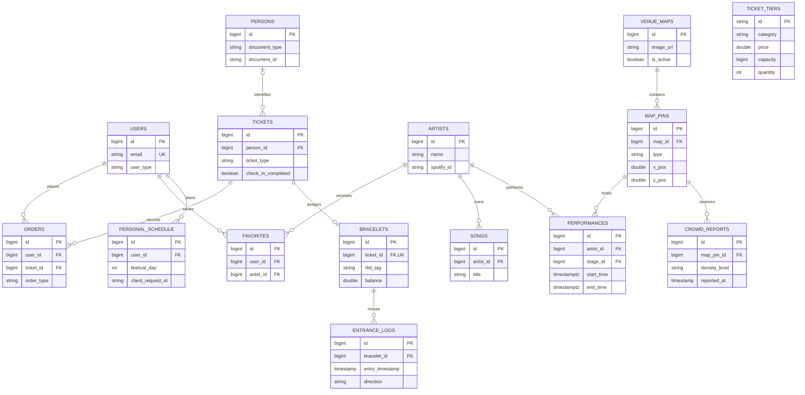

# Data model and persistence

[Overview](../README.md) · [API](api.md) · [Architecture](architecture.md)

The current source defines 15 JPA entities and 13 Flyway migration files. PostgreSQL is authoritative for domain data; Hibernate `ddl-auto=none` leaves schema changes to Flyway. [Entity sources](../backend/src/main/java/com/untold/backend/model/) · [Migrations](../backend/src/main/resources/db/migration/).

## 1. Entity relationship diagram

Ticket tiers deliberately appear without an edge: `tickets.ticket_type` is a string, not a tier foreign key. Personal schedule names/times are snapshots, not artist/performance foreign keys.

## 2. Entity dictionary

All IDs are identity-generated numeric IDs except the string ticket-tier key.

| Entity/table | Fields beyond ID | Relationship and persistence notes |
|---|---|---|
| [User](../backend/src/main/java/com/untold/backend/model/User.java) / `users` | username, email, password hash, user type | Email unique in SQL; owns orders |
| [Person](../backend/src/main/java/com/untold/backend/model/Person.java) / `persons` | first/last name, date of birth, gender, country, city, document type/ID, phone | Tickets may reference a person; no unique document constraint |
| [Ticket](../backend/src/main/java/com/untold/backend/model/Ticket.java) / `tickets` | ticket type string, price, purchase date, check-in flag, person ID | Many orders, optional person, optional bracelet |
| [AppOrder](../backend/src/main/java/com/untold/backend/model/AppOrder.java) / `orders` | user ID, ticket ID, order type, amount paid, purchase date | Non-null user/ticket relationships; purchase and top-up rows |
| [Bracelet](../backend/src/main/java/com/untold/backend/model/Bracelet.java) / `bracelets` | RFID identifier string, balance, ticket ID | Unique non-null ticket ID; identifier itself has no SQL unique constraint |
| [EntranceLog](../backend/src/main/java/com/untold/backend/model/EntranceLog.java) / `entrance_logs` | bracelet ID, timestamp, direction | Many movements per bracelet; SQL cascade on bracelet deletion |
| [TicketTier](../backend/src/main/java/com/untold/backend/model/TicketTier.java) / `ticket_tiers` | display name, category, price, capacity, nullable quantity, sold, active | Free-form string primary key; counters/flags do not themselves enforce inventory |
| [Artist](../backend/src/main/java/com/untold/backend/model/Artist.java) / `artists` | name, genre, biography, image URL, spotify ID | Owns songs; external ID may actually be iTunes ID |
| [Song](../backend/src/main/java/com/untold/backend/model/Song.java) / `songs` | artist ID, title, duration seconds, spotify ID, preview URL | Non-null artist; SQL cascade and JPA orphan removal through artist |
| [Favorite](../backend/src/main/java/com/untold/backend/model/Favorite.java) / `favorites` | user ID, artist ID, creation time | Unique user/artist pair; FKs cascade on deletion |
| [VenueMap](../backend/src/main/java/com/untold/backend/model/VenueMap.java) / `venue_maps` | image URL, active flag, creation time | Owns map pins with JPA cascade/orphan removal |
| [MapPin](../backend/src/main/java/com/untold/backend/model/MapPin.java) / `map_pins` | map ID, type, name, description, x/y percentage positions, creation time | Non-null map; SQL cascade on map deletion |
| [Performance](../backend/src/main/java/com/untold/backend/model/Performance.java) / `performances` | artist ID, stage ID, offset start/end timestamps, status | References artist and a STAGE map pin; SQL restricts deletion of referenced rows |
| [CrowdReport](../backend/src/main/java/com/untold/backend/model/CrowdReport.java) / `crowd_reports` | map-pin ID, density, reporter text, notes, report time | Pin FK cascades; reporter is not an account FK |
| [PersonalSchedule](../backend/src/main/java/com/untold/backend/model/PersonalSchedule.java) / `personal_schedule` | user ID, artist/stage names, HH:mm start/end, festival day, alarm offset, nullable client request ID | User FK cascades; optional request deduplication index in V15 |

Money/balances are `Double`/`DOUBLE PRECISION`. Times use several representations: offset-aware performance timestamps, local timestamps for orders/movements/reports, text times plus day number for personal schedules. These differences matter to overnight/time-zone behavior.

## 3. Ownership and deletion semantics

[Ticket.getUser()](../backend/src/main/java/com/untold/backend/model/Ticket.java) derives ownership from the first associated order. The service expects an order, although SQL permits a ticket with zero order rows. `getOrder()` similarly takes the first list element without a separate ownership/history model.

[TicketService.transferTicket](../backend/src/main/java/com/untold/backend/service/TicketService.java) changes the user on every order associated with the ticket. Original purchase attribution is therefore replaced; there is no transfer-history entity.

SQL deletes cascade from users/tickets to orders, tickets to bracelets, bracelets to movements, users/artists to favorites, artists to songs, maps to pins, pins to crowd reports, and users to schedules. Deleting a person sets ticket `person_id` to null. Performances restrict artist/stage deletion. JPA mappings have their own cascade/orphan behavior; these are not a general account-erasure workflow.

Stage overlaps are checked in service queries, not a database exclusion constraint. No persisted Stripe-session/idempotency record, inventory reservation entity, staff entity, broadcast entity, or POS transaction entity exists.

## 4. Migrations

| Version | File | Purpose |
|---|---|---|
| V1 | [init_schema](../backend/src/main/resources/db/migration/V1__init_schema.sql) | Users |
| V2 | [create_domain_tables](../backend/src/main/resources/db/migration/V2__create_domain_tables.sql) | Persons, tickets, orders, bracelets |
| V3 | [create_venue_map_tables](../backend/src/main/resources/db/migration/V3__create_venue_map_tables.sql) | Maps/pins |
| V4 | [create_artist_and_song_tables](../backend/src/main/resources/db/migration/V4__create_artist_and_song_tables.sql) | Artists/songs |
| V5 | [create_favorites_table](../backend/src/main/resources/db/migration/V5__create_favorites_table.sql) | Favorites and unique pair |
| V6 | [create_crowd_reports_table](../backend/src/main/resources/db/migration/V6__create_crowd_reports_table.sql) | Reports |
| V7 | [create_ticket_tiers](../backend/src/main/resources/db/migration/V7__create_ticket_tiers.sql) | Dynamic tiers |
| V10 | [create_performances_table](../backend/src/main/resources/db/migration/V10__create_performances_table.sql) | Performances |
| V11 | [create_entrance_logs_table](../backend/src/main/resources/db/migration/V11__create_entrance_logs_table.sql) | Movements |
| V12 | [add_entrance_direction](../backend/src/main/resources/db/migration/V12__add_entrance_direction.sql) | IN/OUT direction |
| V13 | [create_personal_schedule_table](../backend/src/main/resources/db/migration/V13__create_personal_schedule_table.sql) | Personal slots |
| V14 | [add_schedule_festival_day](../backend/src/main/resources/db/migration/V14__add_schedule_festival_day.sql) | Day number |
| V15 | [add_schedule_client_request_id](../backend/src/main/resources/db/migration/V15__add_schedule_client_request_id.sql) | Nullable request ID and partial unique user/request index; currently untracked |

There are no V8/V9 files in the current repository; earlier schedule documentation used those obsolete names. Version gaps are not evidence of missing required tables. [FlywayConfig](../backend/src/main/java/com/untold/backend/configs/FlywayConfig.java) baselines at version 0 and disables migration validation.

## 5. Startup seeding

[DatabaseSeeder](../backend/src/main/java/com/untold/backend/DatabaseSeeder.java) runs as a CommandLineRunner without a development-only profile guard. It:

1. Creates missing demonstration attendee/administrator accounts.
2. Creates a default map if needed and creates/updates named pins.
3. Imports missing numeric artist IDs through iTunes, potentially receiving mock fallbacks.
4. Creates missing enum-derived tiers and reconciles sold counts from ticket rows.
5. Creates sample purchases if there are no tickets.
6. Deletes all performances and reseeds its predefined schedule, shifted to `festival.start-date`.

This is an active data lifecycle, not one-time schema migration. Restarting can remove administrator schedule edits and reintroduce deleted enum tiers/pins. Several seeded legacy ticket strings are not recognized day-ticket enums. Imported catalog data and seeded dates must not be described as verified official festival information.

## 6. Other persistence

| Mechanism | Data |
|---|---|
| Compose `postgres_data` | PostgreSQL database |
| Backend `uploads/` bind-mounted directory | Map images |
| Browser session storage | User and JWT |
| Browser local storage | Language/currency preferences |
| IndexedDB `untold_offline_db` / `outbox` | Check-in request bodies |
| Cache Storage | Worker resources and previously fetched GET API data |
| Process memory | Flash queue, Spotify token/results, rate buckets, SSE subscriptions |
| Compose `grafana_data` | Grafana state |

Kafka/Prometheus/Loki lack dedicated persistent volumes. No object storage or external distributed cache is configured. See [offline/realtime](offline-and-realtime.md) and [known limitations](known-limitations.md).

## 7. Persistence rules by lifecycle

### 7.1 Purchase and credit records

Each buy operation saves Ticket and a TICKET_PURCHASE AppOrder. The ticket records its commercial price/purchase time; each top-up adds a TOP_UP order and changes Bracelet.balance. TicketStats revenue sums ticket prices and does not represent all top-up cash movement.

There is no many-ticket checkout entity in the database: a multi-item Stripe session is expanded into ticket/order operations, and the session metadata carries cart context. No persisted session ID or settlement/idempotency table links an external payment exactly once to those rows. Monetary Double fields and direct client prices are implementation choices, not an accounting-grade ledger.

### 7.2 Identity and movement invariants

Check-in assigns a Person and a unique-per-ticket Bracelet, while allowing multiple tickets to reference a Person at the schema level. Required identity fields are enforced in TicketService for check-in, not uniformly by database constraints or administrative Person CRUD.

EntranceLog references Bracelet and records IN/OUT/local timestamp. The repository can fetch the most recent movement after a cutoff and count directions. There is no database uniqueness constraint meaning “one person currently inside”; state is inferred from log order. Sequential service validation is distinct from concurrent database serialization.

### 7.3 Ownership and account deletion

AppOrder has mandatory account/ticket foreign keys, but SQL does not require each Ticket to have an AppOrder. Deleting an account cascades its orders without automatically proving a complete cleanup of all ticket/person/bracelet history. Service methods expecting ticket.getUser() can encounter records with no order.

This matters for user management and data export. Account deletion is not a complete privacy-erasure implementation, and transfer changing order users means the recipient's export can include transferred purchase attribution. No historical owner column distinguishes original buyer from current account owner.

### 7.4 Map and performance integrity

MapPin coordinates are percentages within an uploaded image. The map/pin aggregate uses cascade/orphan removal, so replacing the saved pin collection can remove omitted children. Performance stage foreign keys use RESTRICT, preventing an uncoordinated removal of a referenced pin even if the editor locally removes it.

STAGE is a pin type validated by PerformanceService, not a distinct relational table or a SQL foreign key to a stage-only subset. Artist stage/time collisions are query-level rules rather than exclusion constraints. Changing a pin type/name affects presentation and future validation, while existing relationships remain ID-based.

### 7.5 Personal-slot independence

PersonalSchedule's required user FK and simple snapshot fields make account filtering direct. Artist/stage/time values are not constrained to existing program rows; API creation can represent a valid named interval independently. This explains both the absence of automatic schedule synchronization and why catalog deletion need not remove saved slot labels.

The optional user/request unique index only applies when client_request_id is non-null. It prevents duplicate non-null keys at the database level but does not by itself turn every client retry into a reconciled successful response. The current UI does not send request IDs. [Personal scheduling](personal-scheduling.md) gives the full behavior.

## 8. Query semantics used by reports

[TicketRepository](../backend/src/main/java/com/untold/backend/repository/TicketRepository.java) groups sales by the date cast of purchaseDate, counting tickets and summing coalesced ticket price. The country query left-joins attendee data and uses Unknown for missing country. Percentages use total tickets as denominator; they are not a survey of unique people.

Average age uses year difference from date of birth rather than exact birthday-aware elapsed years. Identity-completion statistics count checkInCompleted, not EntranceLog. A ticket may therefore be “checked in” for reporting without ever physically entering, and the Excel report's scanning-oriented labels do not change that query.

[CrowdReportRepository](../backend/src/main/java/com/untold/backend/repository/CrowdReportRepository.java) returns recent report rows; the service groups/averages in memory. It does not compute capacity or derive density from entrance logs. The reporter field is display text without a User FK.

## 9. Schema and Java differences

Migration SQL is the deployed schema definition because automatic Hibernate DDL is disabled. Entity annotations express Java-side intent and relationships but do not automatically rewrite an older/more permissive SQL column. For example, historical domain SQL permits some nullable ticket fields that later Java annotations describe as required.

Offsets, local timestamps and text times also have different semantics. Performance uses timestamp with time zone/OffsetDateTime; movement/order/report fields are local datetimes; personal slots have HH:mm plus day number. Consumers must not assume that every timestamp can be grouped with the same timezone/overnight rule.

## 10. Migration review and reproducibility

The versioned files should be reviewed in numeric Flyway order, not filesystem lexical order. Missing V8/V9 are historical naming gaps, while V13/V14 are the actual personal-schedule migrations. V15 currently exists only as an untracked file in the working tree.

The explicit Flyway bean uses the configured DataSource, baseline-on-migrate version 0 and validation disabled. This means startup is not evidence that all previously applied migrations match their checked-in text. A migration test environment should verify a clean database and upgrade path rather than rely on the demonstration seeder.

## 11. Source-derived data examples

A ticket lifecycle can be read as Ticket 1 → purchase order owned by User A → Person assigned on identity submission → Bracelet assigned → movement logs appended. IDs here are illustrative, not seeded fixture guarantees. Transfer before identity submission changes order ownership to User B; after check-in the transfer service rejects the operation.

For schedules, saving a 23:00-00:30 day-2 slot produces text times and a day number, while the official performance stores full offsets. Both can be displayed together, but no FK forces them to remain equal after edits. These examples explain actual persistence boundaries without fabricating records or executing database changes.
