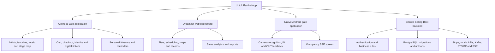

# Current functional specifications

[Project overview](../README.md) · [Feature index](features.md) · [User journeys](workflows.md) · [API contracts](api.md)

## 1. Scope and application ecosystem

This specification describes source-backed behavior in the current working tree. It covers a team-developed portfolio project with three clients and one shared backend. The attendee application serves public visitors and account holders; the organizer dashboard serves administrators; the native Android application serves gate operators using administrator accounts. All clients use the same account, ticket, artist, map and schedule data through the Spring Boot service.

“Implemented” means the code path and persistence/interaction described here exist. “Integration incomplete” means server and client code exist but their current contracts prevent a complete flow. “Demonstration” means static/sample or local-only interaction. No section records successful runtime execution, measured performance or official festival affiliation. Cross-cutting gaps belong in [known limitations](known-limitations.md); historical ambitions remain in [design specifications](design-specifications/README.md).

Source entry points: [attendee router](../frontend-attendee/src/App.tsx), [organizer router](../frontend-admin/src/App.tsx), [Android activity](../admin-app/app/src/main/java/com/example/admin_app/MainActivity.kt), [backend application](../backend/src/main/java/com/untold/backend/BackendApplication.java).

## 2. Users, permissions and terminology

Anonymous visitors can inspect public catalog, performances, active map, tier information, flash-sale status and crowd-report reads. Registration creates an ATTENDEE regardless of submitted role. Authenticated accounts can use favorites and their own personal schedules; several general ticket/payment operations are available to any authenticated role.

ADMIN protects organizational mutations, all-ticket reporting, gate validation and administrative exports. Organizer and gate operator are descriptions of that same role, not separate security identities. PARTNER is an assignable role with baseline authenticated access, without a partner-specific interface. Owner checks additionally protect schedule mutations, dynamic QR generation and transfers. Transfers require attendee sender and recipient.

Use **identity check-in** for submitting a ticket holder's personal details. Use **gate entry/exit** for physical movement recorded by a scanner. Use **favorite artist** for the account/artist association, and **personal slot** for a copied itinerary entry. These concepts are intentionally separate in the data model.

[Roles and permissions](roles-and-permissions.md) specifies exact authorization, including current missing owner checks; [UserType](../backend/src/main/java/com/untold/backend/model/UserType.java) and [SecurityConfig](../backend/src/main/java/com/untold/backend/configs/SecurityConfig.java) define the actual role/filter rules.

## 3. Organizer web application

### 3.1 Administrator authentication and workspace

The organizer enters email and password. The client rejects blank values, posts to ordinary login, inspects the returned user's role and accepts only ADMIN into the workspace. It stores user/token in session storage; a page refresh restores the token-presence gate. Header logout removes those values and reloads the page.

Successful interaction displays the dashboard layout, sidebar and account name/role. Invalid credentials, a non-admin result and network failure have separate visible error messages. A locally stored token is not server validation: protected requests still pass through backend authentication and role checks.

The workspace has routes for dashboard, lineup, events, staff, persons, crowd reports, tickets, venue map, settings and support. Sales is a Tickets subview, and Announcements is a Staff subview. Reusable tables paginate loaded rows in the client, reset on data identity changes and can follow an externally selected map pin.

**Status:** authentication/layout implemented; token expiry recovery is not a complete session-management flow. Sources: [Login](../frontend-admin/src/pages/Login.tsx), [App](../frontend-admin/src/App.tsx), [Header](../frontend-admin/src/components/Header.tsx), [GenericTable](../frontend-admin/src/components/GenericTable.tsx).

### 3.2 Artist directory and manual maintenance

The artist directory reads persisted artists, displays genre/profile details and relates each artist to scheduled sets. An administrator can open a manual-add form, supply name, genre, biography, image URL and external ID, and submit it. Name is required in the client; genre and image can receive client defaults. The backend stores the artist and returns its DTO, including songs.

Deletion asks for confirmation and removes associated song data through entity/database relationships. Existing performances can prevent artist deletion. Backend update and song-add/remove APIs also exist; song removal checks that the song belongs to the specified artist. These API capabilities should not be confused with a complete visual song/role-management interface.

**Status:** directory reads work by public contract; create/import/delete UI requests currently omit the Bearer header required for administrator mutations. The forms exist but are not fully integrated with current security. Sources: [organizer Lineup](../frontend-admin/src/pages/Lineup.tsx), [ArtistController](../backend/src/main/java/com/untold/backend/controller/ArtistController.java), [ArtistService](../backend/src/main/java/com/untold/backend/service/ArtistService.java).

### 3.3 External artist and music import

The import form accepts a numeric Apple/iTunes artist ID. Despite the path parameter and service method using Spotify terminology, the import calls iTunes Lookup for the artist and up to six songs. Successful processing maps name/genre, artwork, track IDs, durations and preview URLs into persisted artist/song rows, replacing the prior song list.

The service validates numeric input before the remote call. Import failure returns generated fallback data; some recognized IDs receive named examples while unknown IDs receive generic data. Biography text is constructed by the application, not retrieved as an authoritative biography. A “successful” import response therefore does not prove the upstream lookup succeeded.

**Status:** backend import path implemented with mock fallback; organizer authentication integration incomplete. Separate Spotify search is used for attendee playback widgets, not this import. Sources: [AppleMusicSyncService](../backend/src/main/java/com/untold/backend/service/AppleMusicSyncService.java), [ArtistService](../backend/src/main/java/com/untold/backend/service/ArtistService.java).

### 3.4 Performance creation, editing and removal

The administrator chooses an artist, a STAGE map pin, logical festival day, start/end time and status. The client converts its selected day/time to offset datetimes and submits POST for a new performance or PUT for an existing one. Selection on the timeline or artist action opens the scheduling form; successful save closes it and refetches performances/stages.

The backend requires artist/stage IDs, both timestamps and start before end. The pin must actually be type STAGE. New rows default to SCHEDULED; status choices include LIVE, DELAYED, CANCELLED and COMPLETED. Deletion is confirmed in the client, calls DELETE and refreshes the matrix.

Outputs include artist/stage labels, times, status and a computed conflict flag. Invalid input, missing references and collisions are reported to the client; error handling attempts to read JSON messages and otherwise falls back to an HTTP-status message.

**Status:** authenticated form-based CRUD implemented. No drag/drop, changeover buffer or draft/publish transition is implemented. Current fixed client dates differ from backend configuration. Sources: [organizer Lineup](../frontend-admin/src/pages/Lineup.tsx), [PerformanceController](../backend/src/main/java/com/untold/backend/controller/PerformanceController.java), [PerformanceService](../backend/src/main/java/com/untold/backend/service/PerformanceService.java).

### 3.5 Scheduling conflict behavior

Two sets conflict on a stage when the existing start is before the requested end and the existing end is after the requested start. Editing excludes the current performance ID. The server rejects a same-stage overlap with HTTP 409 and a message identifying the conflicting booking. Adjacent sets sharing an end/start boundary are allowed because comparisons are strict.

For one artist booked in overlapping intervals, the service computes a soft conflict rather than rejecting persistence. DTOs carry hasConflict, and the organizer shows warnings for the selected day. The attendee also computes personal/favorite conflicts, but those do not enforce organizer bookings.

**Status:** application-level query checks implemented; not database-enforced serialization of simultaneous edits. [PerformanceRepository](../backend/src/main/java/com/untold/backend/repository/PerformanceRepository.java) and [PerformanceService](../backend/src/main/java/com/untold/backend/service/PerformanceService.java) define the predicates. [Detailed conflict journey](workflows.md) includes boundary examples.

### 3.6 Ticket-tier configuration

Ticket Tiers lets administrators create or edit a string tier ID, display name, GA/VIP/BACKSTAGE category, price, capacity and active state. Editing retains the existing sold count in the payload. Client search matches ID/display name; category and active/inactive filters narrow the loaded list. Save refreshes the tiers, and deletion requires confirmation.

The backend POST saves the supplied tier entity as create/update and DELETE removes it by string ID. Quantity is also a backend field, used particularly for flash sales, but the current organizer form does not expose the full stock-reservation lifecycle.

**Status:** authenticated persistence implemented. Capacity/active fields are configuration data, not a guarantee that purchase code enforces availability. The attendee storefront does not dynamically render every saved tier. Sources: [Tickets](../frontend-admin/src/pages/Tickets.tsx), [useTicketTiers](../frontend-admin/src/hooks/useTicketTiers.ts), [TicketTier](../backend/src/main/java/com/untold/backend/model/TicketTier.java).

### 3.7 Sales ledger and analytics

The sales subview reads all tickets with administrator authentication. Rows identify a transaction from ticket ID, show buyer identity when present, display ticket type/price and format purchase time. Daily metrics select tickets using the browser's current calendar day. A reusable table paginates rows.

The dashboard obtains category totals/revenue and a separate summary with daily ticket/revenue velocity, country distributions, identity-completion counts and approximate average age. Categories derive from saved tiers with enum fallback. Country statistics use ticket-holder person data; tickets lacking that data contribute to Unknown.

**Status:** real repository queries and authenticated requests exist, alongside hardcoded operational cards, simulated baselines and mock fallback data. Empty/error fallback figures are not evidence of sales or attendance. The check-in percentage means completed identity details, not gate scans. Sources: [Sales](../frontend-admin/src/pages/Sales.tsx), [Dashboard](../frontend-admin/src/pages/Dashboard.tsx), [TicketRepository](../backend/src/main/java/com/untold/backend/repository/TicketRepository.java).

### 3.8 Excel audit export

The administrator activates the audit download. The client sends a Bearer-authenticated request, handles unauthorized/server errors, reads the binary response and uses Content-Disposition when available to choose a filename. It creates a temporary object URL and download link, then releases them.

The service uses a streaming Apache POI workbook and generates Executive Summary, Sales Allocation, Daily Sales Velocity, and Attendee & Scanning Audit sheets. Formatting includes headers, currency/percentage styles and totals. It combines ticket stats, daily sales, country data and identity-completion/age aggregates.

**Status:** backend and download client implemented; the “scanning” sheet's totals are identity completion, not movement-log history. Sources: [TicketAuditController](../backend/src/main/java/com/untold/backend/controller/TicketAuditController.java), [TicketAuditExportService](../backend/src/main/java/com/untold/backend/service/TicketAuditExportService.java), [Dashboard](../frontend-admin/src/pages/Dashboard.tsx).

### 3.9 Venue-map editor

An administrator uploads an image, places a pin by clicking its percentage location, enters name/type/description, and confirms the local change. Clicking selects an existing pin; double-click opens editing. Search, category tabs and visibility controls support locating pins. Removing or editing a pin changes local state until the administrator saves the complete layout.

Upload sends multipart file data. The UI rejects files over 10 MB; the backend checks nonempty image MIME input and a 15 MB limit, stores a generated filename and returns an image URL. Layout save requires an image URL, updates matching pin IDs, creates new pins and removes omitted pins. Existing performances can prevent deleting their stage pin.

The returned active map contains persisted coordinates and pin metadata; it is loaded again after save. Pin categories cover stages, food, bars, credit points, wellness, fashion, activations, Ferris wheel, first aid, toilets, entrances and exits. A category label does not implement its corresponding commercial/hardware service.

**Status:** authenticated upload/layout persistence implemented. Sources: [MapEditor](../frontend-admin/src/pages/MapEditor.tsx), [MapController](../backend/src/main/java/com/untold/backend/controller/MapController.java), [VenueMap](../backend/src/main/java/com/untold/backend/model/VenueMap.java).

### 3.10 Attendee identity records

The records screen loads people, displays identity/contact fields and resolved owner email, and opens create/edit forms. Names are minimally required in its UI; ticket identity check-in has more extensive validation. Save POSTs/PUTs a person, deletion asks for confirmation, and success refreshes the list.

This is maintenance of Person records, not administrative editing of User accounts or a gate-entry register. A person may be associated with a ticket without being that account's login identity.

**Status:** API and interaction implemented but client requests lack required Bearer authentication. Sources: [Persons](../frontend-admin/src/pages/Persons.tsx), [PersonController](../backend/src/main/java/com/untold/backend/controller/PersonController.java), [PersonService](../backend/src/main/java/com/untold/backend/service/PersonService.java).

### 3.11 Crowd monitoring

An administrator chooses a map pin and LOW/MODERATE/HIGH/CRITICAL level, enters reporter and optional notes, and creates or edits a report. The UI requires a pin and nonblank reporter. It also fetches recent density aggregation and map pins, and exposes refresh/delete actions.

The service records a report timestamp, loads reports newest first and aggregates a requested time window, defaulting to 60 minutes at the API. It averages levels scored 1-4 per pin, rounds the current level, supplies count/latest reporter/time and sorts highest score first. This is manual reporting, not a camera/sensor estimate or global occupancy count.

**Status:** public report/aggregation reads implemented; organizer protected mutations omit authentication. Sources: [CrowdReports](../frontend-admin/src/pages/CrowdReports.tsx), [CrowdReportService](../backend/src/main/java/com/untold/backend/service/CrowdReportService.java).

### 3.12 Demonstration organizational interfaces

Staff Allocation displays a sample roster and lets an operator choose a person and target zone; reassignment changes React state and shows temporary confirmation. It does not persist deployment, call a staff API or establish job-title permissions.

Announcements shows sample history and a New Broadcast control without delivery logic. Events displays static experiences with inactive creation/management/export actions. Settings displays editable inputs but does not save configuration. Support and the notification bell are presentation content. These interfaces illustrate intended organization rather than completed operational workflows.

**Status:** demonstration/static. Sources: [Staff](../frontend-admin/src/pages/Staff.tsx), [Announcements](../frontend-admin/src/pages/Announcements.tsx), [Events](../frontend-admin/src/pages/Events.tsx), [Settings](../frontend-admin/src/pages/Settings.tsx), [Support](../frontend-admin/src/pages/Support.tsx).

## 4. Attendee web application

### 4.1 Registration, login and session use

A visitor switches between registration and login. Registration submits username/email/password; login submits email/password. The backend rejects an already registered email, hashes passwords and returns a token/user envelope. Successful interaction saves the session and redirects to the requested route, or My Account when no return route is present.

The client displays response or network errors and loading state. My Account redirects an absent user to authentication. Session storage survives same-tab reload but is not a persistent cross-device login; no refresh-token or password-reset screen exists.

**Status:** implemented in [Auth](../frontend-attendee/src/pages/Auth.tsx), [AuthContext](../frontend-attendee/src/context/AuthContext.tsx), [AuthService](../backend/src/main/java/com/untold/backend/service/AuthService.java).

### 4.2 Ticket selection and cart

The visitor can inspect offerings; adding/configuring requires a logged-in account and otherwise redirects to auth. Standard cards offer GA/VIP/backstage four-day tickets and GA/VIP one-day selection. Day configuration produces the recognized day-ticket string and base RON price. The cart merges like types, increments quantity, permits removal and keeps quantity at least one.

Checkout expands quantity into one TicketItem per ticket. Display prices use selected currency while request ticket prices remain RON; the backend converts ticket charges. The cart lives only in React state and is cleared after successful confirmation.

**Status:** implemented UI/source path with hardcoded offerings/prices. Sources: [Tickets](../frontend-attendee/src/pages/Tickets.tsx), [CartContext](../frontend-attendee/src/context/CartContext.tsx), [Cart](../frontend-attendee/src/pages/Cart.tsx).

### 4.3 Stripe ticket checkout and result pages

Checkout requires a user and nonempty cart. The client submits buyer ID, expanded ticket list and currency with Bearer auth. The backend creates hosted Checkout with ticket metadata and success/cancel URLs derived from Origin or a local fallback. The browser redirects to Stripe.

On return, the success page requires session_id, attempts confirmation once for that mounted component and displays loading, success or error. Confirmation retrieves the external session and issues database tickets/orders. Cancellation has its own page and does not establish a completed purchase.

**Status:** implemented development path. A component ref prevents repeated calls only within that mount; it is not server idempotency. [PaymentService](../backend/src/main/java/com/untold/backend/service/PaymentService.java) and [PaymentSuccess](../frontend-attendee/src/pages/PaymentSuccess.tsx) define this interaction.

### 4.4 Ticket wallet and identity check-in

My Account lists the current account's tickets with type, price, purchase date and check-in state. Each unchecked-in ticket has independent form data. Required inputs are first/last name, birth date, gender, country/city, document type/number, phone and a client declaration checkbox.

The server requires identity/contact fields, rejects repeat check-in, creates a Person, marks the ticket checked in and creates a bracelet with generated identifier/zero balance. The returned ticket updates local state and reveals access-code and balance interfaces. The client declaration is not a separately persisted consent record.

On offline/network failure the form can be queued locally, described below. A persisted identity record does not mean the person passed a gate.

**Status:** implemented source path with missing universal ticket-owner enforcement. Sources: [MyAccount](../frontend-attendee/src/pages/MyAccount.tsx), [TicketService](../backend/src/main/java/com/untold/backend/service/TicketService.java).

### 4.5 Rotating digital QR credentials

For a checked-in ticket with a bracelet, the QR component requests an owner-scoped signed payload. The backend resolves ownership and signs a timestamp together with ticket/owner identity. The browser renders it as an SVG QR with countdown, refreshes on a 30-second cadence, staggers initial requests and retries failed requests.

The server accepts issue age up to 35 seconds and future skew up to five seconds. It verifies the truncated HMAC using a separate QR signing configuration and resolves the bracelet. An expired or invalid payload produces validation failure at scanning; the page may display an error after retry attempts.

**Status:** implemented online issuance/rendering. This is HMAC-SHA256, not RS256, and there is no offline native verifier. Sources: [DynamicTicketQr](../frontend-attendee/src/components/DynamicTicketQr.tsx), [TicketService](../backend/src/main/java/com/untold/backend/service/TicketService.java).

### 4.6 Ticket transfer

Before identity check-in, an attendee owner can open Transfer, enter a recipient email and submit. The modal validates email shape and disables submission during the request. The backend requires sender ownership, attendee roles, a registered recipient, no self-transfer and an unchecked-in ticket.

Success reassigns associated orders, removes the sender's card after its exit transition and shows a confirmation toast. Errors remain in the modal. Kafka publishes an event intended to refresh the sender's other sessions and the receiver's account, with a received-ticket message.

**Status:** persisted transfer and sender interaction implemented; current browser SSE authentication blocks automatic reception. Sources: [TransferTicketModal](../frontend-attendee/src/components/TransferTicketModal.tsx), [MyAccount](../frontend-attendee/src/pages/MyAccount.tsx), [TicketService](../backend/src/main/java/com/untold/backend/service/TicketService.java).

### 4.7 Wristband details and balance top-up

After check-in, the account shows bracelet identifier and balance. The attendee enters a positive amount in selected currency, creates a Stripe top-up session and is redirected to Checkout. Metadata identifies ticket, amount and payment currency. Fulfillment converts the paid amount back to base RON, updates balance and saves a TOP_UP order.

The UI rejects invalid/nonpositive entered amounts and reports checkout/network failures. A backend direct-credit endpoint also exists, separate from Stripe. There is no debit, merchant transaction, NFC provisioning or cash refund workflow.

**Status:** balance/top-up source path implemented; payment idempotency/owner boundaries remain cross-cutting limitations. Sources: [MyAccount](../frontend-attendee/src/pages/MyAccount.tsx), [PaymentService](../backend/src/main/java/com/untold/backend/service/PaymentService.java), [CurrencyConverter](../backend/src/main/java/com/untold/backend/service/CurrencyConverter.java).

### 4.8 Artist discovery, favorites and song previews

The lineup loads persisted artists, derives genre choices and filters cards by genre/favorites. Authenticated favorites load from the current user's backend association; toggling posts to the artist-specific endpoint and updates the favorite ID set on success. Anonymous attempts to favorite redirect to authentication.

Opening a performance fetches artist details and can prepare a synced preview audio URL. Top Tracks expands a lazily loaded Spotify widget: the backend uses Client Credentials, searches artist tracks and caches nonempty results; the client embeds returned Spotify track IDs. Empty/error results have separate messages.

**Status:** implemented; favorites apply to artists rather than selecting one particular performance. Sources: [Lineup](../frontend-attendee/src/pages/Lineup.tsx), [FavoriteService](../backend/src/main/java/com/untold/backend/service/FavoriteService.java), [SpotifyService](../backend/src/main/java/com/untold/backend/service/SpotifyService.java).

### 4.9 Global music player and presentation content

A floating player provides play/pause, previous/next, volume and automatic track advance for six bundled tracks. It uses Web Audio analysis to update a CSS visual-intensity value from low-frequency audio energy. Playback initialization/resume is connected to user controls, and failed autoplay resets playing state.

The landing page includes a countdown, featured cards and video background; the gallery includes local images, expandable FAQs and an external directions link. The featured home play control should not be confused with the implemented global audio player.

**Status:** player and information interactions implemented; some landing content is hardcoded/presentation-only. Sources: [MusicPlayer](../frontend-attendee/src/components/MusicPlayer.tsx), [Home](../frontend-attendee/src/pages/Home.tsx), [Gallery](../frontend-attendee/src/pages/Gallery.tsx).

### 4.10 Interactive performance timeline

Lineup provides artist, schedule and map tabs. The timeline groups performances by a selected logical day and stage, positions intervals across evening/overnight hours and opens detail overlays when a set is selected. Data is fetched on mount and refreshed every 20 seconds, along with a current clock tick.

Favorite-set clashes are calculated using overlapping timestamps on the selected day. They warn rather than prohibit saving or viewing sets. CANCELLED is excluded from live-map selection, while stored statuses also distinguish delayed/live/completed listings.

**Status:** implemented polling and browser calculations. The matrix is not a pushed schedule-update channel; fixed date mappings are documented separately. [Lineup](../frontend-attendee/src/pages/Lineup.tsx).

### 4.11 Personal itinerary and reminders

A separate Add to Schedule control copies artist name, stage, HH:mm start/end and festival day into an account slot. The current UI identifies an existing slot by artist/stage names and toggles removal or creation. My Schedule groups slots by day, sorts through midnight rollover, highlights current day and displays named conflict warnings.

Each slot allows alarm offset 0/5/10/15/30 minutes and deletion. The default is ten minutes. Notifications require an explicit permission action; reminder checks synthesize sound and optionally create a browser Notification when a slot enters its window. The detail of time adjustment, validation, owner checks and error states is specified in [personal scheduling](personal-scheduling.md).

**Status:** implemented persisted CRUD subset and open-page reminders. Full slot editing/request-ID support exists only in current backend changes and is not exposed by this UI. Sources: [ScheduleContext](../frontend-attendee/src/context/ScheduleContext.tsx), [MySchedule](../frontend-attendee/src/pages/MySchedule.tsx), [PersonalScheduleService](../backend/src/main/java/com/untold/backend/service/PersonalScheduleService.java).

### 4.12 Festival stage map

The attendee reads the active uploaded image and STAGE pins. Each stage's live artist is derived from current time and performance intervals. If a next set belongs to the current night, it can be shown; during an active set the next artist is restricted to a nearby 30-minute window. Liked/scheduled artists drive map alert content.

Selecting a stage performance opens its artist/set detail with schedule/favorite/music interactions. This is an image with positioned overlays, not a vector-navigation/GPS engine. The administrator's non-stage POIs are not all rendered in this attendee map.

**Status:** implemented stage-focused view. [Lineup](../frontend-attendee/src/pages/Lineup.tsx) defines current-night reset calculation and overlays.

### 4.13 Flash-sale queue participation

The Tickets page has standard and flash-sale tabs. A REST status supplies opening datetime, total/remaining stock, per-user queue position and queue size. The browser calculates a countdown and connects to STOMP when the flash tab is active. Joining/leaving sends authenticated user-ID requests, and broadcasts update queue position/availability.

An eligible account can initiate Checkout when its positive queue position is within remaining quantity. The UI shows loading, error, queue confirmation and sold-out states. Leaving the flash tab while queued asks for confirmation and calls leave. Browser unload warns while queued unless a purchase redirect is underway; this warning is not durable queue cleanup.

**Status:** implemented in-memory queue and STOMP/Checkout interaction, without a durable reservation guarantee. Sources: [Tickets](../frontend-attendee/src/pages/Tickets.tsx), [FlashSaleController](../backend/src/main/java/com/untold/backend/controller/FlashSaleController.java), [FlashSaleService](../backend/src/main/java/com/untold/backend/service/FlashSaleService.java).

### 4.14 Localization and currency selection

The navigation preference menu switches EN/RO and RON/EUR/USD. Valid saved preferences restore from local storage. Translation lookup selects the dictionary and falls back to the key if absent. Price formatting uses language-specific Intl formatting and fixed conversion rates.

Ticket charges convert base RON to selected currency; top-up entry is treated as the selected payment currency and fulfillment converts back to RON. There is no live exchange-rate provider. Several newer interfaces retain hardcoded text, so language selection is not complete localization.

**Status:** implemented preferences/conversion, partial content coverage. Sources: [I18nContext](../frontend-attendee/src/context/I18nContext.tsx), [translations](../frontend-attendee/src/i18n/translations.ts), [Navbar](../frontend-attendee/src/components/Navbar.tsx), [CurrencyConverter](../backend/src/main/java/com/untold/backend/service/CurrencyConverter.java).

### 4.15 PWA caching and queued check-in

Production startup registers a service worker with shell, static resource, image and GET API strategies. It allows previously fetched content to be reused under connectivity loss. The worker does not preload every account resource or cache successful POST mutations as a business database.

Identity check-in uses a page-managed IndexedDB outbox on offline/network failure. The UI shows copied details and Pending Sync while replay later submits with the current session token. The generated local identifier is not backend admission. Successful replay removes the request and prompts account refetch; selected permanent failures are discarded and other errors stop replay.

**Status:** implemented caching/queued submission, not offline gate validation or Background Sync. [Offline/realtime](offline-and-realtime.md) details lifecycle/error handling. Sources: [main](../frontend-attendee/src/main.tsx), [sw.js](../frontend-attendee/public/sw.js), [offlineQueue](../frontend-attendee/src/utils/offlineQueue.ts).

### 4.16 Personal-data PDF

The account's Download My Data action calls an authenticated current-user export. The backend resolves the principal, collects account, order and ticket projections, and renders a styled paginated PDF with person/bracelet details where present. The browser downloads a generated filename and reports failure.

The export omits passwords and does not include every personal-data relationship, such as favorites, schedule or entrance logs. Policy pages exist, but are not proof of complete account correction/erasure/retention operations.

**Status:** PDF generation/download implemented. Sources: [UserController](../backend/src/main/java/com/untold/backend/controller/UserController.java), [UserService](../backend/src/main/java/com/untold/backend/service/UserService.java), [PdfExportService](../backend/src/main/java/com/untold/backend/service/PdfExportService.java).

## 5. Native Android gate application

### 5.1 Administrator login and local navigation

The operator submits email/password to the dedicated admin-login endpoint. Blank fields show a local error. A successful response extracts the returned user, stores username in SharedPreferences and opens the scanner. A 403 has an administrator-only message; other unsuccessful responses and network exceptions show login failure. Logout clears username and returns to login.

Navigation switches between scanner and statistics using local Compose state. Restoring username skips the login screen, but does not restore a server session. **Status:** login UI/backend role check implemented; returned JWT is currently discarded, leaving protected subsequent operations incompletely integrated.

### 5.2 Camera permission, preview and recognition

Opening the scanner checks CAMERA permission and requests it if missing. Permission denial displays a camera-required message. With permission, CameraX binds a back-camera preview and ImageAnalysis to the lifecycle; analysis keeps only the latest frame and passes image/rotation information to ML Kit configured for QR codes.

Recognition takes a barcode raw value and invokes the scan callback. The application closes image proxies after processing and logs camera/recognition failures. A single-thread executor is owned by the activity and shut down on destruction. No NFC hardware read or native ticket-signature verifier exists.

**Status:** camera/recognition implementation exists; denial recovery is limited to re-entering/restarting or external permission changes.

### 5.3 Entry and exit modes, validation and overlays

The operator chooses IN or OUT before scanning. Idle recognition changes scanner state to Validating and snapshots direction for the request. The app sends raw QR/direction to the backend. On a successful validation response it displays server message, participant name and ticket type; a denied business response shows the supplied reason. Transport/network failures have their own generic failure messages.

Success/failure cards and scanner HUD reflect state. Scan Next/Try Again resets to Idle for the next interaction. Backend rules—not the camera—decide whether the bracelet is already inside, whether an exit is allowed, whether identity is complete and whether an enum day ticket applies.

**Status:** state/HTTP/overlay paths exist, but requests lack the administrator Bearer token required by current backend security. A successful-login screenshot does not demonstrate working gate admission.

### 5.4 Occupancy statistics and reconnection

The statistics view opens an OkHttp SSE connection with an indefinite read timeout. It reads entriesInside from received event data, shows a large occupancy number and indicates connected/reconnecting status. Failure or closure schedules a five-second reconnect through a new connection attempt. Disposal cancels the source and shuts down the client executor.

The backend sends an initial snapshot and later entrance events through Kafka/SSE. The older Retrofit statistics method remains defined but is not the screen's active polling mechanism. **Status:** live-screen/client bridge implemented with missing authentication; it cannot currently establish the required authenticated stream.

All Android behavior is in [MainActivity](../admin-app/app/src/main/java/com/example/admin_app/MainActivity.kt), with permissions in [AndroidManifest](../admin-app/app/src/main/AndroidManifest.xml). [Android guide](../admin-app/README.md) covers emulator/device setup.

## 6. Shared backend functionality

### 6.1 Authentication, user administration and authorization

AuthService hashes/verifies credentials; JwtTokenProvider issues HS256 tokens using email/expiry; the filter reads Bearer auth and reloads current authorities. URL rules and method annotations distinguish public reads, authenticated operations and ADMIN-only management. User CRUD hashes new passwords and maps returned account data without password fields.

Resource-scoped services separately enforce owner rules for schedules, transfers and QR. Authentication is not universal ownership enforcement. See [permissions](roles-and-permissions.md) for exact boundaries and failure order.

### 6.2 Cross-application ticket and payment rules

TicketService creates ticket/order pairs, performs identity registration, assigns bracelets, adds balance, transfers ownership and validates movements. Purchase updates tier sold/quantity values. PaymentService maps checkout metadata to those operations after retrieving a session; signed webhook event parsing and success-page confirmation share fulfillment logic.

User/order/ticket/bracelet persistence connects attendee actions to organizer reporting and gate validation. Money is stored with floating-point fields, and Stripe/card details are processed externally rather than stored as card-number entities. Direct issue/credit routes and incomplete verification remain development limitations; [API](api.md) documents both entry points.

### 6.3 Scheduling, maps and reporting

PerformanceService validates stage/time requests, queries stage collisions and computes artist soft conflicts. PersonalScheduleService validates named snapshot slots and checks owner on mutations. MapController persists local uploads/layouts, and CrowdReportService computes manual density aggregation.

Repository projections provide daily sales, countries, identity completion and approximate age. PDFBox and Apache POI generate account/report artifacts. These are actual business modules, distinct from frontend staff/event demonstrations. [Data model](data-model.md) describes constraints and [API](api.md) lists payloads.

### 6.4 Event processing and realtime communication

Successful movement/transfer operations attempt Kafka publication. Listener services hold process-local SSE emitters; entrance events broadcast occupancy snapshots, while ticket events route to sender and recipient. FlashSaleService separately uses a simple STOMP broker for queue/stock updates.

There is no durable client replay, transactional event outbox or distributed subscriber registry. The attendee performance timeline uses polling, and reminders use local timers. [Offline/realtime](offline-and-realtime.md) describes each mechanism rather than treating them as one generic push feature.

### 6.5 Persistence, migrations and startup

PostgreSQL stores 15 entity types through JPA repositories; Flyway applies 13 current migration files. Hibernate schema generation is disabled. Local uploads are served from the backend working directory.

A CommandLineRunner seeds accounts/catalog/map/tier/purchase data and replaces performances on each startup. This behavior must be accounted for in local demos and tests. [Data model](data-model.md) contains the complete migration and lifecycle description.

### 6.6 Rate limiting and observability

A raw servlet filter protects ticket routes before JWT/MVC processing using process-local per-IP buckets with ten-token burst and five-per-second refill. OPTIONS is excluded; rejected requests get 429 and increment a custom counter.

Actuator/Micrometer expose health/JVM/pool/HTTP metrics; Prometheus scrapes them. Logback JSON output and Docker discovery feed Promtail/Loki, while Grafana provisions sources and a six-panel dashboard. These developer tools do not turn hardcoded organizer operational cards into live data. [Observability](observability.md) includes exact settings and inspection examples.

## 7. Source-derived acceptance checks

These are review criteria derived from existing behavior, not test results:

1. Public registration creates ATTENDEE regardless of requested role; admin login rejects another role.
2. Owner QR and transfer requests reject another owner's ticket; eligible transfer requires an unchecked-in ticket and registered attendee recipient.
3. Required identity details produce a persisted person/bracelet and are distinct from an entrance log.
4. Repeated IN without OUT is denied by sequential backend state; OUT then IN allows re-entry under applicable ticket-day rules.
5. Same-stage interval overlap returns a conflict; same-artist overlap produces a warning.
6. Personal slots persist per user, warn on same-day overlap and support specified alarm offsets.
7. Active-map edits persist on full save and cannot freely remove a performance-referenced stage.
8. Density aggregation uses recent reports, not inferred people counts.
9. Report downloads use the implemented Excel/PDF formats, and identity-completion totals remain distinct from movement-log occupancy.
10. Demonstration screens are identified as such; incomplete authenticated client paths are not described as operational.

[Testing](testing.md) identifies which cases have actual automated coverage. [Workflows](workflows.md) provides the complete narrative journeys and alternative paths.
