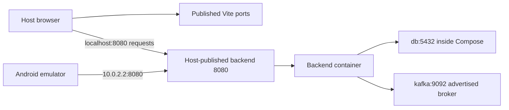

# Local development

[Overview](../README.md) · [Application guides](../README.md#1-applications) · [Testing](testing.md)

## 1. Execution status

Commands in this guide are derived from checked-in scripts/configuration and current local source. The documentation task did not install dependencies, start services, build applications or run application tests. They are instructions for a later development session, not verified pass results.

The directory containing `docker-compose.yml` is the project root. In some existing workspaces it is nested below another folder with the same name; run commands at the actual Git root.

## 2. Prerequisites

| Development path | Requirements from repository |
|---|---|
| Compose | Docker engine/Desktop with Compose; network for image/dependency downloads |
| Backend outside Docker | JDK 17, Maven wrapper, reachable PostgreSQL and Kafka |
| Web outside Docker | npm; Node satisfying locked Vite `^20.19.0 \|\| >=22.12.0` |
| Android | Android Studio, Android SDK compile 36.1/target 36, emulator/device minimum API 24 |
| Android build runtime | Java 21 Gradle daemon configuration, Gradle 9.5.0, AGP 9.3.0 configuration; app Java level 11 |
| PWA behavior | Production build and browser context supporting service workers; development deliberately removes workers |

Sources: [backend POM](../backend/pom.xml), [attendee lockfile](../frontend-attendee/package-lock.json), [organizer lockfile](../frontend-admin/package-lock.json), [Android build](../admin-app/app/build.gradle.kts), [Gradle JVM](../gradle/gradle-daemon-jvm.properties).

## 3. Clone and configure

```sh
git clone https://github.com/iuliamara/Untold-Festival-App.git
cd Untold-Festival-App
```

If already working in an existing checkout, reuse it. Preserve existing source and environment changes.

Create `.env` from [.env.example](../.env.example) only if it does not already exist. For PowerShell:

```powershell
if (-not (Test-Path -LiteralPath .env)) {
    Copy-Item -LiteralPath .env.example -Destination .env
}
```

Edit it locally. Secret values and seeded credentials are intentionally omitted from these guides.

| Variables | Purpose |
|---|---|
| `DB_NAME`, `DB_URL`, `DB_USERNAME`, `DB_PASSWORD` | PostgreSQL database and application/Flyway connection |
| `JWT_SECRET`, `JWT_EXPIRATION_MS` | Account JWT signing and lifetime; configured default lifetime 86,400,000 ms |
| `QR_SECRET` | Separate dynamic QR signing input |
| `STRIPE_SECRET_KEY`, `STRIPE_WEBHOOK_SECRET` | Stripe test integration and signed webhook parsing |
| `SPOTIFY_CLIENT_ID`, `SPOTIFY_CLIENT_SECRET`, `SPOTIFY_MARKET` | Spotify catalog search; default market RO |
| `KAFKA_BOOTSTRAP_SERVERS`, `KAFKA_CONSUMER_GROUP_ID` | Broker and consumer identity |

Configure all placeholders needed by Spring/Compose. Empty/unconfigured Spotify credentials lead to empty search results; valid credentials are needed for real Spotify data. iTunes import does not use Spotify credentials and may return mock fallback data on failure. Use Stripe test settings for development; the existing “test mode” comment does not enforce the supplied credential's mode.

[application.properties](../backend/src/main/resources/application.properties) additionally controls `festival.start-date`, flash-sale opening/total quantity, multipart limits, Flyway and observability. Festival fixtures conflict across clients; see [limitations](known-limitations.md).

## 4. Start Compose

```sh
docker compose up --build
```

Compose builds the backend and both web clients from development Dockerfiles and starts PostgreSQL, Kafka, Prometheus, Grafana, Loki and Promtail. Backend waits for healthy database/broker; web/Prometheus wait for backend TCP health. A listening port is not proof that seeding, payments, scans or streams work.

| Service | Host address | Container/internal detail |
|---|---|---|
| Attendee | `http://localhost:5173` | Vite development server |
| Organizer | `http://localhost:5174` | Vite development server |
| Backend | `http://localhost:8080` | Spring API |
| PostgreSQL | `localhost:5433` | `db:5432` on Compose network |
| Kafka | `localhost:9092` published | Advertises `kafka:9092` |
| Prometheus | `http://localhost:9090` | Scrapes `backend:8080/actuator/prometheus` |
| Grafana | `http://localhost:3000` | Anonymous Viewer enabled for development |
| Loki | `http://localhost:3100` | Log API; use Grafana to browse |
| Promtail | No published UI | Docker discovery and log shipping |

```sh
docker compose ps
docker compose logs --tail=100 backend
docker compose down
```

These inspection/stop commands are not substitute application tests. No destructive volume-reset command is required for normal setup.

### 4.1 Startup data behavior

[DatabaseSeeder](../backend/src/main/java/com/untold/backend/DatabaseSeeder.java) creates demonstration accounts and sample purchases, synchronizes map pins and missing enum tiers, imports artists, reconciles sold counts, and **deletes/reseeds all performances every startup**. There is no development-only seed profile guard.

Use a disposable development database until this is changed. The provided source creates local admin accounts; review their provisioning locally without publishing credentials. Do not use these seed records as verified official festival data.

## 5. Native backend

Root Compose `.env` is consumed by Compose; ordinary Spring execution does not load it automatically. Set environment variables through your IDE/process.

For PostgreSQL exposed by Compose, native `DB_URL` must use `localhost:5433` with the configured database. Compose's `db:5432` hostname/port is internal. The database healthcheck uses fixed names, so custom database/user names also require configuration review.

Kafka's published listener advertises the container hostname; native host clients need compatible broker/listener or hostname configuration. This repository does not supply a complete separate host-broker profile.

From `backend`:

```powershell
.\mvnw.cmd spring-boot:run
```

POSIX equivalent: `./mvnw spring-boot:run`. Maven wrapper properties select 3.9.16. The Docker command uses Java 17, source mounts, cached Maven dependencies, and skips tests. It is not a production artifact image.

## 6. Native web clients

Run separately in `frontend-attendee` and `frontend-admin`:

```sh
npm ci
npm run dev
```

Other defined scripts:

```sh
npm run build
npm run preview
npm run lint
```

Both builds run TypeScript then Vite. The attendee development watcher uses polling for Windows bind mounts. Preview uses Vite defaults; its port is not explicitly in backend CORS, so preview is not a guaranteed fully connected PWA demo without configuration work.

Most requests hardcode `http://localhost:8080`. Only selected organizer hooks/pages use `VITE_API_BASE_URL`. Attendee STOMP uses `ws://` plus browser hostname and port 8080. Network/HTTPS deployment requires coordinated code/configuration changes; there is no universal base-URL switch today.

## 7. Android Studio and networking

Open the root [settings.gradle.kts](../settings.gradle.kts); `:app` maps to `admin-app/app`. Install configured SDK/toolchains and select an emulator camera source.

The local wrapper JAR exists but is ignored/untracked by [root .gitignore](../.gitignore), while wrapper scripts require it. A clean clone's Gradle bootstrap is incomplete; restore that artifact through project build maintenance before using the wrapper. This documentation task does not regenerate it or install tools.

Android uses `http://10.0.2.2:8080/` for emulator-to-host REST and separately hardcodes the SSE URL. A physical device needs both addresses changed to a reachable host LAN address. Internet/camera permissions and cleartext development HTTP are declared in [AndroidManifest.xml](../admin-app/app/src/main/AndroidManifest.xml).

Login currently discards JWT. Backend reachability alone does not make protected scans/SSE work. [Android details](../admin-app/README.md).

## 8. Persistence and troubleshooting

| Symptom/expectation | Source-based explanation |
|---|---|
| Schedule edits disappear after restart | Seeder replaces performances |
| Android login works but scan/stats fails | JWT not retained/sent |
| Artist/person/crowd mutation fails in organizer | Missing Bearer header |
| Recipient does not receive transfer live update | EventSource/filter authentication mismatch |
| Signed Stripe webhook fails | Payment-family JWT rule |
| PWA changes invisible/worker absent in dev | Development unregisters workers/clears caches; production worker can cache prior resources |
| Preview/another device cannot call API | CORS and hardcoded localhost URLs |
| Grafana opens but no metrics | Verify backend/Prometheus target and logs; no runtime status is promised by docs |
| Media/import missing | External service/network dependency; iTunes may silently return mock fallback |
| Historical metrics/logs/queue disappear | Kafka/Prometheus/Loki lack named persistence; queue is in memory |

PostgreSQL and Grafana use named volumes; uploads use the backend bind-mounted directory. Monitoring containers are development services, not a secured production monitoring deployment.

[Observability](observability.md) · [Offline/realtime](offline-and-realtime.md) · [Known limitations](known-limitations.md)

## 9. Configuration walkthrough by process

### 9.1 Compose interpolation and application settings

Compose reads the root environment file and passes backend variables explicitly. DB_URL normally names the internal database service; PostgreSQL's own initialization uses DB_NAME/user/password settings. These must agree. Copying a template is not enough when provider/signing values remain placeholders.

Spring reads the passed environment through application.properties. Its datasource and Flyway connect to the same database, while Kafka connects separately. A local Maven process does not gain Compose's service-name DNS or automatic environment-file loading; configure an IDE/run environment rather than assuming the container settings transfer unchanged.

JWT and QR signing inputs are distinct so their rotation/lifetimes need not be identical. Stripe secret and webhook-signing settings serve different purposes. Spotify credentials support read-side track search, while numeric iTunes import has a separate network dependency. No credential values are needed in screenshots or documentation.

### 9.2 Browser-facing versus container-facing addresses



Frontend JavaScript runs in the browser, even when Vite runs in a container. Its localhost therefore means the browsing device. The backend's db/kafka hostnames mean Compose services. A physical phone browsing localhost cannot reach the host backend through that address, and a native host Kafka client cannot necessarily follow a container-advertised hostname.

The attendee STOMP URL uses browser hostname but still assumes port 8080 and cleartext ws. Other fetches mostly use hardcoded localhost. This mixed addressing needs coordinated configuration for device or HTTPS demos.

## 10. First-run demonstration sequence

After independently resolving environment/build requirements, use a disposable database and allow startup seeding to finish before evaluating a feature. Inspect logs/health for configuration failures, then public artist/performance/map reads, then account login, then protected requests.

A useful demonstration order is artist browsing, saved itinerary, map viewing, administrator tier/scheduler interaction, and reporting. Payment flows require valid Stripe test configuration. Android admission and receiver transfer SSE are known blocked integrations, not prerequisites to silently omit from a status report.

Do not edit the official program assuming restart persistence: the CommandLineRunner replaces performances. Imported artists may be mock fallbacks when external lookup fails. If the UI shows numbers, check whether they came from real queries or fallback examples before presenting them as data.

## 11. Production-build PWA inspection

The attendee npm build produces a production bundle, while Compose still runs npm dev. A preview can load that bundle and register its worker, but Vite's preview port is not explicitly in current backend CORS. Inspect the emitted address and adjust configuration in a separate authorized implementation task rather than claiming the preview is fully connected.

In development, main.tsx unregisters workers and deletes caches. For a later manual test, confirm the production worker is installed, warm the selected resources and then test network loss. Reconnect must be tested separately for cached reads, check-in replay, QR freshness and reminders; those are different mechanisms.

## 12. Environment failure diagnosis

When backend startup fails, separate missing property values from database DNS/port/authentication and broker connectivity. A running container with a TCP health result can still have application/provider problems. When a protected request fails after login, inspect whether the client actually attached the header before changing the account role.

For Android, confirm both hardcoded URLs, host reachability, cleartext permission and camera grant before evaluating barcode decoding. Even with those conditions satisfied, the current missing JWT remains an application blocker. Camera permission refusal does not currently offer the complete recovery flow requested in historical UI designs.

For monitoring, trace metrics and logs separately. Provisioned Grafana configuration is not telemetry history. PostgreSQL and Grafana volumes preserve different state; the absence of Kafka/Prometheus/Loki dedicated volumes must be accounted for in reproducibility expectations.

## 13. Setup review criteria

A later verification session should record the exact checkout state, Node/JDK/SDK versions, configured hostnames, database isolation, provider test mode and commands actually run. Do not convert commands in this guide into pass claims. The ignored Gradle JAR issue and current untracked migration/tests mean a fresh clone can differ materially from this working tree.
