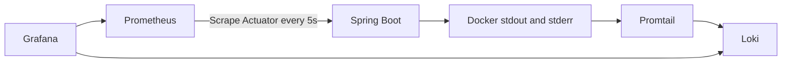

# Observability and rate limiting

[Overview](../README.md) · [Local development](local-development.md) · [Architecture](architecture.md)

The repository configures metrics, centralized log collection and a Grafana dashboard for development. Configuration exists; successful startup, ingestion and dashboard rendering were not verified during the documentation rewrite.

## 1. Metrics and logs



| Piece | Actual configuration | Source |
|---|---|---|
| Actuator/Micrometer | health, info, metrics, prometheus exposed; HTTP histograms and p50/p95/p99; Hikari pool named `UntoldHikariPool` | [application.properties](../backend/src/main/resources/application.properties), [POM](../backend/pom.xml) |
| Prometheus | Five-second scrape/evaluation interval; target `backend:8080/actuator/prometheus` | [prometheus.yml](../monitoring/prometheus/prometheus.yml) |
| Structured logging | Logstash JSON encoder on stdout with service field `untold-backend` | [logback-spring.xml](../backend/src/main/resources/logback-spring.xml) |
| Promtail | Docker socket discovery, container/stream labels, Docker log pipeline, Loki push | [promtail-config.yml](../monitoring/promtail/promtail-config.yml) |
| Grafana sources | Fixed UIDs `prometheus` and `loki`, proxy access | [datasources](../monitoring/grafana/provisioning/datasources/datasources.yml) |
| Dashboard | File provisioning, 30-second provisioning refresh | [dashboard provider](../monitoring/grafana/provisioning/dashboards/dashboards.yml) |

Promtail discovers available Docker containers rather than filtering specifically to this project. Docker socket/container-log mounts must exist in the selected Docker environment. Direct `System.out`/`System.err` and SQL output can remain unstructured despite the Logback encoder.

## 2. Provisioned dashboard

[Untold Backend Overview](../monitoring/grafana/provisioning/dashboards/untold-overview.json) defines:

| Panel | Data/query intent |
|---|---|
| HTTP Request Rate | Rate of server request counts grouped by URI |
| HTTP p95 Latency | Histogram quantile by URI |
| JVM Heap Memory Used | Heap usage across JVM memory areas |
| HikariCP Active Connections | Active and idle pool connections |
| Rate-Limited Requests | Increase of custom rejected-request counter |
| Backend Logs | Loki container-name selector for backend logs |

This is technical observability, separate from organizer business analytics. Organizer “Live Check-ins”, scanner speeds and staffing cards include hardcoded demo numbers; they are not backed by these panels.

## 3. Ticket rate limiter

[RateLimitingConfig](../backend/src/main/java/com/untold/backend/configs/RateLimitingConfig.java) registers a raw servlet filter for `/api/tickets/*` at highest precedence, before JWT/MVC processing.

[RateLimitingFilter](../backend/src/main/java/com/untold/backend/security/RateLimitingFilter.java) uses:

- Per-IP in-memory token buckets.
- Burst capacity **10**.
- Greedy refill **five tokens per second**.
- OPTIONS excluded from consumption.
- First forwarded IP from `X-Forwarded-For`, otherwise remote address.
- 429 JSON rejection with response CORS headers.
- Micrometer counter `ratelimit.rejected`, exposed as `ratelimit_rejected_total`.

The custom counter records rejections before MVC instrumentation; ordinary HTTP metrics alone are not the rejection counter. SSE routes are outside the ticket family so subscriptions do not consume these ticket tokens.

Limits are per process, not distributed, and buckets have no eviction. Trusted proxy validation is not configured. CORS/preflight behavior and legitimate multi-ticket QR bursts still need regression tests.

## 4. Local inspection

After independently starting services:

```sh
curl http://localhost:8080/actuator/health
curl http://localhost:8080/actuator/prometheus
curl http://localhost:9090/api/v1/targets
```

Open Grafana at [localhost:3000](http://localhost:3000) and find **Untold Backend Overview**. Development anonymous Viewer is enabled; no login credentials are reproduced here. Use Explore with the Loki source and selector `{container=~".*backend.*"}`.

These are suggested inspection commands, not recorded test results. Rate-limit behavior should be checked against the current burst/refill settings using controlled authenticated traffic in a disposable environment, not the old five-capacity/unauthenticated example.

## 5. Persistence and access boundaries

PostgreSQL and Grafana have named volumes. Prometheus/Loki/Kafka do not have dedicated persistent data volumes. File provisioning can recreate dashboards/datasources but cannot restore lost history.

Actuator routes are publicly permitted with health details enabled; Grafana enables anonymous viewing; monitoring ports are published. These are local development choices, not an access-controlled production setup. Prometheus/Grafana use floating `latest` images. Review versions, persistence, credentials, socket access and exposure before any shared deployment.

[Known limitations](known-limitations.md) · [Testing](testing.md)

## 6. Reading dashboard metrics correctly

### 6.1 Request rate and latency

The request-rate panel uses the increase/rate of http_server_requests_seconds_count grouped by URI. It measures instrumented server traffic, not ticket sales. Backend exceptions, browser retries and anonymous catalog polling can all affect it.

The p95 panel aggregates histogram buckets and applies histogram_quantile. Its value is a percentile estimate over the query window, not the configured client refresh interval or a measured service-level objective. No target latency or load-test result is asserted by this repository documentation.

### 6.2 Heap and pool connections

JVM heap panels sum heap-area usage; they do not represent container memory limits or native process memory in full. Hikari active/idle series describe the named UntoldHikariPool and help distinguish query pressure from capacity configuration. A low active count does not prove queries or startup seeding succeeded.

### 6.3 Rejected traffic

The custom ratelimit_rejected_total counter is cumulative for the running process; a range increase shows rejections during a window. Restart resets an in-process counter, and querying a larger time window is not the same as increasing configured bucket capacity.

The limiter protects /api/tickets servlet paths and excludes OPTIONS; other API families are not covered by this particular bucket. Initial QR bursts and sustained requests behave differently because ten tokens can be consumed immediately while only five replenish per second.

## 7. Query examples

These expressions mirror the provisioned dashboard and can be inspected manually after services run. They are not recorded outputs.

```promql
sum(rate(http_server_requests_seconds_count[1m])) by (uri)

histogram_quantile(
  0.95,
  sum(rate(http_server_requests_seconds_bucket[5m])) by (le, uri)
)

sum(jvm_memory_used_bytes{area="heap"})

hikaricp_connections_active{pool="UntoldHikariPool"}

sum(increase(ratelimit_rejected_total[5m]))
```

For logs, select the Loki datasource and first inspect the backend container selector. A JSON-field query is useful only for records actually encoded as JSON:

```logql
{container=~".*backend.*"}
{container=~".*backend.*"} | json | level="ERROR"
```

Plain System.out/SQL lines remain searchable text but may not carry level/service fields. The configured encoder does not transform every library/console write into the same structured event.

## 8. Log discovery and ingestion details

Promtail queries Docker discovery every five seconds, attaches container and stream labels and uses a Docker pipeline stage before pushing to Loki. Its positions file is under /tmp and has no dedicated persisted volume. Restarts can affect read position/history behavior.

The socket mount identifies containers, while the log-directory mount provides records in the configured environment. Discovery is not explicitly restricted to this Compose project. Access to the Docker socket is itself a deployment consideration, even when mounted read-only; no production access boundary is established by these files.

Logback's root logger sends structured application logs with the untold-backend service field. Application code also uses direct console writes, and show-sql can print SQL separately. A troubleshooting session should inspect raw records before assuming every message supports the same JSON filters.

## 9. Provisioning and startup diagnostics

Grafana datasource UIDs are fixed to match references in the JSON dashboard. The file provider refreshes dashboard provisioning every 30 seconds; this is configuration discovery, not a guarantee of data refresh frequency or business-event delivery.

A useful diagnosis order is backend health/metrics exposure, Prometheus target health, datasource URLs/UIDs, then dashboard queries. For logs, check container discovery/mount support and Loki push/query response independently from the metrics path. A working Grafana page does not prove either datasource has records.

If request metrics exist but the rejection panel is empty, distinguish no 429s from a query-window/process-reset issue. If a browser reports a network/CORS error, inspect the raw response rather than inferring a missing application route. These are review procedures, not verified results.

## 10. Business metrics versus technical monitoring

The organizer's sales totals come from ticket/domain queries and its operational cards include mock values. Prometheus counts HTTP/JVM/pool events. Entrance occupancy comes from IN/OUT logs and Kafka/SSE, while identity check-in completion is a ticket flag. None of these metrics should be substituted for another because their UI labels sound similar.

A future instrumentation change could add explicit business counters, but no revenue, scanner-speed or staffing metric should be invented from the current technical dashboard. [Reporting semantics](data-model.md) and [functional specifications](functional-specifications.md) document the actual data sources.

## 11. Source-derived verification checklist

After starting a disposable environment, inspect the four configured Actuator endpoints, scrape target, datasource UIDs, all six panel queries and both JSON/plain log examples. Controlled authenticated ticket traffic can confirm the limiter's burst/refill behavior and custom counter without relying on obsolete unauthenticated examples.

No automated dashboard, load or ingestion tests exist in the repository. Current public monitoring access, nonpersistent historical stores and floating image tags remain deployment limitations. The [full historical engineering note](design-specifications/6_rate_limiting_and_observability.md) and [English translation](design-specifications/6_rate_limiting_and_observability.en.md) preserve original rationale and examples separately.
