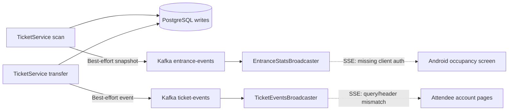
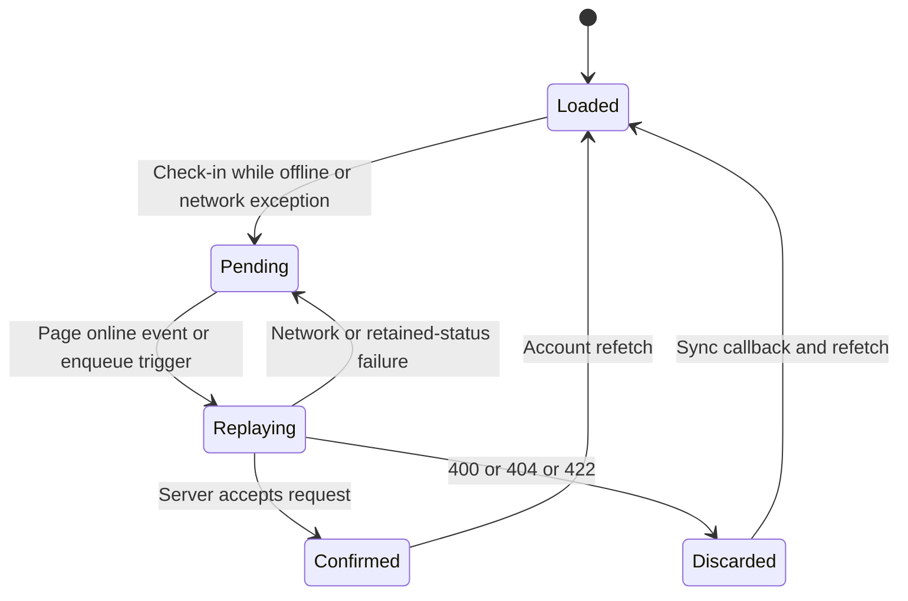

# Offline-oriented behavior and realtime delivery

[Overview](../README.md) · [Architecture](architecture.md) · [API](api.md) · [Limitations](known-limitations.md)

## 1. PWA lifecycle and caching

[main.tsx](../frontend-attendee/src/main.tsx) registers the service worker only when `import.meta.env.PROD` is true. Development unregisters existing workers and clears Cache Storage to avoid stale Vite resources. Running Compose's Vite development server does not demonstrate production PWA caching.

[manifest.json](../frontend-attendee/public/manifest.json) defines standalone display, app name/start URL, colors and SVG icons. It does not implement Wallet passes or guarantee installation behavior on every browser.

[sw.js](../frontend-attendee/public/sw.js) imports Workbox 6.4.1 from a CDN.

| Resource | Actual strategy |
|---|---|
| Initial shell | Precaches `/`, `/index.html`, favicon and manifest |
| Navigations | Network-first with cached index fallback |
| Scripts/styles/fonts/manifest | Cache-first; up to 100 entries, 30 days |
| Images | Stale-while-revalidate; up to 150 entries, 30 days |
| API GET paths containing `/api/` | Network-first; up to 100 entries, seven days |

This caches previously fetched resources; it does not preload the complete database, validate tickets offline or keep signed QR responses fresh. There is no explicit per-account partition/clear-on-logout policy for private GET caches.

## 2. IndexedDB check-in outbox

[offlineQueue.ts](../frontend-attendee/src/utils/offlineQueue.ts) opens `untold_offline_db` version 1 with auto-incremented `outbox` records containing URL, method, body, headers and timestamp. [MyAccount](../frontend-attendee/src/pages/MyAccount.tsx) uses it for identity check-in when offline or a request fails at the network level.

1. Save request body locally.
2. Mark the local ticket as pending sync and show copied identity fields.
3. When online/enqueue triggers replay, send requests sequentially with the current session token.
4. Delete successful requests; delete 400/404/422 responses as invalid/redundant.
5. Stop on other failures and retain remaining requests.
6. Notify the account page to refetch when synchronization finishes.

Replay runs in page code, not Service Worker Background Sync. It does not currently replay every queued request simply because an already-online page reopens, and it lacks explicit account partitioning and comprehensive reconciliation. Favorites and schedule changes do not use this outbox.

The optimistic `UNTOLD-QR-OFFLINE` string is a local placeholder, not a registered bracelet or valid offline admission credential. The account still renders the dynamic QR component, which requires server issuance. Cached dynamic payloads expire at backend validation.

## 3. QR freshness

[TicketService](../backend/src/main/java/com/untold/backend/service/TicketService.java) generates `UD1|rfidTag|issuedAtEpochSeconds|hmac`. HMAC-SHA256 is truncated to 16 hexadecimal characters and covers ticket ID, owner ID and issue timestamp. [DynamicTicketQr](../frontend-attendee/src/components/DynamicTicketQr.tsx) refreshes using a 30-second countdown/retry logic; the backend accepts at most 35 seconds of age with five seconds of future clock tolerance.

The gate app validates through the backend, not with a public-key/offline verifier. Raw bracelet identifiers are also accepted. These facts limit any anti-screenshot or offline-security guarantee.

## 4. Schedule polling and reminders

[Lineup](../frontend-attendee/src/pages/Lineup.tsx) fetches map/performance data every 20 seconds. Live/next-stage cards derive from time and status; the next set is limited to the current night and, during an active set, a 30-minute upcoming window. This is not pushed schedule-change notification delivery.

[ScheduleContext](../frontend-attendee/src/context/ScheduleContext.tsx):

- Loads personal slots on token changes and festival current-day metadata on mount.
- Waits for mutation responses before updating slot state.
- Checks reminders every 15 seconds.
- Supports offsets 0/5/10/15/30; 0 disables the reminder.
- Synthesizes two Web Audio beeps and optionally creates a browser Notification.
- Requests notification permission on an explicit button click.
- Tracks fired IDs in memory for that mounted context.

The loop stops with page closure/suspension and is subject to browser audio/notification policies. Device time zone and stale/null day metadata can affect reminders. A null festival day does not suppress all slots. There is no closed-app scheduler, server push, or historical notification inbox.

[Time helpers](../frontend-attendee/src/utils/schedule.ts) use a 06:00 rollover for chronological order/overlap and only compare slots on the same festival day. Saved slots remain copies without performance synchronization.

## 5. Flash-sale STOMP

The attendee connects to `ws://<browser-host>:8080/ws/flash-sale` and subscribes to `/topic/flash-sale`. Current [WebSocketConfig](../backend/src/main/java/com/untold/backend/configs/WebSocketConfig.java) registers a native endpoint and simple `/topic` broker; it does not call `withSockJS`.

[FlashSaleService](../backend/src/main/java/com/untold/backend/service/FlashSaleService.java) broadcasts remaining tickets, queue size and queue user IDs on queue changes and fulfillment cleanup. A REST snapshot supplies opening time and per-user state. There is no persisted queue/reservation, user-private queue topic, or periodic durable replay. Countdown parsing uses client date interpretation of a backend local datetime.

## 6. Kafka to SSE

Sources: [KafkaConfig](../backend/src/main/java/com/untold/backend/configs/KafkaConfig.java), [EntranceStatsBroadcaster](../backend/src/main/java/com/untold/backend/service/EntranceStatsBroadcaster.java), [TicketEventsBroadcaster](../backend/src/main/java/com/untold/backend/service/TicketEventsBroadcaster.java), [StreamController](../backend/src/main/java/com/untold/backend/controller/StreamController.java).

| Stream | Event behavior | Current connection boundary |
|---|---|---|
| `/api/stream/entrance-stats` | Immediate occupancy snapshot; named `entrance-stats` events on movements | Android sends no JWT; filter requires authentication |
| `/api/stream/tickets` | Named `ticket-event` to sender and recipient user IDs | Browser query JWT cannot satisfy preceding Bearer-only filter |

Emitter timeout is 30 minutes. Android reconnects after five seconds on close/failure; browser EventSource has automatic retry behavior. No heartbeat/replay protocol or exactly-once delivery is implemented.

Kafka publication is best-effort in business methods, without a transactional outbox. A database commit and broker event are not atomic. Group-based consumption and process-local emitters do not guarantee multi-instance broadcast to every connected client.

[Workflows](workflows.md) · [Roles](roles-and-permissions.md) · [Known limitations](known-limitations.md)

## 7. Connectivity state transitions

A page can be reachable while a particular external operation fails. The check-in queue specifically branches on navigator.onLine or fetch exceptions; an HTTP 400/401 is not the same as a network failure. Schedule/favorite/payment mutations do not all share that fallback. “Offline support” should therefore be read per operation, not as a global application mode.

The diagram describes source control flow rather than a durable outbox-state column. Records do not persist a separate Pending/Replaying enum; isSyncing and callback state are in memory.

## 8. Cache requests, responses and freshness

Workbox routing matches request destinations for static assets/images and URL paths for API GETs. Successful/cacheable responses have entry/age bounds, but a cache hit only proves a prior response is available. It does not prove the account is still authorized, the catalog is current or a QR issue timestamp remains valid.

NetworkFirst attempts network before cache fallback. Cached data is browser Cache Storage, not the IndexedDB outbox. This distinction matters to debugging: deleting a queued request does not clear a cached ticket listing, and refreshing preferences does not revalidate a signed credential.

Navigation fallback precaches base HTML, while runtime scripts/styles are cached after requests. No build-generated full dependency precache manifest is created by the current handwritten worker. First-load connectivity and the external Workbox import can therefore matter. The offline shell should be tested from an actually loaded production build, with known resources warmed, rather than assumed from the manifest alone.

## 9. Outbox ordering and reconciliation

Queued records preserve URL/method/body/headers/timestamp. syncOfflineQueue fetches all records and replays sequentially. A successful HTTP response removes the record, while selected permanent statuses are removed to avoid an indefinitely stuck queue. A retained-status failure stops later replay, preserving order rather than continuing arbitrarily.

MyAccount merges queued check-in bodies into fetched tickets to show a pending local person. This merge does not create a backend Person or Bracelet. Once synchronization calls back, a refetch replaces local display with server state. A server rejection may therefore undo a pending-looking success without a comprehensive per-request reconciliation history.

The module has one sync callback slot and an in-memory isSyncing guard. Reopening while already online is not a complete persisted retry scheduler, and sessions can change between enqueue and replay. Account identity, error visibility and cleanup are explicit follow-up concerns in known limitations rather than solved by IndexedDB's presence.

## 10. Notification timing examples

For a slot at 23:00 with offset ten, a check at 22:53 enters the allowed window and can fire. A check after the start does not. A same-time slot on another festival day is skipped only when currentFestivalDay is non-null and different.

The loop fires at most once per slot ID in that mounted context. It is not an exact operating-system alarm, and reloading during the window can reset in-memory deduplication. An alert message uses the configured offset rather than recomputed exact remaining minutes. [Personal scheduling](personal-scheduling.md) provides rollover math and permission states.

## 11. STOMP snapshot and incremental delivery

Tickets first fetches a REST state with open time and the account's queue status. The STOMP subscription then receives shared queue/stock snapshots. Its callback uses a user ref to resolve the current account against queue IDs rather than trusting a stale closure. Reconnect delay is five seconds in the client configuration.

A queue update is not a user-private admission token. The frontend derives whether its position is within remaining count; the server rechecks eligibility for purchase. The shared broadcast can expose queue IDs, and local queue state is not persisted across restart. Neither the initial HTTP snapshot nor a message reserves stock.

Native WebSocket is used with ws:// plus browser hostname/port; HTTPS/mixed-content routing and generalized deployment URLs are not completed by the current code. SockJS declarations do not supply an active fallback.

## 12. SSE subscription lifecycle and failure paths

EntranceStatsBroadcaster adds an emitter, sends a fresh occupancy snapshot immediately and removes it on completion/timeout/error. TicketEventsBroadcaster instead groups emitters by user ID and forwards transfer events to the two relevant accounts. Each connection lasts up to the configured 30-minute timeout; no periodic keepalive or last-event-ID recovery is implemented.

The browser relies on EventSource reconnect behavior, while Android increments a local attempt after a five-second coroutine delay. A reconnected entrance subscriber receives a new snapshot, but a reconnected ticket subscriber does not receive a durable transfer history. Refetching account data is therefore the authoritative way to inspect persisted ownership.

Current authentication mismatches prevent normal native/browser subscription establishment. The existence of reconnect logic does not repair those credentials. [Permissions](roles-and-permissions.md) explains the order of filter and controller validation.

## 13. Event durability and multiple instances

Kafka topics decouple producers from listener delivery inside this local architecture. They do not make SQL changes and broker sends atomic. Publication can fail, be delayed or precede transaction outcome; no transactional outbox is present. Transfer UI changes may complete even when delivery does not.

A shared consumer group assigns records among consumers. Since subscribers are held in a particular backend process, adding instances without redesign can route an event to a process with none of the affected user's emitters. The in-process STOMP broker/flash queue has a similar locality boundary. Current code does not establish distributed exactly-once or every-client broadcast guarantees.

## 14. Review examples for future verification

Use separate accounts to inspect cache/outbox isolation, expired JWT on replay, a permanent rejected check-in followed by another queued request, reopening while already online, and a production worker serving an expired QR response. Inspect database ownership separately from transfer notification arrival.

For scheduling, test page suspension, permission denial, daylight/time-zone changes and overnight festival-day transitions. These are proposed tests; this documentation task did not start services, change browser state or execute them.
