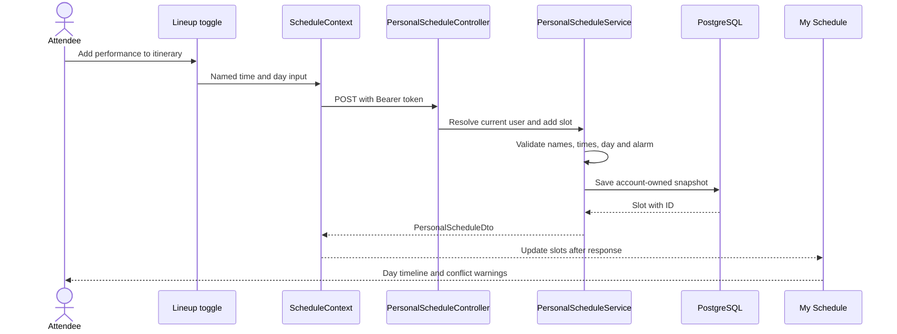

# Personal scheduling and reminders

[Functional specification](functional-specifications.md) · [User journeys](workflows.md) · [API](api.md) · [Historical engineering note](design-specifications/5_personal_schedule_feature.md)

## 1. Purpose and scope

Personal scheduling lets an authenticated attendee plan which performances to attend without changing the organizer's program. A saved slot contains the artist/stage labels, time interval, festival day and reminder lead time. The user can save overlapping plans deliberately; warnings help the user decide rather than prohibiting the plan.

This module is separate from artist favorites and physical attendance. Favoriting an artist does not create a slot. Entering/exiting a gate does not mark a slot attended. The backend persists account slots so another authenticated session can fetch them; it does not continuously synchronize open tabs or automatically reconcile a saved slot with an edited performance.

## 2. Component responsibilities and data flow



| Source | Responsibility |
|---|---|
| [Lineup](../frontend-attendee/src/pages/Lineup.tsx) | Reusable Add to Schedule control on cards/detail views; selects performance data |
| [ScheduleContext](../frontend-attendee/src/context/ScheduleContext.tsx) | Authenticated requests, slot state, current-day fetch, permission/reminder loop |
| [schedule utility](../frontend-attendee/src/utils/schedule.ts) | Types, alarm options, day labels, adjusted intervals and overlap logic |
| [MySchedule](../frontend-attendee/src/pages/MySchedule.tsx) | Day sections, today badge, named clashes, alarm selector and delete |
| [controller](../backend/src/main/java/com/untold/backend/controller/PersonalScheduleController.java) | Principal resolution and response/status mapping |
| [service](../backend/src/main/java/com/untold/backend/service/PersonalScheduleService.java) | Validation, owner checks, persistence mapping and optional request deduplication |
| [repository](../backend/src/main/java/com/untold/backend/repository/PersonalScheduleRepository.java) | Per-user listing and user/request lookup |
| [entity](../backend/src/main/java/com/untold/backend/model/PersonalSchedule.java) | Stored snapshot and user relationship |

## 3. Data representation and defaults

A PersonalScheduleDto has id, artistName, stageName, startTime, endTime, festivalDay and alarmOffset. Request input additionally permits clientRequestId. Times are five-character 24-hour strings, not full timestamps. Festival day is an integer 1-4; a newly created slot defaults to day 1 if absent. New alarm default is ten minutes.

The user relationship is a non-null foreign key with deletion cascade. There is no Performance or Artist FK. This supports a simple itinerary independent of catalog joins, but copied times/names can become stale. Updating an official performance does not rewrite personal rows.

V13 creates the table, V14 adds festival day and current untracked V15 adds a nullable client request ID plus partial unique index per user. Previous documentation's V8/V9 names were incorrect for the actual repository. [Migration details](data-model.md).

## 4. Saving, loading and removing slots

### 4.1 Initial loading

ScheduleContext observes the auth token. With no token it clears slots; with a token it sets loading, fetches the user's schedule with a Bearer header and replaces state from the response. My Schedule renders a loading panel, an empty-state explanation or four day sections. Loading failure is logged, with no complete dedicated error/retry screen.

Current festival-day metadata is fetched separately once on mount. The backend uses configured start date and Bucharest calendar date to return 1-4 or null. This drives visual Today highlighting; it does not make the timer's device clock use Bucharest automatically.

### 4.2 Add/remove toggle

The lineup supplies artist/stage/times/day. The context searches existing slots by matching artistName and stageName. If found it sends DELETE; otherwise POST. A successful response updates state; failed/non-OK results do not optimistically add/remove the slot.

A card chooses its artist's earliest performance for this operation; detail overlays can use the selected set. The name-pair identity can conflate repeated bookings of the same artist on the same stage on different days. There is no performance-ID-based uniqueness rule.

### 4.3 Explicit deletion

My Schedule's delete control calls the owner-scoped DELETE. Success removes the row from client state and removes its ID from the notified set. A future newly saved row receives a new database ID. The server returns not-found semantics for another user's ID, avoiding a separate existence disclosure.

There is no offline schedule mutation queue. If the page cannot reach the backend, the source logs failures rather than treating a local change as durably saved.

## 5. Backend validation and editing

Names must be present/nonblank, with trimmed length at most 255. startTime/endTime must match two-digit HH:mm and parse as valid LocalTime. Identical start and end is rejected. End before start can represent crossing midnight and is not rejected simply for that ordering.

Non-null day must be 1-4; supported alarm offsets are 0, 5, 10, 15 or 30. Creation applies defaults. Full update sets names/times/day, trims updated names and preserves an omitted alarm. The current full-update validation permits null day but persistence does not; callers should supply it. This is an implementation gap, not an optional-day guarantee for PUT.

Optional creation clientRequestId must contain 1-36 nonblank characters. A valid repeated request for the same user returns the existing slot rather than saving another. This is a backend facility, with database support in V15; the current attendee context does not send IDs or use full-slot PUT. Concurrent duplicate handling is not complete.

The service loads a slot then checks user ownership for PUT, alarm change and DELETE. Invalid data maps to 400 in controller handling; missing/other-owner slots map to 404 when reached. The security filter requires authentication before controller resolution.

## 6. Chronological time model

### 6.1 Rollover adjustment

Festival sets commonly cross midnight. A raw lexical sort would place 00:30 before 23:00, even when both belong to one festival evening. The helper adds 24 hours to times before 06:00.

```ts
// Equivalent explanation of the source helper:
const minutes = hours * 60 + minute;
const adjusted = hours < 6 ? minutes + 24 * 60 : minutes;
```

Examples:

| Time | Adjusted minutes |
|---|---|
| 18:00 | 1080 |
| 23:00 | 1380 |
| 00:30 | 1470 |
| 05:30 | 1770 |
| 06:00 | 360, the next logical day's boundary |

These values express logical ordering, not elapsed epoch time. getSlotRange adjusts the end by another 24 hours if it is not after the adjusted start. It therefore supports intervals crossing the selected rollover boundary as well as midnight.

### 6.2 Overlap predicate

Two saved slots overlap only if their festivalDay is equal and their adjusted ranges satisfy:

```text
a.start < b.end AND b.start < a.end
```

For day 2, 23:00-00:30 overlaps 00:15-01:00 because [1380,1470) intersects [1455,1500). A set starting exactly at 00:30 is adjacent rather than overlapping. The same clock intervals on different festival days do not clash.

My Schedule compares every pair of the account's slots, collecting clashing IDs and artist names. The number of comparisons is quadratic in the small personal list; no benchmark or large-schedule performance result is claimed.

### 6.3 UI behavior

Rows display start/end times, artist and stage. Clashing rows receive a warning treatment and a banner naming other artists. Warnings do not prevent persistence, deletion or alarm changes. Day headers still render when a day has no saved rows, with an empty-day explanation.

These checks are planning aids, not the organizer's same-stage blocking validation. The organizer works from timestamped Performance rows; this module works from copied HH:mm/day snapshots.

## 7. Reminder configuration and execution

### 7.1 User interaction and permission

The per-slot selector offers No alarm and 5/10/15/30 minutes before start. PUT to the alarm endpoint updates the server and then the client. My Schedule shows permission state: an enable button when permission is undecided, an active badge when granted, and blocked/unblock guidance when denied. Unsupported Notification environments are represented in context.

Permission is requested only from an explicit user gesture. Sound uses Web Audio independently of Notification permission, but browser audio policy still applies; lack of a sound file does not guarantee audible playback on every platform.

### 7.2 Polling window

The context checks immediately when the effect runs and every 15 seconds. It obtains device-local hours/minutes, applies the same rollover adjustment, and skips disabled/already-notified IDs. If currentFestivalDay is non-null it skips other saved days.

The reminder fires the first time minutesUntilStart is within [0, alarmOffset], rather than requiring exact equality. If a tab was inactive at precisely ten minutes before the set, a later poll can still trigger within the window. The notification body names artist/stage and configured offset; it does not recompute its displayed number to the exact remaining minute.

### 7.3 Sound and de-duplication

Two ascending sine beeps are synthesized around 880 Hz and 1108.73 Hz with short gain envelopes. This avoids an external notification-audio dependency. The notified set is an in-memory ref keyed by slot ID. A slot fires at most once for that mounted provider unless removed/re-added; changing its offset does not explicitly re-arm an already fired ID.

The state is not a durable per-day notification history. Reloading recreates the provider and can permit another reminder in the same window. There is no server delivery record or scheduled operating-system alarm.

### 7.4 Lifecycle boundary

The loop is page JavaScript. Closing the tab, suspending execution or device sleep can stop/delay it. It is not implemented through Service Worker wake-up timers, Push API or Android AlarmManager. It may run without network if all needed state remains loaded, but that is distinct from guaranteed offline/closed-app delivery.

## 8. API and example input

The module exposes GET/POST /api/my-schedule, PUT/DELETE by ID and PUT by ID/alarm with required offset query.

An illustrative non-sensitive creation body:

```json
{
  "artistName": "Example Artist",
  "stageName": "Example Stage",
  "startTime": "23:00",
  "endTime": "00:30",
  "festivalDay": 2,
  "alarmOffset": 10
}
```

This does not create data by being documented and is not a live seeded performance. The actual principal is supplied through Bearer authentication. The backend accepts names without checking a corresponding catalog booking, consistent with the snapshot model.

## 9. Tests and review cases

Current focused service tests check preserving an omitted alarm on update, rejecting another user's update, rejecting invalid day, and returning the existing row for repeated request ID. They are local/untracked tests and were not run in this task.

Additional source-derived review examples include midnight overlap versus adjacency, different-day nonconflict, disabled reminders, denied permission, null day metadata, a device in another time zone, repeated same-artist/stage bookings and reopening during a reminder window. These are proposed verification cases, not existing automated coverage.

## 10. Implementation status and related design

Persistent account slots, day display, nonblocking conflicts and configurable open-page reminders are implemented. Remaining gaps are concentrated in schedule identity/reconciliation, calendar/rollover consistency, reminder lifecycle, request-ID client adoption and error recovery. A null current day presently does not suppress all reminders, and mount-only day metadata can become stale.

Detailed cross-cutting issues remain in [known limitations](known-limitations.md). The [original personal-schedule specification](design-specifications/5_personal_schedule_feature.md) is preserved in full so its rationale and examples can be reviewed against current behavior.
