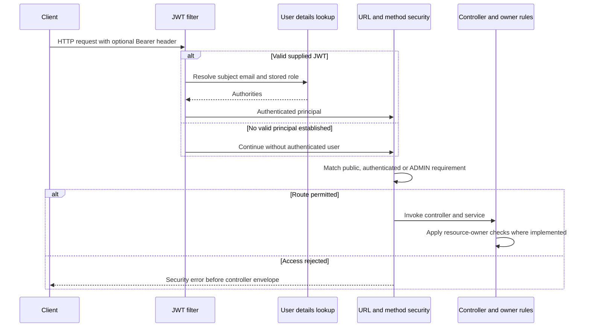

# Roles and permissions

[Overview](../README.md) · [API contracts](api.md) · [Limitations](known-limitations.md)

This page describes the current working tree, including local changes in [SecurityConfig](../backend/src/main/java/com/untold/backend/configs/SecurityConfig.java) and [AuthController](../backend/src/main/java/com/untold/backend/controller/AuthController.java). Older comments/specifications claiming all API routes are public are stale.

## 1. Role model

[UserType](../backend/src/main/java/com/untold/backend/model/UserType.java) contains exactly `ADMIN`, `PARTNER` and `ATTENDEE`. Organizer and gate operator both use `ADMIN`. Staff job titles are sample UI data; Super Admin, Scheduler and Box Office Manager are historical requirements, not implemented roles.

| Access level | Permissions |
|---|---|
| Anonymous | Auth endpoints; public artist/performance/map/tier/festival/flash-sale/crowd reads; uploaded files; configured Actuator endpoints and WebSocket connection |
| Authenticated account | Ticket/payment/flash-sale families unless overridden; own favorites/schedules and own PDF; stream fallback access |
| `ATTENDEE` | Authenticated permissions plus explicit eligibility to transfer owned unchecked-in tickets to other attendees |
| `ADMIN` | User/person/artist/song/map/crowd mutations, performance mutations, tier mutations, all tickets/stats, gate scans, analytics/export |
| `PARTNER` | Assignable role with baseline authenticated access; no partner-specific module or exclusive workflow |

Administrators can manage users through the API. Public registration ignores the submitted role and creates `ATTENDEE`. Ordinary login accepts valid accounts of any role; dedicated admin login rejects non-admin accounts.

## 2. Authentication flow

1. [AuthService](../backend/src/main/java/com/untold/backend/service/AuthService.java) hashes registration passwords with BCrypt and compares hashes on login.
2. [JwtTokenProvider](../backend/src/main/java/com/untold/backend/security/JwtTokenProvider.java) issues HS256 JWTs containing email subject, issue time and expiration.
3. [JwtAuthenticationFilter](../backend/src/main/java/com/untold/backend/security/JwtAuthenticationFilter.java) reads only `Authorization: Bearer <token>`.
4. [CustomUserDetailsService](../backend/src/main/java/com/untold/backend/security/CustomUserDetailsService.java) reloads the user by email and maps the stored role to `ROLE_<type>`.
5. URL rules and enabled method-level `@PreAuthorize` enforce access.

Sessions are stateless; CSRF is disabled. Both web clients use session storage for token/user data. Logout clears client storage, not a server revocation list. No refresh token, MFA, email verification or password-reset implementation was found.

## 3. URL rules and method checks

| Route family | Effective rule |
|---|---|
| `/api/auth/**` | Public |
| GET artists/performances, current day, active map, tiers, flash status, crowd reads | Public before broader rules |
| `/api/users/me/**` | Authenticated before admin users rule |
| `/api/admin/**`, other users/persons/map/crowd/artists routes | Admin |
| `/api/favorites/**`, `/api/my-schedule/**` | Authenticated |
| `/api/tickets/validate-qr`, `/api/tickets/stats/**` | Admin |
| Other ticket/payment/flash routes | Authenticated; ticket list/tier mutations add admin method checks |
| Performance mutations | Authenticated fallback plus admin method checks |
| `/uploads/**`, `/actuator/**`, `/ws/**` | Public at filter level |
| Other routes, including SSE | Authenticated fallback |

CORS permits an explicit set of local development origins and methods. It is not authorization. Invalid/missing-token requests may be rejected by Spring Security before a controller constructs its own 401/error envelope.

## 4. Resource ownership

| Operation | Owner binding |
|---|---|
| Schedule list/create | Uses authenticated user |
| Schedule update/alarm/delete | Requires slot owner; other-owner slots return not-found semantics |
| Favorite operations | Uses authenticated user |
| PDF export | Resolves current user's email |
| Dynamic QR | Requires ticket owner |
| Transfer | Requires owner, attendee sender/recipient, no check-in and no self-transfer |
| Ticket listing by user ID | No caller-to-user comparison |
| Single/bulk purchase and checkout | Submitted user ID is not tied to caller |
| Identity check-in/direct top-up/top-up checkout | Ticket ID is not owner-bound |
| Flash-sale join/leave/purchase | Submitted user ID is not tied to caller |
| Payment confirmation | Session fulfillment is not bound to caller's account |
| Entrance SSE | Authenticated fallback only; no admin-specific controller rule |

These gaps describe current behavior, not intended permissions. Do not interpret authenticated access as proof of resource ownership. Evidence: [TicketController](../backend/src/main/java/com/untold/backend/controller/TicketController.java), [PaymentController](../backend/src/main/java/com/untold/backend/controller/PaymentController.java), [FlashSaleController](../backend/src/main/java/com/untold/backend/controller/FlashSaleController.java), [PersonalScheduleService](../backend/src/main/java/com/untold/backend/service/PersonalScheduleService.java).

## 5. Integration mismatches

- Android keeps only username, so protected scans/SSE lack authentication.
- Browser `EventSource` sends the ticket-stream JWT in a query parameter; the filter requires Bearer authentication before controller query-token validation can run.
- Stripe sends a signed webhook but no application JWT; the current payment-family rule blocks that request.
- Organizer artist/person/crowd mutations omit the required Bearer header.
- Flash-sale STOMP broadcasts include the queue user-ID list without per-user subscription authorization.

[StreamController](../backend/src/main/java/com/untold/backend/controller/StreamController.java) validates query tokens itself, but that does not bypass the preceding security filter. No tokens or credentials should be copied into logs, screenshots or documentation examples.

## 6. Credential and session lifecycle

### 6.1 Registration and login results

Registration validates duplicate email through the service, hashes the submitted password and saves an ATTENDEE. It returns an auth envelope immediately; there is no verify-email pending state. Ordinary login verifies the stored hash and can authenticate any stored role. Admin-login first verifies credentials, then rejects a valid non-admin account.

Tokens contain email subject, issue time and expiry. Role authorities are reconstructed from the current database user on each authenticated request, rather than trusted from a client role field. Changing an account's role can therefore affect subsequent requests without issuing a token containing a new role claim. Changing/deleting the email subject can make the old subject lookup fail.

### 6.2 Browser versus native persistence

Web auth storage holds both user display data and token in session storage. It supports same-tab refresh, but neither the stored role nor a token's mere presence proves server authorization. Organizer App checks token presence, while Login checks the returned role; API calls still require filter/method enforcement.

Android saves only username, so its local navigation can reopen the scanner without server credentials. Logout clears that local state. Neither client implements a server revocation list or token-refresh protocol. These observations describe lifecycle behavior, not a recommendation to copy tokens into URLs or logs.

## 7. Authorization processing sequence

The filter catches token/user-resolution exceptions and continues the chain; access rules determine whether the resulting unauthenticated request can proceed. A public artist read can succeed without a principal, while a protected ticket read cannot. Controller-local 401 branches are not the only possible response, since the filter chain can reject before invocation.

## 8. Owner checks versus commercial eligibility

A transfer needs three independent facts: authentication, ownership and attendee eligibility. ADMIN has administrative permissions but is explicitly excluded from the attendee transfer workflow. The target must be a registered attendee account, cannot be the caller, and the ticket must not have completed identity check-in.

Dynamic QR requires owner plus a checked-in bracelet, but does not add the same attendee-role restriction as transfer. Personal schedules/favorites use current account identity and are not limited to ATTENDEE at URL level. This difference should be preserved in tests and API consumers rather than replaced with a broad “all attendee features are attendee-only” statement.

Public tier/crowd/catalog endpoints also expose data independently of the organizer UI gate. Hiding a menu item is not a server permission. Crowd reads include reporter/notes; current API configuration does not make them private merely because creation is administrative.

## 9. Boundary examples and expected handling

An owner can request their QR, but an authenticated different owner is denied. A schedule belonging to another account is treated as not found on mutation. An ADMIN performance request can still fail validation for overlap/non-stage pin. An anonymous flash status read may succeed while a join requires authentication.

By contrast, current ticket-by-user, check-in, direct credit, checkout/session and flash-user-ID operations do not uniformly bind submitted resource identity to the caller. [Known limitations](known-limitations.md) records those gaps; this page does not redefine them as intended cross-account privileges.

## 10. Configuration implications

CSRF is disabled with stateless sessions and clients use Bearer headers rather than authenticated cookies. CORS permits explicit local origins and supported methods; it controls browser exposure, not account authorization, and is not a defense for a non-browser client.

Actuator/uploads/WebSocket paths are public by rule. Entrance SSE falls through to authenticated access without an ADMIN-specific controller check. Ticket SSE separately validates a URL token after the filter, which does not satisfy the filter's initial authentication requirement. Provider webhook authorization likewise needs its own deliberate contract rather than accidental inheritance from a browser route family.

## 11. Verification criteria

Existing focused registration tests check forced role assignment, and schedule service tests cover one other-owner update case. There is no complete filter-chain/role/owner regression suite. A future test matrix should exercise anonymous, attendee, partner, admin, owner, non-owner and expired-token cases against each protected route family.

Those are source-derived review cases, not tests executed by this task. [Testing](testing.md) provides current coverage and commands.
