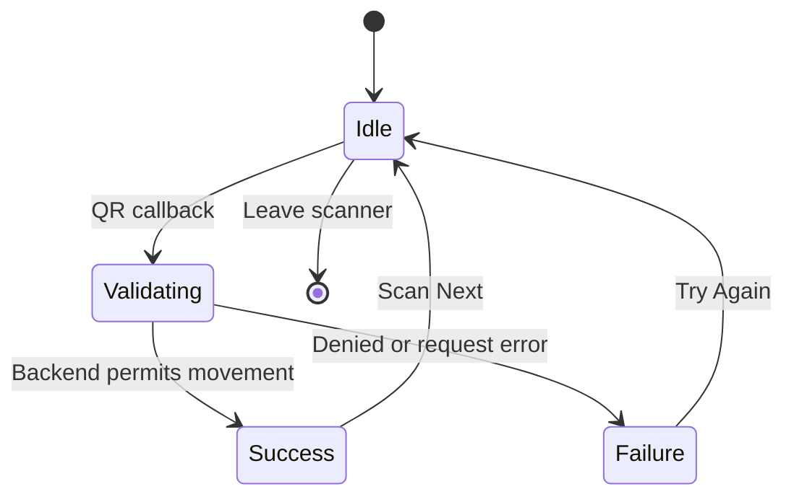

# Current UI and interaction specification

[Project overview](../README.md) · [Functional specification](functional-specifications.md) · [User journeys](workflows.md) · [Historical UI targets](design-specifications/4_ui_ux_specification.md)

## 1. Scope and design sources

The three clients have distinct interaction contexts: mobile-oriented attendee browsing, a desktop organizer workspace and a camera-first native gate interface. They share business data, not one universal theme or navigation system. This specification describes visible source-defined states without asserting a visual, accessibility or device test.

Actual design inputs are [attendee Tailwind](../frontend-attendee/tailwind.config.js), [attendee CSS](../frontend-attendee/src/index.css), [organizer CSS](../frontend-admin/src/index.css) and [Android Compose](../admin-app/app/src/main/java/com/example/admin_app/MainActivity.kt). Historical tokens and unimplemented gestures are retained separately.

## 2. Attendee web presentation

### 2.1 Typography, color and layout

The attendee uses dark surfaces, light purple primary accents, cyan/teal secondary emphasis, translucent panels and gradients. Tailwind defines semantic surface/on-surface/outline/error tokens and custom spacing/type scales. Font configuration uses Anton for large display/headline text, Geist for labels and Hanken Grotesk for body text. Fonts and Material Symbols are external assets.

Pages use responsive utility classes for mobile/desktop margins, columns and font sizes. Artist and ticket cards combine imagery with layered text/gradient backgrounds. Loading, empty and error messages are present in particular components, but there is no verified application-wide design-system conformance result.

### 2.2 Navigation and preferences

[Navbar](../frontend-attendee/src/components/Navbar.tsx) is a fixed top navigation with desktop links and a mobile expandable menu. It changes background treatment on scroll. Links include lineup, tickets, gallery, account/cart and personal schedule where applicable. The preference dropdown selects language/currency; the auth state changes account/logout versus login actions.

A mobile menu link closes the menu after selection. A router helper scrolls to top on route change. This is not the historical five-action bottom-navigation or pull-to-refresh design. [Footer](../frontend-attendee/src/components/Footer.tsx) links policy/terms, while Press remains a placeholder link.

### 2.3 Authentication and form feedback

[Auth](../frontend-attendee/src/pages/Auth.tsx) uses a background slideshow, labeled credentials and registration/login switching. During submission the view tracks loading and presents a server/network error. Successful authentication navigates to the prior requested path or account.

My Account keeps identity forms per ticket, so editing one ticket does not overwrite another ticket's input state. Labels, required fields, document selection and declaration acknowledgement precede submission. Failure uses alerts/messages; this is not a complete inline field-error/assistive-technology validation system.

### 2.4 Artist discovery and music

Artist cards show image/name/genre, a favorite control and schedule action when performance data is available. Favorite mutation has a pending state. Genre and favorites-only filtering affect the loaded list; these are browsing controls, not stored organizer tagging operations.

Top Tracks expands an overlay panel lazily and distinguishes loading, no results and failure. Each returned track has a Spotify iframe. Set detail is a modal overlay with close interaction, profile/music and scheduling actions. The global floating player is a separate persistent control with expandable playback panel and audio-reactive intensity.

Sources: [Lineup](../frontend-attendee/src/pages/Lineup.tsx), [MusicPlayer](../frontend-attendee/src/components/MusicPlayer.tsx).

### 2.5 Timeline, itinerary and conflicts

The schedule tab has a day selector, stage rows and time-positioned set blocks. Clicking a set opens detail. Visual status can distinguish LIVE/DELAYED/CANCELLED and favorite conflict information. The attendee matrix is horizontally structured stage/time planning, not the exact orientation described by the earliest design mock.

My Schedule renders four day sections, optional Today emphasis, sorted cards and empty-day messages. Alarm selectors and delete controls stay with each slot. Conflict cards use error color/border/animation and identify the conflicting artist names. The action remains allowed; visual warning is not server rejection.

[Personal scheduling](personal-scheduling.md) defines the exact time behavior. Layout/color animation alone does not prove reminder delivery or automatic itinerary reconciliation.

### 2.6 Tickets, transfers and balance

Ticket cards show commercial type/pricing and purchase/check-in state. After identity check-in, the QR area uses a white high-contrast surface with an SVG code and countdown ring. Nearby panels display the identifier and balance/top-up controls.

Transfer opens a focused modal with destination email, validity/submitting state and server error. Success animates the sender card away and shows a toast. That local animation is independent of the incomplete receiver SSE connection.

Offline check-in presents Pending Sync and copied identity details. Its “completed” wording describes a local pending state rather than backend admission. Freshness/offline validity should be interpreted according to [offline behavior](offline-and-realtime.md), not solely the badge color.

### 2.7 Flash-sale states

The ticket page separates normal offers and flash sale. Countdown/loading, upcoming/open, queue position, eligible purchase and sold-out conditions determine messaging/actions. Join/leave/purchase requests disable controls while loading and can display errors or success text.

Changing away from the flash tab while queued prompts a leave confirmation. Browser unload warning protects against accidental departure but does not persist queue membership or guarantee cleanup. Stock/status badges are views of server/broadcast information, not inventory reservations.

### 2.8 Information and localization

The gallery uses a masonry-like image layout and hover captions, followed by location information and expandable FAQ entries. External directions open Google Maps. Policy pages switch EN/RO text through the preference context.

Several recent screens include hardcoded Romanian/English strings outside dictionary lookup. Currency formatting follows preference and fixed rates. User-facing text is therefore only partially localized; a language menu is not evidence of a full translation audit.

## 3. Organizer desktop workspace

### 3.1 Theme and layout

The organizer uses light/lavender surfaces, purple controls and coral/status accents. CSS sets Plus Jakarta Sans body typography and Outfit headings. Sidebar navigation is persistent; the main content area scrolls beneath a fixed-height header.

Header displays stored account name/role and logout. Its notification bell is decorative/placeholder. Source defaults for missing user display are not actual staff accounts. Sources: [DashboardLayout](../frontend-admin/src/components/DashboardLayout.tsx), [Sidebar](../frontend-admin/src/components/Sidebar.tsx), [Header](../frontend-admin/src/components/Header.tsx).

### 3.2 Tables and selection

[GenericTable](../frontend-admin/src/components/GenericTable.tsx) receives column renderers and data, with default ten rows per page. It shows page controls and bounded previous/next navigation, condensed page numbers for longer datasets, empty messages and optional row click/double-click/hover behavior.

Changing data identity resets pagination. External selection can select the page containing a pin. This lets map and table views coordinate without server pagination. Hover/selected-row styles distinguish transient focus from persisted object changes.

### 3.3 Scheduling workspace

Artist directory and stage/time matrix lead to form dialogs for scheduling. Artist/stage selects, day/time inputs and state choices determine the payload. Same-stage server errors are displayed; artist conflict warnings remain visible after loading.

Creation/editing uses dialogs and explicit save/delete controls. There is no drag/drop affordance with persistence, no publication toolbar with draft state and no implemented configurable buffer. [Organizer Lineup](../frontend-admin/src/pages/Lineup.tsx) is the current interaction reference.

### 3.4 Map editor interactions

The editor combines image canvas-like presentation, typed pin overlays, filtering controls and a table. Background click places a new pin unless an existing selection is being cleared. Single click selects a pin and can switch category tabs; double-click opens edit.

Local create/edit/delete confirmation changes editor state, while Save Layout persists the complete arrangement. Upload progress, toast messages and loading states provide feedback. This local-versus-saved distinction is essential to interpreting the editor.

[MapEditor](../frontend-admin/src/pages/MapEditor.tsx) uses portal/dialog overlays and percentage coordinates. It does not implement real geographic coordinates, route finding or physical device positioning.

### 3.5 Ticketing, records and reporting

Tier management has search/category/status controls and a create/edit dialog. Sales Ledger and dashboard tabs use cards, charts/visual summaries and tables. Backend failures can substitute mock analytics; a visually populated chart does not prove a live query succeeded.

Person/crowd forms support creation/editing and confirmation of deletion. Their current auth integration gap is documented in functional specifications rather than presenting the visible form as operational proof. The Excel download exposes progress and error state and produces a browser attachment.

### 3.6 Demonstration-only surfaces

Staff reassignment changes local roster state and temporary success text. Events, announcements, settings and support show intended product areas without full operational handlers. They should be labeled in portfolio demonstrations; screenshots must not imply delivered broadcast/staff configuration.

## 4. Native Android gate interaction

### 4.1 Visual language

The native UI uses dark Compose surfaces, a deep-violet gradient and pink accent, separate from the organizer's light theme. MainActivity defines its own UntoldTheme and scanner elements. Existing ui/theme files should not be taken as proof that every template theme is active.

### 4.2 Login

The operator sees email/password fields, password visibility toggle, loading indicator and error text. Login changes to scanner only after a parsed user response. A stored username restores local navigation; it is not an authenticated server state.

### 4.3 Camera and scan states

The camera preview fills the scanner area with a reticle/HUD overlay. Header actions expose operator name, statistics and logout. An IN/OUT toggle changes the direction captured for the next validation.

Idle, Validating, Success and Failure drive overlay/card content. Successful validation displays participant and ticket information; failure displays its reason or a transport message. Scan Next/Try Again resets the state. Camera denial shows an explanatory message without an in-app settings/retry control.

### 4.4 Occupancy

The statistics screen has back navigation, a large count or loading spinner, and a connection-status dot/text. SSE callbacks update the count and schedule reconnect attempts. Without token integration it remains a disconnected implementation path; presentation is not proof of event delivery.

## 5. State transitions and feedback contract

The state diagram reflects Android UI states, not cryptographic validation stages. Authorization may reject the request before business validation; the client currently maps that to failure.

Across web forms, successful persistence generally causes refetch/confirmed local replacement. Exceptions include deliberately optimistic offline check-in and local editor/staff changes. Product explanations must name which type of state is being shown.

## 6. Accessibility and review boundaries

The source includes some labels, aria attributes and keyboard form behavior, but no comprehensive accessibility audit. Historical minimum-target dimensions, app-like gestures and motion quality are requirements rather than measured results.

A future review should check focus trapping/return in modals, keyboard equivalents for map double-click, contrast, reduced motion, zoom restrictions in the attendee viewport, iframe titles, image alternatives, inline field errors and screen-reader announcements for toasts/scans. These are proposed verification cases, not claims of implemented compliance.

## 7. Implementation evidence and historical separation

Use [functional specifications](functional-specifications.md) for business behavior and [known limitations](known-limitations.md) for cross-cutting gaps. The [original UI/UX document](design-specifications/4_ui_ux_specification.md) remains complete, including its proposed tokens, layouts, animation snippets and target interactions; it is not silently substituted with this current-state description.
