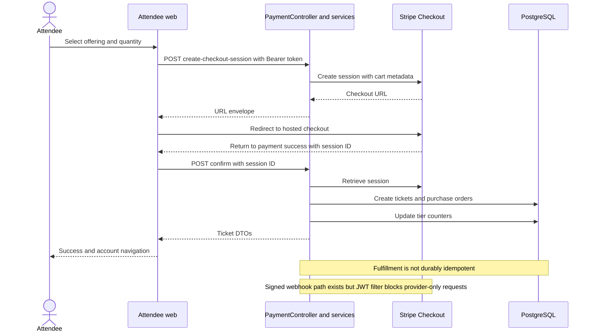
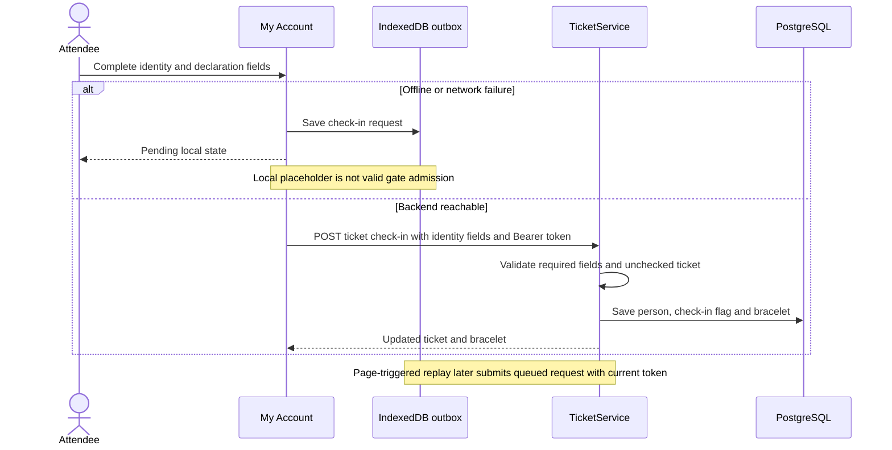
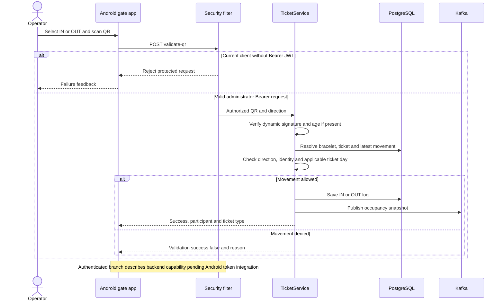
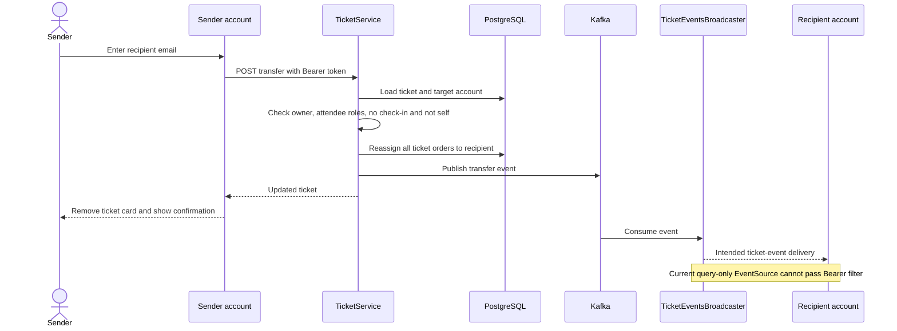
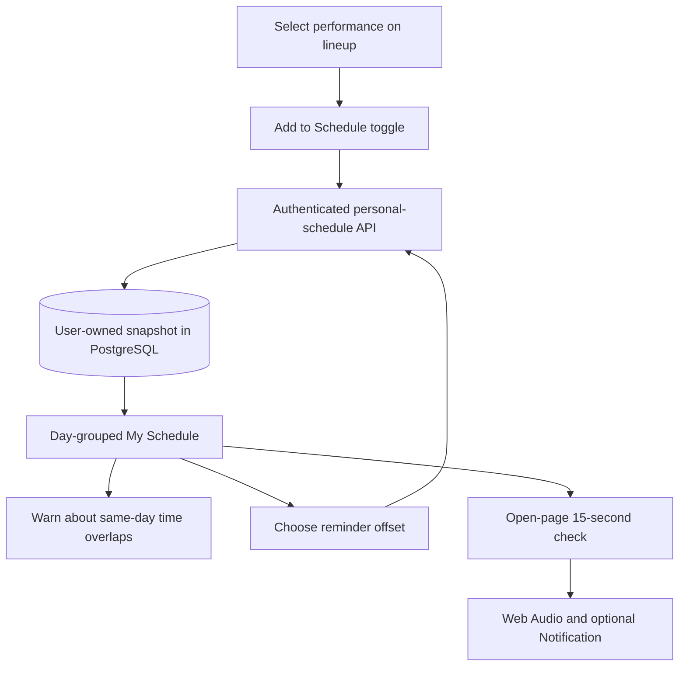
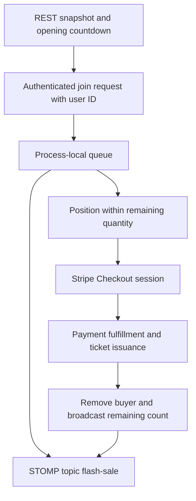

# Current user journeys

[Project overview](../README.md) · [Functional specifications](functional-specifications.md) · [API contracts](api.md)

The personas below are illustrative users, not real accounts or contribution claims. Andrei represents an attendee, Elena an organizer, and the operator a gate administrator. Steps describe code-supported interactions, not a record of successful execution. For incomplete flows, the supported stopping point and backend/intended continuation are stated separately.

## 1. Account registration and authentication

**Goal and preconditions.** Andrei needs an account before purchasing, saving favorites or managing tickets. The attendee web application and backend must be reachable; the browser may preserve a return route from the action that required login.

1. Andrei opens Auth, switches to registration and enters username, email and password.
2. The browser POSTs the registration request. The controller forces ATTENDEE regardless of a submitted role.
3. AuthService checks email duplication, hashes the password and saves the user.
4. The backend signs an account JWT and returns token plus UserDto.
5. AuthContext stores both in session storage and the router navigates to the remembered path or My Account.
6. On a later login, email/password are verified against the stored hash and a new JWT is returned.
7. Logout removes local session values; other already-issued tokens are not revoked by that action.

**Alternatives and failures.** Duplicate registration returns an error. Invalid credentials show an authentication error; network failures leave the form available with feedback. A visitor redirected from ticket selection returns to that route, not necessarily to the exact unsaved cart action. The cart itself is in-memory.

**Result and status.** Registration/login/session storage are implemented. Administrator web login adds a client ADMIN check; Android uses dedicated admin-login. No email-verification, password-reset or refresh-token journey is implemented.

Sources: [Auth](../frontend-attendee/src/pages/Auth.tsx), [AuthContext](../frontend-attendee/src/context/AuthContext.tsx), [AuthController](../backend/src/main/java/com/untold/backend/controller/AuthController.java).

## 2. Purchasing a festival ticket through Stripe

**Goal and preconditions.** Andrei is signed in and chooses a standard offering or configures a GA/VIP day. Stripe test configuration and backend/database connectivity are required for the external path.

1. He adds a ticket; CartContext merges an existing type or creates a cart line.
2. He opens Cart, adjusts quantities or removes an item and selects language/currency preferences.
3. Checkout expands each quantity into individual ticket items and POSTs user ID, RON base prices and currency with Bearer auth.
4. PaymentService creates Stripe line items and metadata, with success/cancel return URLs.
5. The browser redirects to hosted Stripe Checkout; the application does not collect card fields itself.
6. Stripe returns the browser to the success URL with session_id.
7. PaymentSuccess submits confirmation. The backend retrieves the external session and calls ticket purchase operations from metadata.
8. Ticket/order rows and tier counters are updated; the page clears the cart and displays success.
9. Andrei opens My Account to fetch issued tickets.

**Alternatives and failures.** No user redirects to Auth; an empty cart does not check out. Failed session creation shows an error. Missing session_id or rejected confirmation renders the success page's error state. Cancellation uses a distinct page. Signed webhook handling exists but is blocked by the current JWT rule; it is not an independently working fallback.

**Result and status.** The source path is implemented, with payment verification/idempotency, authoritative pricing and inventory gaps documented centrally. A frontend “confirm once” ref is not durable server deduplication.

Sources: [Cart](../frontend-attendee/src/pages/Cart.tsx), [PaymentSuccess](../frontend-attendee/src/pages/PaymentSuccess.tsx), [PaymentService](../backend/src/main/java/com/untold/backend/service/PaymentService.java).

## 3. Completing ticket identity check-in

**Goal and preconditions.** Andrei owns a ticket that has not completed identity check-in and wants to associate the actual ticket holder's details. This is not yet gate admission.

1. My Account fetches account tickets and renders a separate form state for each unchecked-in ticket.
2. Andrei enters first/last name, birth date, gender, country/city, document type/number and phone.
3. He acknowledges the client declaration and submits the selected ticket.
4. The client checks required fields and sends PersonDto with Bearer auth.
5. TicketService rejects repeat check-in or missing required identity/contact values.
6. It creates Person, links the ticket, marks completion and creates a bracelet identifier with zero balance.
7. The returned TicketDto updates the card, exposing QR and top-up interfaces.

**Alternatives and failures.** Missing fields/declaration produce a client alert. Offline/network failure can instead store the request in IndexedDB and show Pending Sync. Later page-triggered replay attempts the same backend registration. A local pending identifier is not a registered bracelet and cannot establish admission.

**Result and status.** The identity-registration path exists. Backend ownership enforcement and offline reconciliation need work; do not interpret client completion text as a movement-log entry.

Sources: [MyAccount](../frontend-attendee/src/pages/MyAccount.tsx), [offlineQueue](../frontend-attendee/src/utils/offlineQueue.ts), [TicketService](../backend/src/main/java/com/untold/backend/service/TicketService.java).

## 4. Generating and displaying a rotating QR ticket

**Goal and preconditions.** The ticket has persisted identity completion and a bracelet. Andrei is the authenticated owner and has network access for issuance.

1. Opening the checked-in ticket mounts DynamicTicketQr.
2. The component staggers its initial request and sends the ticket ID with Bearer auth.
3. The backend resolves the caller, verifies ownership and checks bracelet/check-in state.
4. It signs ticket ID, owner ID and issue timestamp with the QR HMAC key and returns a UD1 payload plus refresh metadata.
5. The browser renders an SVG QR on a white surface and starts its countdown ring.
6. Countdown/retry logic requests a replacement; normal visible refresh cadence is 30 seconds.
7. At a gate, the backend checks signed timestamp age and HMAC before resolving the embedded bracelet.

**Alternatives and failures.** Another owner is denied. A ticket without persisted check-in/bracelet cannot receive the credential. Network/non-OK responses trigger retries or error display. Cached payloads are still subject to the backend's 35-second age and five-second future tolerance; displaying one offline does not extend validity.

**Result and status.** Online rotating credentials are implemented. The gate also accepts raw bracelet identifiers, and no RS256/offline verification is implemented. The QR is not a password or wallet pass.

Sources: [DynamicTicketQr](../frontend-attendee/src/components/DynamicTicketQr.tsx), [TicketController](../backend/src/main/java/com/untold/backend/controller/TicketController.java), [TicketService](../backend/src/main/java/com/untold/backend/service/TicketService.java).

## 5. Entering and exiting through the Android gate application

**Goal and preconditions.** The operator has an ADMIN account, camera permission and an emulator/device that can reach the backend. A participant presents a rotating QR or QR-encoded bracelet identifier.

1. The operator logs in through admin-login and is routed to the scanner.
2. If needed, the camera permission prompt appears; CameraX binds preview/analysis when granted.
3. The operator chooses IN or OUT. ML Kit decodes a camera frame to a raw string.
4. UI state changes from Idle to Validating and snapshots the selected direction.
5. The app sends validate-qr. **Current execution stops at authentication:** the app discarded JWT, so security rejects this protected request.
6. The app shows request failure; the operator can reset to scan the next code.
7. The backend continuation, when supplied a valid administrator Bearer request, verifies dynamic code if present, loads ticket/bracelet and checks movement/day/identity rules.
8. An allowed IN/OUT saves a movement, attempts an occupancy event and returns participant/ticket details.
9. Success/denial overlays reflect the response; Scan Next/Try Again returns to Idle.

**Alternatives and failures.** Camera denial shows an explanatory screen without an in-app settings recovery. Invalid/expired code, incomplete identity, wrong recognized day ticket, already-inside IN or outside OUT produces denial. Sequential OUT then IN supports re-entry. Concurrent/overnight cases are not guaranteed by the current implementation.

**Result and status.** Camera, UI and backend movement rules exist; complete authenticated Android admission remains pending. No step performs offline verification or physical RFID programming.

Sources: [MainActivity](../admin-app/app/src/main/java/com/example/admin_app/MainActivity.kt), [TicketService](../backend/src/main/java/com/untold/backend/service/TicketService.java).

## 6. Transferring a ticket to another attendee

**Goal and preconditions.** Andrei wants to move an unchecked-in ticket to a recipient who already has an attendee account.

1. He opens Transfer from an eligible ticket card.
2. He enters the recipient email; the modal checks its basic format and disables duplicate submission while processing.
3. It POSTs targetEmail with the current Bearer token.
4. The backend checks ownership, sender/recipient attendee roles, recipient existence, self-transfer and check-in state.
5. It reassigns every associated order to the recipient and saves the ticket.
6. It attempts to publish a Kafka transfer event.
7. The sender receives success, closes the modal, animates the card out and shows a toast.
8. TicketEventsBroadcaster is intended to send the event to both accounts; recipient handling refetches tickets and shows a received-ticket toast.

**Alternatives and failures.** Unknown/invalid target, self-transfer and checked-in ticket are rejected; modal error text remains available. Non-owner requests are forbidden. The current query-token EventSource cannot pass the Bearer filter, so step 8 is an incomplete live-delivery path. A subsequent authorized refetch can show persisted ownership.

**Result and status.** Persisted transfer and sender confirmation exist. Associated order attribution changes; independent transfer history is not retained.

Sources: [TransferTicketModal](../frontend-attendee/src/components/TransferTicketModal.tsx), [MyAccount](../frontend-attendee/src/pages/MyAccount.tsx), [TicketService](../backend/src/main/java/com/untold/backend/service/TicketService.java).

## 7. Topping up a wristband balance

**Goal and preconditions.** Andrei has a checked-in ticket/bracelet and wants a stored balance increase. This journey does not include spending that balance.

1. My Account shows current bracelet balance and top-up amount input.
2. He chooses currency and enters a positive amount; the client rejects invalid/nonpositive input.
3. The client creates a top-up session with ticket ID, amount and currency.
4. The backend creates hosted Checkout metadata for TOP_UP and returns its URL.
5. The browser redirects to Stripe and later to the shared payment-success page.
6. Confirmation retrieves the session and metadata.
7. Fulfillment converts the payment-currency amount to RON, increments bracelet balance and saves a TOP_UP order.
8. The account can refetch the updated ticket/balance.

**Alternatives and failures.** Missing bracelet is rejected by the balance service. Session/network failure shows feedback; cancellation does not imply a credit. A repeated confirmation can currently repeat fulfillment, so the journey is not an idempotency guarantee. A separate direct top-up API also exists and is not a payment-verified path.

**Result and status.** Balance/Stripe credit source path exists. No NFC integration, merchant debit, balance-transfer, refund or cash withdrawal journey is implemented.

Sources: [MyAccount](../frontend-attendee/src/pages/MyAccount.tsx), [PaymentService](../backend/src/main/java/com/untold/backend/service/PaymentService.java), [TicketService](../backend/src/main/java/com/untold/backend/service/TicketService.java).

## 8. Discovering artists and saving favorites

**Goal and preconditions.** Andrei explores the public lineup, then signs in to save artist preferences. A favorite is an artist association, not a selected performance slot.

1. Lineup fetches artists and derives available genres.
2. He selects a genre or uses the full card grid.
3. Opening Top Tracks lazily asks the backend for Spotify search results, which become embedded players.
4. Opening a set detail fetches its artist and prepares an imported preview URL where available.
5. He clicks favorite. An anonymous visitor is redirected to Auth.
6. For an account, the backend toggle creates/removes its unique user/artist association.
7. The returned boolean updates the card and the favorites-only filter.
8. Timeline logic can warn when performances by favorite artists overlap.

**Alternatives and failures.** Spotify can return no tracks or fail; the widget distinguishes those states. Import previews may be absent. Remote embeds require connectivity and provider behavior. Failed favorite requests are logged rather than creating a confirmed server favorite.

**Result and status.** Discovery, filtering, persisted favorites and playback paths exist. Use Add to Schedule separately for a particular itinerary entry; favorite performers are not automatically added to it.

Sources: [Lineup](../frontend-attendee/src/pages/Lineup.tsx), [FavoriteService](../backend/src/main/java/com/untold/backend/service/FavoriteService.java), [SpotifyService](../backend/src/main/java/com/untold/backend/service/SpotifyService.java).

## 9. Creating a personal itinerary and configuring reminders

**Goal and preconditions.** Andrei is authenticated and chooses sets he plans to attend. Personal planning need not match actual gate attendance.

1. He chooses Add to Schedule on a card or selected set.
2. ScheduleContext searches by artist/stage name and POSTs a copied name/time/day input when absent.
3. The backend validates it and saves an owner-linked slot with default reminder ten minutes.
4. My Schedule displays returned slots by festival day and sorts them with rollover-aware time helpers.
5. Andrei inspects named overlap warnings; he may keep intentional overlaps.
6. He changes the alarm selector to 0/5/10/15/30 and the server persists the offset.
7. If desired, he explicitly enables browser Notification permission.
8. While the page is active, the 15-second check produces sound and optionally notification when a slot enters its reminder window.
9. Deleting a slot removes it after server confirmation and clears its in-memory notified ID.

**Alternatives and failures.** Same clock intervals on different days do not clash; adjacent intervals do not overlap. Permission denial displays guidance, while audio remains subject to browser policy. Network failure does not durably queue schedule changes. Tab closure/sleep stops reliable timing, and saved slots do not follow later organizer edits.

**Result and status.** Persistent itinerary and open-page reminders exist. See [personal scheduling](personal-scheduling.md) for exact validation, math, once-per-mount behavior and null-day/time-zone boundaries.

Sources: [ScheduleContext](../frontend-attendee/src/context/ScheduleContext.tsx), [MySchedule](../frontend-attendee/src/pages/MySchedule.tsx), [PersonalScheduleService](../backend/src/main/java/com/untold/backend/service/PersonalScheduleService.java).

## 10. Participating in a flash-sale queue

**Goal and preconditions.** Andrei has an account and visits the flash-sale tab. The configured opening time and remaining quantity determine whether joining is allowed.

1. The page gets a REST snapshot and displays countdown or open/sold-out state.
2. It connects to the native STOMP endpoint while the tab is active.
3. Andrei joins; the backend checks opening/stock and adds his submitted user ID if not already queued.
4. REST success shows a position, and STOMP broadcasts queue IDs/size/remaining stock.
5. The browser finds his ID in the queue and updates eligibility.
6. When position is within remaining quantity, he starts purchase and receives Stripe Checkout.
7. Checkout initiation leaves him queued; it does not reserve/decrement stock.
8. Fulfillment creates tickets and removes queue membership, then broadcasts status.
9. He can leave explicitly; changing tabs asks for confirmation and calls leave.

**Alternatives and failures.** Closed/sold-out or ineligible purchase produces a state conflict; the client displays errors. Unload warning does not guarantee server leave. Restart loses queue state; multiple Checkout sessions and concurrent stock are not durably controlled.

**Result and status.** Queue/stock presentation and checkout handoff exist, without a complete reservation or fairness guarantee.

Sources: [Tickets](../frontend-attendee/src/pages/Tickets.tsx), [FlashSaleService](../backend/src/main/java/com/untold/backend/service/FlashSaleService.java), [PaymentService](../backend/src/main/java/com/untold/backend/service/PaymentService.java).

## 11. Creating and modifying a festival performance

**Goal and preconditions.** Elena is an authenticated administrator; artists and STAGE pins already exist.

1. She opens Lineup and chooses an artist action or a stage insertion action.
2. A dialog starts with an artist/stage selection and default times.
3. She chooses logical day, start/end and SCHEDULED/LIVE/DELAYED/CANCELLED/COMPLETED.
4. The client converts its fixed day mapping to offset timestamps and submits POST or PUT with Bearer auth.
5. The backend validates required IDs/timestamps, ordering and STAGE type.
6. It checks overlap and persists immediately when allowed.
7. The response updates the view through a refetch; selecting the block opens editing.
8. Confirmed deletion removes the booking and refreshes the matrix.
9. Attendee polling later reads the changed official schedule.

**Alternatives and failures.** Missing fields, invalid times or nonexistent references fail. A non-stage pin is rejected. HTTP errors are displayed from JSON or a fallback status. Editing requires a full request rather than a timeline drag. Personal itinerary snapshots are not reconciled, and restart reseeding can remove Elena's edits.

**Result and status.** Authenticated form-based scheduling exists. There is no draft/publish or buffer feature.

Sources: [organizer Lineup](../frontend-admin/src/pages/Lineup.tsx), [PerformanceService](../backend/src/main/java/com/untold/backend/service/PerformanceService.java).

## 12. Detecting scheduling conflicts

**Goal and preconditions.** Elena wants to avoid stage collisions while recognizing artist double-booking. Andrei separately wants to understand personal clashes.

1. Elena submits a set on a stage already occupied in the requested interval.
2. The service queries existing start < requested end and existing end > requested start, excluding the edited ID.
3. A collision returns 409 and identifies a conflicting set; no new booking is saved through that rejected path.
4. She moves the start to the preceding set's exact end; strict comparisons permit adjacency.
5. If the artist still overlaps another stage, saving can succeed with hasConflict true.
6. The organizer view highlights that soft conflict on the selected day.
7. In the attendee client, favorite performance overlaps are warnings computed from timestamps.
8. My Schedule uses a separate HH:mm/day overlap predicate and allows deliberate overlap.

**Alternatives and failures.** A soft artist warning is not a hard stage rejection. Browser warnings are not database booking constraints. Simultaneous administrator writes are not guaranteed serialized by these pre-save queries. Repeated artist/stage personal slots can be conflated by name-based toggle identity.

**Result and status.** All three conflict concepts exist but serve different purposes: stage validity, artist warning, attendee planning. [Personal scheduling](personal-scheduling.md) gives midnight examples.

Sources: [PerformanceRepository](../backend/src/main/java/com/untold/backend/repository/PerformanceRepository.java), [PerformanceService](../backend/src/main/java/com/untold/backend/service/PerformanceService.java), [schedule utility](../frontend-attendee/src/utils/schedule.ts).

## 13. Creating and editing a venue map

**Goal and preconditions.** Elena has administrator access and an image file. Coordinates will be relative to that image, not geographic latitude/longitude.

1. She opens Venue Map and loads the active layout.
2. Upload checks the client size limit, sends multipart data with Bearer auth and receives a stored image URL.
3. She clicks the background to choose percentage coordinates and enters a pin name/type/description.
4. Confirming places the pin in local editor state.
5. A single click selects a pin/table row; double-click opens edit. Search/category/visibility controls help locate objects.
6. She edits or deletes pins locally and chooses Save Layout.
7. Backend updates existing IDs, creates new pins and removes omitted pins, subject to foreign-key restrictions.
8. The returned layout is refetched. Attendee map reads its image and STAGE pins.

**Alternatives and failures.** A selected pin may be deselected rather than placing another on background click. Empty name/image is rejected. UI/backend upload limits differ; invalid MIME/empty/oversized uploads fail. A stage referenced by a performance can prevent deletion. Leaving before full save loses local pin changes.

**Result and status.** Authenticated editing/persistence exists; non-stage commercial labels do not implement those services.

Sources: [MapEditor](../frontend-admin/src/pages/MapEditor.tsx), [MapController](../backend/src/main/java/com/untold/backend/controller/MapController.java).

## 14. Monitoring crowd density and festival occupancy

**Goal and preconditions.** Elena reviews manually reported zone density; the gate operator reviews movement-derived occupancy. These are separate measures.

1. Crowd Reports loads saved reports, recent aggregation and map pins.
2. Elena opens a report form, selects a pin/level, supplies reporter and optional notes.
3. On submit the intended protected mutation creates/updates its timestamped record. **Current organizer mutation lacks Bearer auth**, so that client path is incomplete.
4. Public reads/aggregation can still display stored reports.
5. The backend averages recent level scores per pin, rounds a level and returns count/latest report metadata.
6. Separately, allowed gate movements save IN/OUT logs and publish occupancy snapshots.
7. The operator opens Statistics, initiating SSE and displaying initial/current count when events arrive.
8. **Current Android SSE lacks authentication**, so its supported current path is reconnect/error presentation.
9. Client failure/close schedules a five-second retry; leaving disposes the source.

**Alternatives and failures.** No reports in a time window is not zero physical attendance. A critical manual report is not a sensor count. Occupancy is net movements after a cutoff, not all identity-completed tickets. Broker/connection failures can leave views without fresh delivery.

**Result and status.** Reporting/aggregation and event bridge code exist; current client auth gaps block the mutations/occupancy stream described. See [offline/realtime](offline-and-realtime.md) for event flow.

Sources: [CrowdReports](../frontend-admin/src/pages/CrowdReports.tsx), [CrowdReportService](../backend/src/main/java/com/untold/backend/service/CrowdReportService.java), [MainActivity](../admin-app/app/src/main/java/com/example/admin_app/MainActivity.kt).

## 15. Reviewing sales analytics and exporting reports

**Goal and preconditions.** Elena is an administrator inspecting stored ticket sales. Andrei may separately download his own account data.

1. Elena opens Ticket Types/Sales or dashboard analytics and sends authenticated requests.
2. The backend calculates ticket totals, category capacities/revenue, daily sales, country distribution, identity completion and approximate age.
3. Rows/cards present the data; sales dates use browser formatting/day selection where applicable.
4. If fetching fails, the current dashboard/sales code can display mock fallback figures. She must distinguish these from live results.
5. She chooses Audit Export; the client requests the binary workbook with Bearer auth.
6. The server generates four formatted Excel sheets and a dated attachment filename.
7. The browser creates/releases an object URL and downloads the file, or displays an export error.
8. For personal data, Andrei's My Account calls current-user export and downloads a styled PDF containing account/orders/tickets/person/bracelet information.

**Alternatives and failures.** Unauthorized or server errors do not produce a valid report. An empty dataset can still trigger demonstration fallbacks in current UI. Identity-completion/“scanning” labels do not mean entrance logs, and the PDF is scoped rather than an export of every personal-data entity.

**Result and status.** Real queries, file generation and download paths exist, alongside mock presentation and reporting semantics that must remain explicit.

Sources: [Dashboard](../frontend-admin/src/pages/Dashboard.tsx), [Sales](../frontend-admin/src/pages/Sales.tsx), [TicketAuditExportService](../backend/src/main/java/com/untold/backend/service/TicketAuditExportService.java), [PdfExportService](../backend/src/main/java/com/untold/backend/service/PdfExportService.java).
