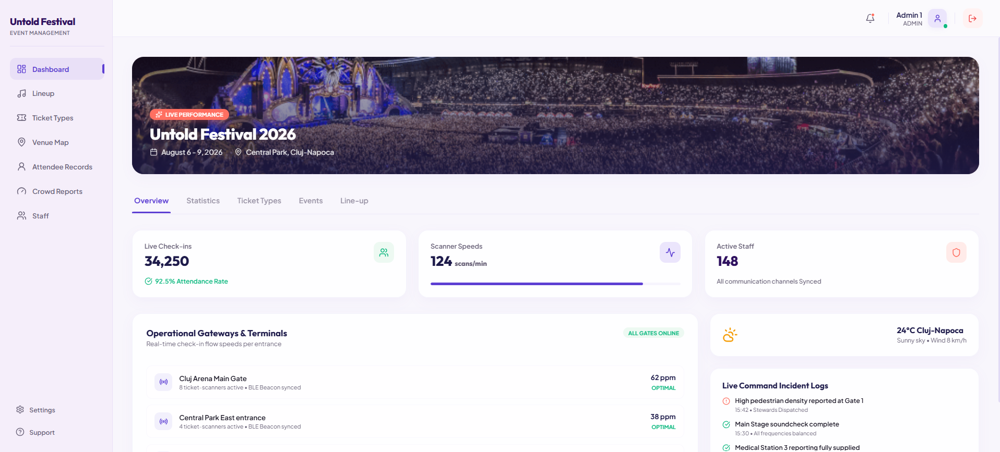
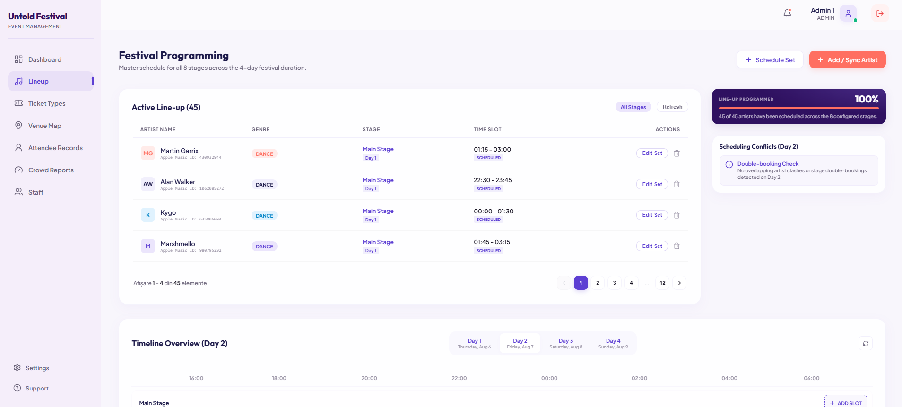
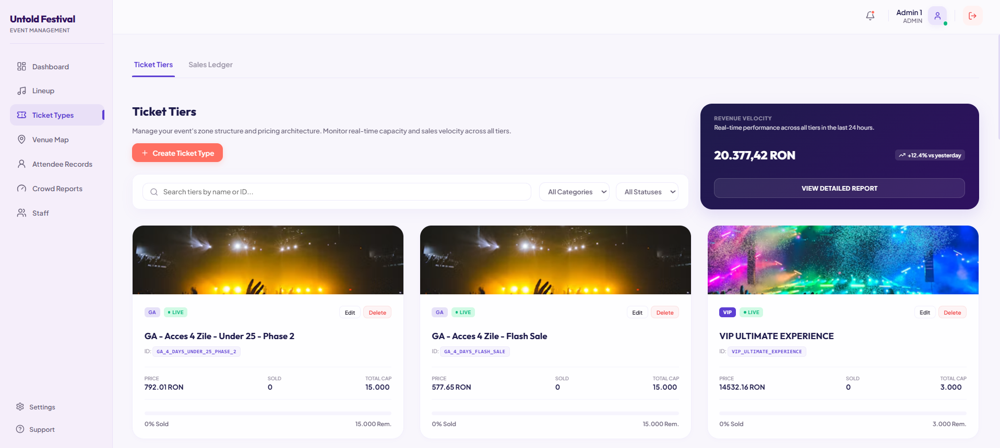
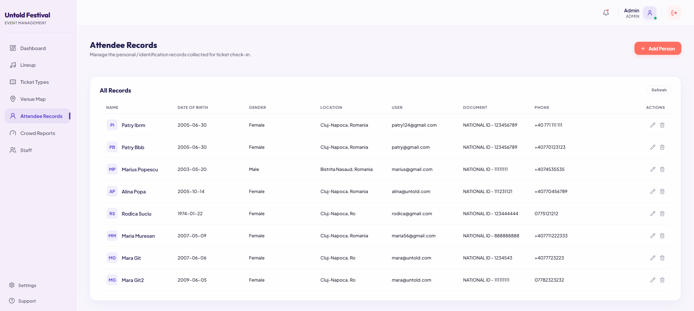
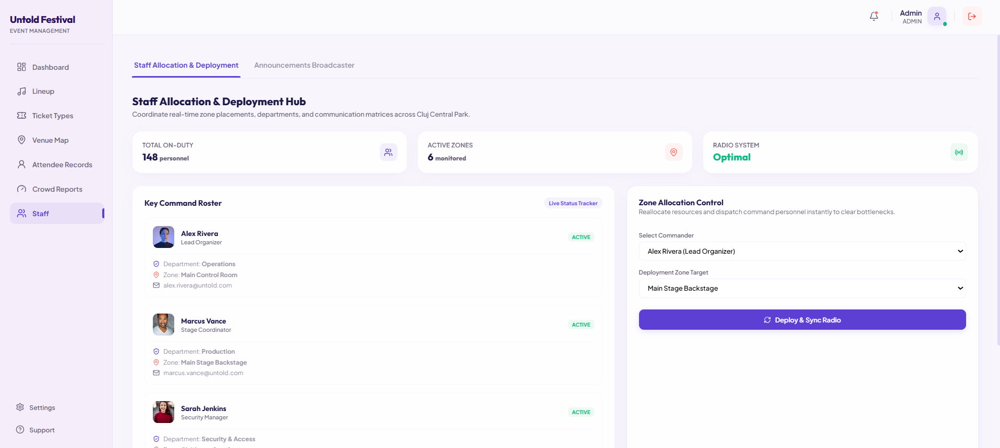

# Organizer web dashboard

[Project overview](../README.md) · [Feature inventory](../docs/features.md) · [Local development](../docs/local-development.md)

The administrator-facing React client for ticket configuration, performance scheduling, venue layouts, sales reporting, attendee records and crowd reports. Operational interfaces and demonstration screens coexist; labels below describe their actual status.

## 1. Features and status

| Area | Status | Behavior |
|---|---|---|
| Login/logout | Implemented | Ordinary auth endpoint, client `ADMIN` check, session storage; backend protects administrative APIs |
| Ticket Tiers | Backend-connected | Create/update/delete, price/category/capacity/active fields, search and filters |
| Sales Ledger | Mixed live/demo | Lists ticket sales; mock transactions/metrics appear on failures or empty data |
| Dashboard ticket analytics | Mixed live/demo | Ticket totals and analytics API; hardcoded operational figures and mock fallback analytics |
| Audit export | Backend-connected | Four-sheet Excel workbook |
| Performance scheduler | Backend-connected | Form-based stage/day/time/status CRUD, stage clash errors, artist conflict warnings |
| Artist management | Integration gap | Listing works; manual create/import/delete requests lack required Bearer headers |
| Venue Map | Backend-connected | Image upload, local pin edits, visibility/search/categories, full-layout save |
| Attendee Records | Integration gap | CRUD UI/API exist; requests omit required authentication |
| Crowd Reports | Integration gap | Public report/aggregation reads; protected mutations omit Bearer headers |
| Staff Allocation | Demo | Sample roster and local React-state reassignment |
| Announcements | Demo | Static history; New Broadcast has no delivery handler |
| Events | Demo | Static cards; create/manage/export buttons do not implement operations |
| Settings/Support | Demo/static | Settings save has no persistence; contact content is static |
| Header notification bell | Placeholder | No notification workflow |

There is no user/role-administration screen despite backend user CRUD. Staff job labels do not create security roles. Sales is a Tickets subview; Announcements is a Staff subview.

### 1.1 Screenshots

A feature-by-feature photo album. Every screenshot is shown below; click a preview to open the original image.

#### 1.1.1 Dashboard overview

The dashboard brings workspace navigation and overview cards together. Operational cards include demonstration figures, as identified in the feature inventory above.

<p align="center">
  <a href="../docs/screenshots/organizer/dashboard.png"></a>
</p>

<p align="center"><sub>Organizer overview · Navigation and demonstration operational metrics</sub></p>

#### 1.1.2 Artist bookings and performance scheduling

Review artist bookings, stage assignments and time slots, then use the scheduling actions to manage performances. The workspace also presents a conflict summary.

<p align="center">
  <a href="../docs/screenshots/organizer/lineup.png"></a>
</p>

<p align="center"><sub>Festival programming · Bookings, scheduling and conflict summary</sub></p>

#### 1.1.3 Ticket-tier management

Browse ticket tiers with search and category/status filters, and open creation or editing actions. Tier cards expose price, sold count and configured capacity.

<p align="center">
  <a href="../docs/screenshots/organizer/tickets.png"></a>
</p>

<p align="center"><sub>Ticket tiers · Pricing, categories and capacity</sub></p>

#### 1.1.4 Attendee identity records

Inspect identity records collected during ticket check-in and the available create, edit and delete controls. This screen represents participant records rather than physical gate movements.

<p align="center">
  <a href="../docs/screenshots/organizer/attendeerecords.png"></a>
</p>

<p align="center"><sub>Attendee records · Identity information and maintenance controls</sub></p>

#### 1.1.5 Staff allocation demonstration

The staff screen illustrates roster browsing and zone reassignment with sample personnel. Reassignment changes local interface state; it is not a persisted staff-deployment service.

<p align="center">
  <a href="../docs/screenshots/organizer/staff.png"></a>
</p>

<p align="center"><sub>Demonstration interface · Sample roster and local zone reassignment</sub></p>

<p align="center">
  <a href="../docs/screenshots/organizer/"><strong>Browse the original organizer screenshots &rarr;</strong></a>
</p>

## 2. Technology and internal architecture

React 19, TypeScript 6, Vite 8, React Router and Lucide. Styling uses CSS variables and inline styles; the organizer theme is light. Recharts is not implemented.

```text
src/
├── App.tsx                  # Token-presence gate and routes
├── pages/                   # Dashboard, Lineup, Tickets/Sales, MapEditor, records, demos
├── components/
│   ├── DashboardLayout.tsx
│   ├── Sidebar.tsx
│   ├── Header.tsx
│   └── GenericTable.tsx     # Reusable table with client-side pagination/selection
└── hooks/
    ├── useTicketStats.ts
    └── useTicketTiers.ts
```

[App](src/App.tsx) gates the router on a session token. [Login](src/pages/Login.tsx) checks the returned role and saves `untold_token`/`untold_user`. [Header](src/components/Header.tsx) clears them on logout. Data requests are distributed across pages/hooks rather than a shared API client.

## 3. Configuration and execution

Requirements: npm, Node satisfying `^20.19.0 || >=22.12.0`, and the backend/database environment. Commands are derived from configuration, not verified execution results.

From this directory:

```sh
npm ci
npm run dev
```

Open [localhost:5174](http://localhost:5174). Vite listens on `0.0.0.0`. Alternatively run the root Compose environment.

```sh
npm run build
npm run preview
npm run lint
```

Build runs `tsc -b && vite build`. Preview's default address may not be in backend CORS; it is not a production server setup.

`VITE_API_BASE_URL` is read by ticket hooks, Sales, and dashboard analytics/export. Login, lineup, maps, persons and crowd-report code still hardcode `http://localhost:8080`. The variable does not configure the whole application.

Authenticate with an administrator account provisioned in your local database. Startup creates demonstration accounts; credential values are intentionally not reproduced in documentation.

## 4. Backend communication

| Client area | API |
|---|---|
| Login | `POST /api/auth/login` |
| Ticket configuration | `/api/tickets/tiers` |
| Sales/totals | `/api/tickets` and `/api/tickets/stats` |
| Analytics/export | `/api/admin/analytics/summary` and `/api/admin/audit/export-tickets` |
| Scheduling | `/api/performances` |
| Artists | `/api/artists`, including numeric iTunes import through legacy Spotify-named path |
| Maps | `/api/map/active` and `/api/admin/map/upload` / `save` |
| Records/crowd | `/api/persons` and `/api/crowd-reports` |

Protected APIs require a valid Bearer token; merely logging in does not repair pages that omit that header. The scheduler fetches on mount/refresh and after mutations. It is not a drag-and-drop editor or a draft/publish system.

## 5. Testing

TypeScript/build and Oxlint scripts exist. No organizer unit/component/end-to-end suite is configured. No test/build/lint success is asserted by this guide. See [testing](../docs/testing.md).

## 6. Known limitations

- Authentication is missing from several mutation clients.
- Dashboard operational figures and fallback analytics must not be treated as live telemetry.
- Tier edits do not update the attendee's hardcoded storefront.
- Backend seeding replaces scheduled performances on every startup.
- Organizer dates remain hardcoded to August 6-9, while backend/attendee schedule configuration uses July 23-26.
- Map upload UI limits files to 10 MB while backend permits 15 MB.
- Staff allocation, broadcasts, events, settings and support do not form complete operational modules.

[Known limitations](../docs/known-limitations.md) · [Roles](../docs/roles-and-permissions.md) · [Workflows](../docs/workflows.md)

## 7. Source references

[Dashboard](src/pages/Dashboard.tsx) · [Scheduler/artists](src/pages/Lineup.tsx) · [Map editor](src/pages/MapEditor.tsx) · [Records](src/pages/Persons.tsx) · [Crowd reports](src/pages/CrowdReports.tsx) · [Staff](src/pages/Staff.tsx) · [Manifest](package.json)

## 8. Detailed workspace behavior

[Functional specifications](../docs/functional-specifications.md) cover each organizer operation's inputs, validation and outputs. [UI/UX](../docs/ui-ux.md) explains map/table selection, dialogs and local-versus-persisted changes. [User journeys](../docs/workflows.md) trace scheduling, conflicts, map editing, monitoring and exports.

Interpret the main data sources separately: ticket sales and tier counts come from domain queries, identity completion comes from a ticket flag, manual density comes from reports and physical occupancy comes from movement logs. Hardcoded operational cards/mock fallbacks are not alternate calculations of those measures.

The map editor can accumulate local pin changes until full save, while the scheduler saves immediately through forms. Staff reassignment is local demonstration state. These similar-looking interactions have different persistence guarantees, which should be stated in a portfolio demonstration.

Administrator role and token presence do not automatically attach headers. The pages with missing authentication require application changes; documentation cannot make those mutation paths operational.
