# Attendee web application

[Project overview](../README.md) · [Feature inventory](../docs/features.md) · [Local development](../docs/local-development.md)

A React application for festival visitors and registered attendees, with PWA caching and queued check-in submission. It is the attendee web client, not the native Android gate application.

## 1. Features and routes

| Route/component | Functionality |
|---|---|
| `/` | Festival landing content, countdown, flash-sale banner, featured artwork, YouTube embed |
| `/lineup` | Artist cards, genre/favorite filters, Spotify embeds, preview audio, day/stage timeline, live stage map |
| `/tickets` | Hardcoded GA/VIP/backstage offerings, day-ticket configurator, flash-sale queue |
| `/cart` | Quantity changes, item removal, fixed-rate currency display, Stripe Checkout redirect |
| `/auth` | Registration/login; public registration creates an attendee |
| `/my-account` | Tickets, identity check-in, bracelet balance/top-up, rotating QR, transfer modal, PDF export |
| `/my-schedule` | Persisted slots, day grouping, overlap warnings, reminder offsets and notification permission |
| `/payment/success` / `/payment/cancel` | Session confirmation or cancellation UI |
| `/gallery` and `/info` | Shared gallery, FAQ, location information and external directions |
| `/privacy-policy` / `/terms` | English/Romanian policy presentation; not proof of implemented compliance workflows |
| `MusicPlayer` | Six bundled audio tracks, playback controls, volume and audio-reactive visual intensity |

Favorites and personal schedule entries are separate features. Saving a slot copies artist/stage/time data; future organizer edits do not automatically update it.

### 1.1 Screenshots

A feature-by-feature photo album. Every screenshot is shown below; click a preview to open the original image.

#### 1.1.1 Festival home

The landing page introduces the festival, displays a countdown and leads visitors into ticketing and the program.

<p align="center">
  <a href="../docs/screenshots/attendee/homepage.png">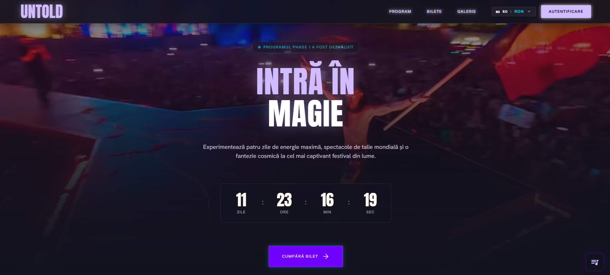</a>
</p>

<p align="center"><sub>Festival home · Countdown and ticket call to action</sub></p>

#### 1.1.2 Artist discovery, genres and favorites

Browse artist cards, narrow the selection by genre and show only favorite artists. Music controls and itinerary actions sit alongside the artist profiles.

<p align="center">
  <a href="../docs/screenshots/attendee/lineup.png">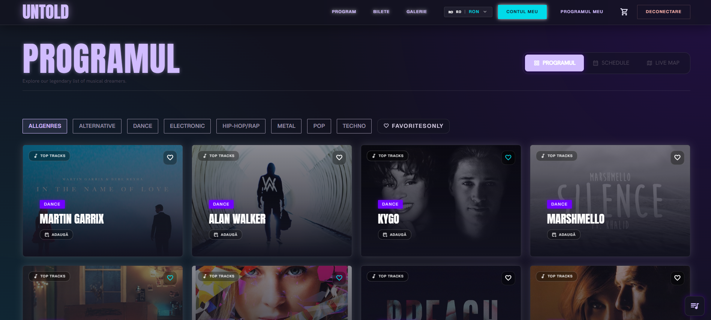</a>
</p>

<p align="center"><sub>Artist directory · Music discovery and favorites</sub></p>

<table width="100%">
  <tr>
    <td width="50%" align="center" valign="top">
      <a href="../docs/screenshots/attendee/lineupcategory.png">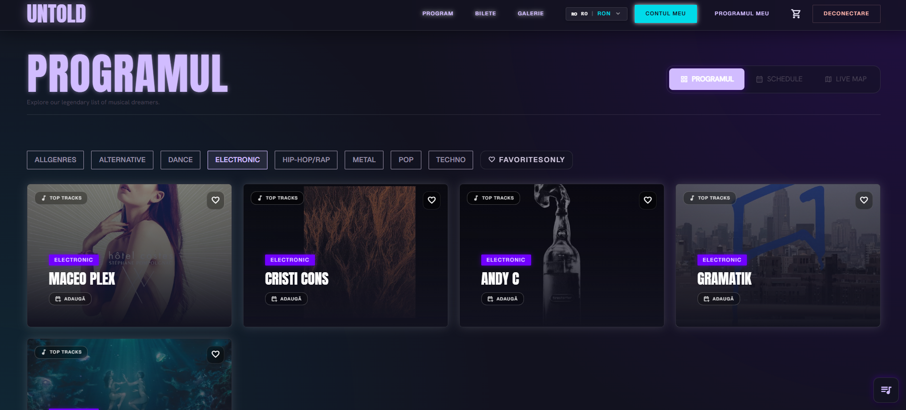</a>
      <p><strong>Genre filtering</strong><br><sub>Artist cards filtered to Electronic</sub></p>
    </td>
    <td width="50%" align="center" valign="top">
      <a href="../docs/screenshots/attendee/lineupcategoryfav.png">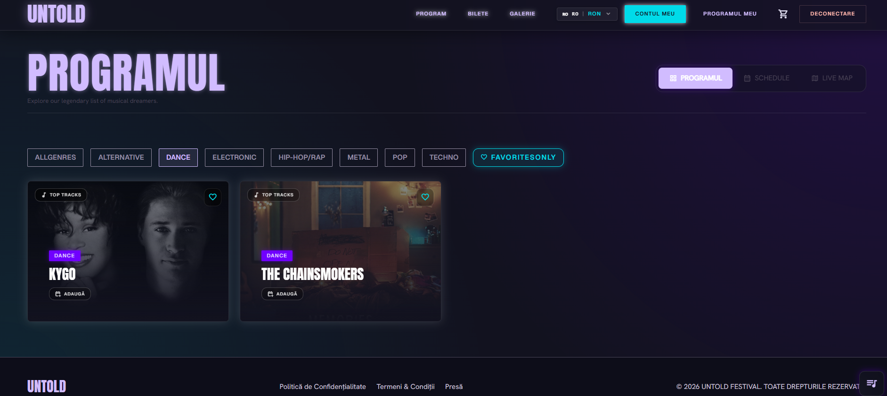</a>
      <p><strong>Favorite artists</strong><br><sub>Favorites-only browsing combined with a genre</sub></p>
    </td>
  </tr>
</table>

#### 1.1.3 Festival schedule

Choose a festival day to view performances by stage and time, with status and favorite indicators.

<p align="center">
  <a href="../docs/screenshots/attendee/schedule.png">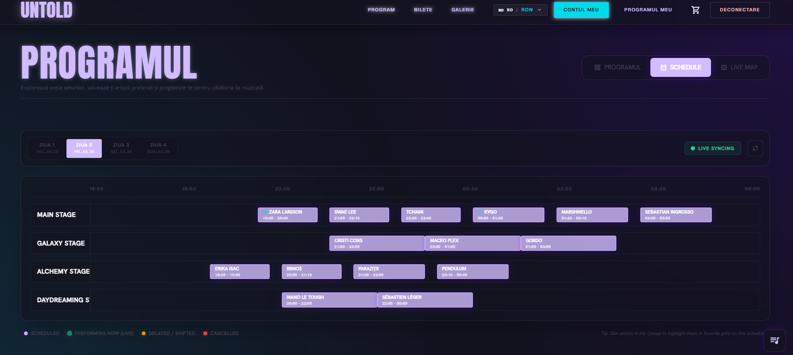</a>
</p>

<p align="center"><sub>Official program · Day selection and stage timeline</sub></p>

#### 1.1.4 Personal itinerary and reminders

Saved performances are grouped by festival day. Each slot has a reminder selector, and overlapping plans show named warnings.

<p align="center">
  <a href="../docs/screenshots/attendee/myschedule.png">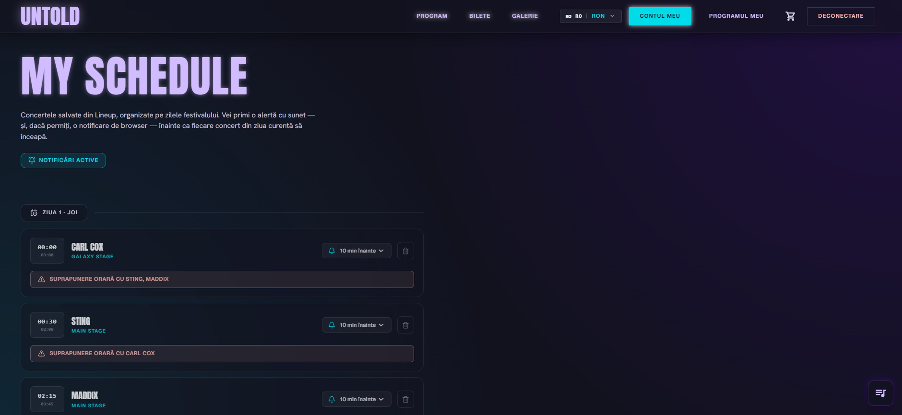</a>
</p>

<p align="center"><sub>My Schedule · Reminders and overlap warnings</sub></p>

#### 1.1.5 Ticket selection and Stripe Checkout

Compare ticket offerings, then continue to hosted Stripe Checkout. The payment capture shows the Stripe sandbox interface.

<table width="100%">
  <tr>
    <td width="50%" align="center" valign="top">
      <a href="../docs/screenshots/attendee/tickets.png">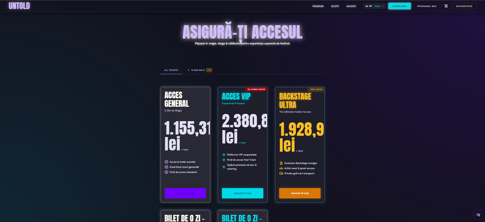</a>
      <p><strong>Ticket selection</strong><br><sub>Available offers and access categories</sub></p>
    </td>
    <td width="50%" align="center" valign="top">
      <a href="../docs/screenshots/attendee/stripepayment.png">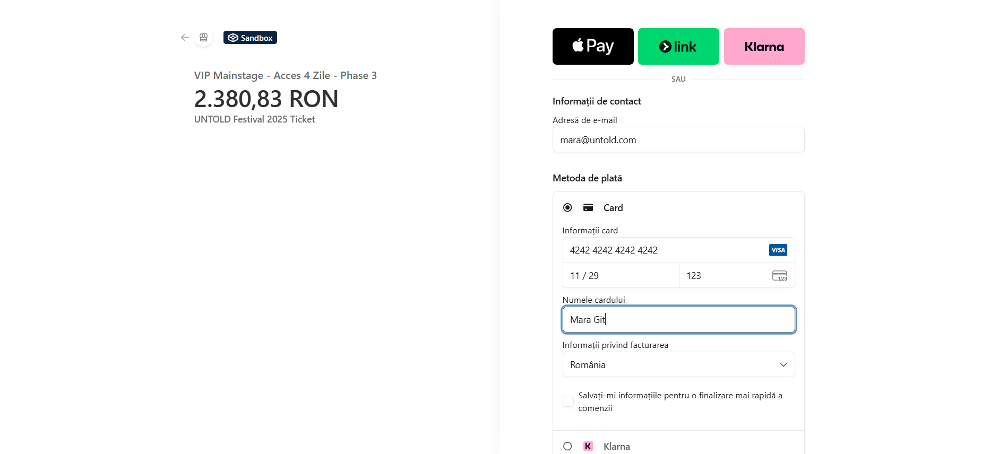</a>
      <p><strong>Hosted checkout</strong><br><sub>Stripe sandbox payment form</sub></p>
    </td>
  </tr>
</table>

#### 1.1.6 Identity check-in, digital ticket and bracelet

Complete the ticket holder's identity form, then view the digital QR, bracelet identifier and balance controls. Identity check-in is separate from physical gate entry.

<table width="100%">
  <tr>
    <td width="50%" align="center" valign="top">
      <a href="../docs/screenshots/attendee/checkin.png">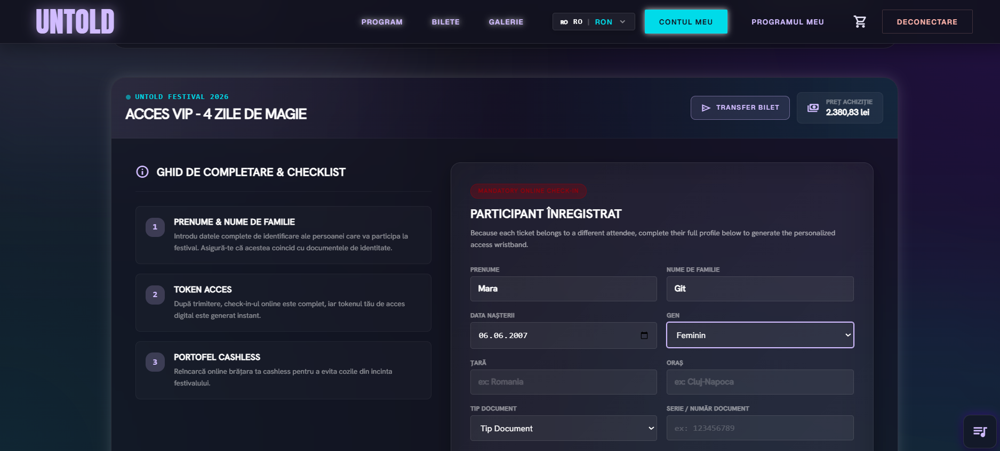</a>
      <p><strong>Identity check-in</strong><br><sub>Participant details before ticket activation</sub></p>
    </td>
    <td width="50%" align="center" valign="top">
      <a href="../docs/screenshots/attendee/qrbracelet.png">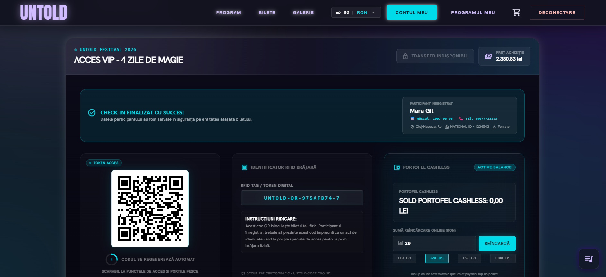</a>
      <p><strong>Digital ticket and bracelet</strong><br><sub>Rotating QR, bracelet details and balance top-up controls</sub></p>
    </td>
  </tr>
</table>

#### 1.1.7 Live stage map

The venue image places stages in context and shows current or upcoming artist information on stage overlays.

<p align="center">
  <a href="../docs/screenshots/attendee/livemap.png">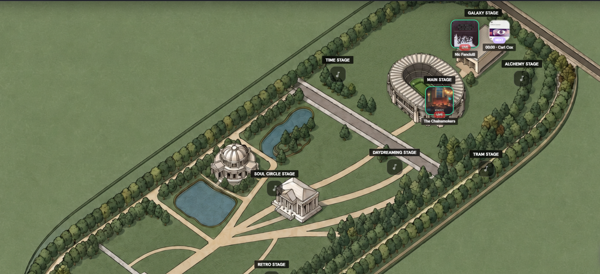</a>
</p>

<p align="center"><sub>Festival map · Stage locations and performance overlays</sub></p>

<p align="center">
  <a href="../docs/screenshots/attendee/"><strong>Browse the original attendee screenshots &rarr;</strong></a>
</p>

## 2. Technology and internal architecture

React 19, TypeScript 6, Vite 8, React Router, Tailwind CSS 3/PostCSS, Lucide, `qrcode.react`, STOMP, and browser APIs. Workbox 6.4.1 is imported by the service worker from a CDN. `sockjs-client` is declared but the implemented flash-sale connection uses native WebSocket.

```text
src/
├── App.tsx                  # Router and provider composition
├── pages/                   # Route views and API interactions
├── components/              # Navbar, QR, transfer modal, audio player, footer
├── context/                 # Auth, cart, schedule, language/currency state
├── utils/
│   ├── offlineQueue.ts      # IndexedDB check-in outbox
│   └── schedule.ts          # Time ranges, rollover and overlap helpers
└── i18n/translations.ts
public/
├── sw.js
├── manifest.json
└── assets/                  # Festival images and local music
```

[AuthContext](src/context/AuthContext.tsx) stores user/JWT in `sessionStorage`. [CartContext](src/context/CartContext.tsx) is in-memory and resets on reload. [I18nContext](src/context/I18nContext.tsx) saves language/currency in `localStorage` and uses fixed rates. [ScheduleContext](src/context/ScheduleContext.tsx) fetches account slots and runs reminder checks.

## 3. Configuration and execution

Requirements: Node satisfying the locked Vite engine `^20.19.0 || >=22.12.0`, npm, and a reachable backend. These commands are configuration-derived and were not executed for the documentation rewrite.

From this directory:

```sh
npm ci
npm run dev
```

Vite listens on [localhost:5173](http://localhost:5173) and `0.0.0.0`. The Docker development option is `docker compose up --build` from the repository root.

```sh
npm run build
npm run preview
npm run lint
```

Build runs `tsc -b && vite build`. Preview uses Vite's default preview settings; confirm the URL printed by Vite and its compatibility with backend CORS. It is not a production hosting configuration.

API URLs are hardcoded to `http://localhost:8080` across source files; there is no effective application-wide API-base environment variable. STOMP uses the current browser hostname and port 8080 with `ws://`. Serving the UI to another device or over HTTPS requires application/network changes; changing only the Vite listen address is insufficient.

## 4. Backend communication

| Path family | Purpose |
|---|---|
| `/api/auth` | Login/registration |
| `/api/artists`, `/api/performances`, `/api/map/active` | Catalog, timeline, stage map; schedule/map polling every 20 seconds |
| `/api/favorites` | Authenticated favorites |
| `/api/my-schedule`, `/api/festival/current-day` | Personal slots and day metadata |
| `/api/payment` | Checkout/top-up session and payment confirmation |
| `/api/tickets` | Account listing, identity check-in, transfer, QR |
| `/api/flash-sale` and `/ws/flash-sale` | Queue snapshots/actions and STOMP availability |
| `/api/stream/tickets` | Transfer SSE; current URL-token approach is blocked by the security filter |
| `/api/users/me/export` | Personal-data PDF |

See [API contracts](../docs/api.md) and [permissions](../docs/roles-and-permissions.md).

## 5. Offline and reminder boundaries

[main.tsx](src/main.tsx) registers [sw.js](public/sw.js) only in production; development unregisters workers and clears Cache Storage. The worker caches shell resources, images, and previously fetched GET API responses. It does not preload every ticket or artist.

[MyAccount](src/pages/MyAccount.tsx) queues check-in forms in IndexedDB on offline/network failure. Page code replays them on an online event or enqueue. A pending local identifier is not a backend-registered bracelet. Dynamic QR issuance and gate validation remain online operations.

Reminder checks run every 15 seconds while the page is active. They synthesize sound and optionally use `Notification` after a user permission request. They are not closed-app alarms or server push. Browser playback/notification policies still apply. See [offline and realtime](../docs/offline-and-realtime.md).

## 6. Testing

Package scripts provide TypeScript/build and Oxlint checks. No frontend unit, component or end-to-end test suite is configured. No build/lint/test pass result is asserted here. [Testing guide](../docs/testing.md).

## 7. Known limitations

- Hardcoded catalog prices do not follow organizer tier edits.
- Transfer SSE cannot authenticate through the current URL-token client request.
- Offline QR freshness, account isolation of caches/outbox, and replay lifecycle need work.
- Schedule slots are snapshots and selected by artist/stage names in the client.
- Festival dates differ between backend, attendee, organizer and landing countdown.
- Some text remains outside translation dictionaries; the cart is not persistent.
- Home featured content and its play control include presentation-only behavior.
- A PDF export does not include favorites, schedules or entrance logs.

[Prioritized limitations](../docs/known-limitations.md) · [Workflows](../docs/workflows.md) · [Roadmap](../docs/roadmap.md)

## 8. Source references

[App/router](src/App.tsx) · [Lineup](src/pages/Lineup.tsx) · [Tickets](src/pages/Tickets.tsx) · [Account](src/pages/MyAccount.tsx) · [QR component](src/components/DynamicTicketQr.tsx) · [Transfer modal](src/components/TransferTicketModal.tsx) · [Package manifest](package.json)

## 9. Detailed behavior and interface reading

The route guide above is an entry-point map. [Current functional specifications](../docs/functional-specifications.md) describe inputs, business rules, error outcomes and implementation status for every attendee domain; [15 user journeys](../docs/workflows.md) show the cross-application sequence. [UI/UX](../docs/ui-ux.md) specifies actual navigation, form/card states and audio behavior.

A ticket card moves from purchased to identity-completed only after Person/Bracelet creation, or shows a distinct pending local check-in state. It does not become physically admitted until a gate movement is recorded. QR countdown, balance and transfer eligibility follow those separate states.

Favorites save artist preference; Add to Schedule saves a named performance snapshot. The stage map combines public performances with liked/saved-name presentation, while My Schedule has its own day/time math. [Personal scheduling](../docs/personal-scheduling.md) explains midnight examples, offset validation and once-per-mount reminders in full.

For failure diagnosis, inspect the response status and whether the operation is a read, confirmed mutation, local-only state change or queued check-in. The current code uses different feedback/retry patterns across those paths; there is no universal offline mutation or auth-refresh layer.
